# Automated Stub & Static CFG Longest-Path Analysis (`main_107_freelist`)

## 1. Function Static CFG & Path Length Summary

| Function | Entry PC | Static ARM64 Insns | Basic Blocks | Loop Back-Edges | Est. Common Path (ARM64 Insns) | Est. Longest Path (ARM64 Insns) |
| :--- | :--- | ---: | ---: | ---: | ---: | ---: |
| `f_8001ac270` | `0x8001ac270` | 425 | 78 | 2 | 100 | 503 |

## 2. Function Control Flow Graphs (CFGs)

### Function `f_8001ac270` (`0x8001ac270` – 425 insns, 78 blocks)

```mermaid
flowchart TD
    B_8001ac270["0x8001ac270..0x8001ac2b8\n(18 insns)"]
    B_8001ac2b8["0x8001ac2b8..0x8001ac2d4\n(7 insns)"]
    B_8001ac2d4["0x8001ac2d4..0x8001ac2e0\n(3 insns)"]
    B_8001ac2e0["0x8001ac2e0..0x8001ac314\n(13 insns)"]
    B_8001ac314["0x8001ac314..0x8001ac328\n(5 insns, loop hdr)"]
    B_8001ac328["0x8001ac328..0x8001ac330\n(2 insns)"]
    B_8001ac330["0x8001ac330..0x8001ac348\n(6 insns, loop hdr)"]
    B_8001ac348["0x8001ac348..0x8001ac34c\n(1 insns)"]
    B_8001ac34c["0x8001ac34c..0x8001ac354\n(2 insns)"]
    B_8001ac354["0x8001ac354..0x8001ac360\n(3 insns)"]
    B_8001ac360["0x8001ac360..0x8001ac364\n(1 insns)"]
    B_8001ac364["0x8001ac364..0x8001ac36c\n(2 insns)"]
    B_8001ac36c["0x8001ac36c..0x8001ac390\n(9 insns)"]
    B_8001ac390["0x8001ac390..0x8001ac3a0\n(4 insns)"]
    B_8001ac3a0["0x8001ac3a0..0x8001ac3a4\n(1 insns)"]
    B_8001ac3a4["0x8001ac3a4..0x8001ac3a8\n(1 insns)"]
    B_8001ac3a8["0x8001ac3a8..0x8001ac3c8\n(8 insns)"]
    B_8001ac3c8["0x8001ac3c8..0x8001ac3d0\n(2 insns)"]
    B_8001ac3d0["0x8001ac3d0..0x8001ac3d4\n(1 insns)"]
    B_8001ac3d4["0x8001ac3d4..0x8001ac3e0\n(3 insns)"]
    B_8001ac3e0["0x8001ac3e0..0x8001ac3e8\n(2 insns)"]
    B_8001ac3e8["0x8001ac3e8..0x8001ac3fc\n(5 insns)"]
    B_8001ac3fc["0x8001ac3fc..0x8001ac408\n(3 insns)"]
    B_8001ac408["0x8001ac408..0x8001ac40c\n(1 insns)"]
    B_8001ac40c["0x8001ac40c..0x8001ac414\n(2 insns)"]
    B_8001ac414["0x8001ac414..0x8001ac434\n(8 insns)"]
    B_8001ac434["0x8001ac434..0x8001ac458\n(9 insns)"]
    B_8001ac458["0x8001ac458..0x8001ac490\n(14 insns)"]
    B_8001ac490["0x8001ac490..0x8001ac4a8\n(6 insns)"]
    B_8001ac4a8["0x8001ac4a8..0x8001ac4ac\n(1 insns)"]
    B_8001ac4ac["0x8001ac4ac..0x8001ac4b4\n(2 insns)"]
    B_8001ac4b4["0x8001ac4b4..0x8001ac4b8\n(1 insns)"]
    B_8001ac4b8["0x8001ac4b8..0x8001ac4e0\n(10 insns)"]
    B_8001ac4e0["0x8001ac4e0..0x8001ac4ec\n(3 insns)"]
    B_8001ac4ec["0x8001ac4ec..0x8001ac4f4\n(2 insns)"]
    B_8001ac4f4["0x8001ac4f4..0x8001ac504\n(4 insns)"]
    B_8001ac504["0x8001ac504..0x8001ac508\n(1 insns)"]
    B_8001ac508["0x8001ac508..0x8001ac524\n(7 insns)"]
    B_8001ac524["0x8001ac524..0x8001ac534\n(4 insns)"]
    B_8001ac534["0x8001ac534..0x8001ac538\n(1 insns)"]
    B_8001ac538["0x8001ac538..0x8001ac554\n(7 insns)"]
    B_8001ac554["0x8001ac554..0x8001ac564\n(4 insns)"]
    B_8001ac564["0x8001ac564..0x8001ac568\n(1 insns)"]
    B_8001ac568["0x8001ac568..0x8001ac584\n(7 insns)"]
    B_8001ac584["0x8001ac584..0x8001ac594\n(4 insns)"]
    B_8001ac594["0x8001ac594..0x8001ac598\n(1 insns)"]
    B_8001ac598["0x8001ac598..0x8001ac5b4\n(7 insns)"]
    B_8001ac5b4["0x8001ac5b4..0x8001ac5c4\n(4 insns)"]
    B_8001ac5c4["0x8001ac5c4..0x8001ac5c8\n(1 insns)"]
    B_8001ac5c8["0x8001ac5c8..0x8001ac5e4\n(7 insns)"]
    B_8001ac5e4["0x8001ac5e4..0x8001ac5f8\n(5 insns)"]
    B_8001ac5f8["0x8001ac5f8..0x8001ac5fc\n(1 insns)"]
    B_8001ac5fc["0x8001ac5fc..0x8001ac608\n(3 insns)"]
    B_8001ac608["0x8001ac608..0x8001ac618\n(4 insns)"]
    B_8001ac618["0x8001ac618..0x8001ac620\n(2 insns)"]
    B_8001ac620["0x8001ac620..0x8001ac674\n(21 insns)"]
    B_8001ac674["0x8001ac674..0x8001ac68c\n(6 insns)"]
    B_8001ac68c["0x8001ac68c..0x8001ac6d4\n(18 insns)"]
    B_8001ac6d4["0x8001ac6d4..0x8001ac72c\n(22 insns)"]
    B_8001ac72c["0x8001ac72c..0x8001ac734\n(2 insns)"]
    B_8001ac734["0x8001ac734..0x8001ac740\n(3 insns)"]
    B_8001ac740["0x8001ac740..0x8001ac780\n(16 insns)"]
    B_8001ac780["0x8001ac780..0x8001ac790\n(4 insns)"]
    B_8001ac790["0x8001ac790..0x8001ac794\n(1 insns)"]
    B_8001ac794["0x8001ac794..0x8001ac7a4\n(4 insns)"]
    B_8001ac7a4["0x8001ac7a4..0x8001ac7a8\n(1 insns)"]
    B_8001ac7a8["0x8001ac7a8..0x8001ac7b0\n(2 insns)"]
    B_8001ac7b0["0x8001ac7b0..0x8001ac7fc\n(19 insns)"]
    B_8001ac7fc["0x8001ac7fc..0x8001ac80c\n(4 insns)"]
    B_8001ac80c["0x8001ac80c..0x8001ac834\n(10 insns)"]
    B_8001ac834["0x8001ac834..0x8001ac844\n(4 insns)"]
    B_8001ac844["0x8001ac844..0x8001ac86c\n(10 insns)"]
    B_8001ac86c["0x8001ac86c..0x8001ac87c\n(4 insns)"]
    B_8001ac87c["0x8001ac87c..0x8001ac8a4\n(10 insns)"]
    B_8001ac8a4["0x8001ac8a4..0x8001ac8b4\n(4 insns)"]
    B_8001ac8b4["0x8001ac8b4..0x8001ac8dc\n(10 insns)"]
    B_8001ac8dc["0x8001ac8dc..0x8001ac8ec\n(4 insns)"]
    B_8001ac8ec["0x8001ac8ec..0x8001ac914\n(10 insns)"]
    B_8001ac270 -- "taken" --> B_8001ac36c
    B_8001ac270 -- "fallthrough" --> B_8001ac2b8
    B_8001ac2b8 --> B_8001ac2d4
    B_8001ac2d4 -- "taken" --> B_8001ac360
    B_8001ac2d4 -- "fallthrough" --> B_8001ac2e0
    B_8001ac2e0 --> B_8001ac314
    B_8001ac314 -- "taken" --> B_8001ac3a4
    B_8001ac314 -- "fallthrough" --> B_8001ac328
    B_8001ac328 --> B_8001ac330
    B_8001ac330 -- "taken" --> B_8001ac354
    B_8001ac330 -- "fallthrough" --> B_8001ac348
    B_8001ac348 -- "taken" --> B_8001ac3a4
    B_8001ac348 -- "fallthrough" --> B_8001ac34c
    B_8001ac34c -- "taken" --> B_8001ac390
    B_8001ac34c -- "fallthrough" --> B_8001ac354
    B_8001ac354 -. "loop back" .-> B_8001ac314
    B_8001ac354 -- "fallthrough" --> B_8001ac360
    B_8001ac360 -- "taken" --> B_8001ac740
    B_8001ac360 -- "fallthrough" --> B_8001ac364
    B_8001ac364 --> B_8001ac5fc
    B_8001ac36c --> B_8001ac2d4
    B_8001ac390 -- "taken" --> B_8001ac354
    B_8001ac390 -- "fallthrough" --> B_8001ac3a0
    B_8001ac3a0 -- "taken" --> B_8001ac780
    B_8001ac3a0 -- "fallthrough" --> B_8001ac3a4
    B_8001ac3a4 -- "taken" --> B_8001ac674
    B_8001ac3a4 -- "fallthrough" --> B_8001ac3a8
    B_8001ac3a8 -- "taken" --> B_8001ac3d4
    B_8001ac3a8 -- "fallthrough" --> B_8001ac3c8
    B_8001ac3c8 -- "taken" --> B_8001ac4e0
    B_8001ac3c8 -- "fallthrough" --> B_8001ac3d0
    B_8001ac3d0 --> B_8001ac3d4
    B_8001ac3d4 -- "taken" --> B_8001ac5e4
    B_8001ac3d4 -- "fallthrough" --> B_8001ac3e0
    B_8001ac3e0 -- "taken" --> B_8001ac5f8
    B_8001ac3e0 -- "fallthrough" --> B_8001ac3e8
    B_8001ac3e8 -- "taken" --> B_8001ac68c
    B_8001ac3e8 -- "fallthrough" --> B_8001ac3fc
    B_8001ac3fc -- "taken" --> B_8001ac72c
    B_8001ac3fc -- "fallthrough" --> B_8001ac408
    B_8001ac408 --> B_8001ac40c
    B_8001ac40c -- "taken" --> B_8001ac6d4
    B_8001ac40c -- "fallthrough" --> B_8001ac414
    B_8001ac414 -- "taken" --> B_8001ac734
    B_8001ac414 -- "fallthrough" --> B_8001ac434
    B_8001ac434 --> B_8001ac458
    B_8001ac458 -- "taken" --> B_8001ac4ac
    B_8001ac458 -- "fallthrough" --> B_8001ac490
    B_8001ac490 -- "taken" --> B_8001ac608
    B_8001ac490 -- "fallthrough" --> B_8001ac4a8
    B_8001ac4a8 --> B_8001ac4ac
    B_8001ac4ac --> B_8001ac4b4
    B_8001ac4b4 --> B_8001ac4b8
    B_8001ac4b8 --> EXIT_8001ac4b8["return"]
    B_8001ac4e0 -- "taken" --> B_8001ac7b0
    B_8001ac4e0 -- "fallthrough" --> B_8001ac4ec
    B_8001ac4ec --> B_8001ac4f4
    B_8001ac4f4 -- "taken" --> B_8001ac7fc
    B_8001ac4f4 -- "fallthrough" --> B_8001ac504
    B_8001ac504 -- "taken" --> B_8001ac524
    B_8001ac504 -- "fallthrough" --> B_8001ac508
    B_8001ac508 -- "taken" --> B_8001ac5e4
    B_8001ac508 -- "fallthrough" --> B_8001ac524
    B_8001ac524 -- "taken" --> B_8001ac834
    B_8001ac524 -- "fallthrough" --> B_8001ac534
    B_8001ac534 -- "taken" --> B_8001ac554
    B_8001ac534 -- "fallthrough" --> B_8001ac538
    B_8001ac538 -- "taken" --> B_8001ac5e4
    B_8001ac538 -- "fallthrough" --> B_8001ac554
    B_8001ac554 -- "taken" --> B_8001ac86c
    B_8001ac554 -- "fallthrough" --> B_8001ac564
    B_8001ac564 -- "taken" --> B_8001ac584
    B_8001ac564 -- "fallthrough" --> B_8001ac568
    B_8001ac568 -- "taken" --> B_8001ac5e4
    B_8001ac568 -- "fallthrough" --> B_8001ac584
    B_8001ac584 -- "taken" --> B_8001ac8a4
    B_8001ac584 -- "fallthrough" --> B_8001ac594
    B_8001ac594 -- "taken" --> B_8001ac5b4
    B_8001ac594 -- "fallthrough" --> B_8001ac598
    B_8001ac598 -- "taken" --> B_8001ac5e4
    B_8001ac598 -- "fallthrough" --> B_8001ac5b4
    B_8001ac5b4 -- "taken" --> B_8001ac8dc
    B_8001ac5b4 -- "fallthrough" --> B_8001ac5c4
    B_8001ac5c4 -- "taken" --> B_8001ac3d0
    B_8001ac5c4 -- "fallthrough" --> B_8001ac5c8
    B_8001ac5c8 -- "taken" --> B_8001ac3d0
    B_8001ac5c8 -- "fallthrough" --> B_8001ac5e4
    B_8001ac5e4 -- "taken" --> B_8001ac620
    B_8001ac5e4 -- "fallthrough" --> B_8001ac5f8
    B_8001ac5f8 --> B_8001ac5fc
    B_8001ac5fc --> B_8001ac4b4
    B_8001ac608 -- "taken" --> B_8001ac4a8
    B_8001ac608 -- "fallthrough" --> B_8001ac618
    B_8001ac618 --> B_8001ac4ac
    B_8001ac620 --> B_8001ac4b8
    B_8001ac674 --> B_8001ac3a8
    B_8001ac68c --> B_8001ac6d4
    B_8001ac6d4 --> B_8001ac4b8
    B_8001ac72c --> B_8001ac40c
    B_8001ac734 --> B_8001ac458
    B_8001ac740 --> B_8001ac5f8
    B_8001ac780 -- "taken" --> B_8001ac354
    B_8001ac780 -- "fallthrough" --> B_8001ac790
    B_8001ac790 -- "taken" --> B_8001ac3a4
    B_8001ac790 -- "fallthrough" --> B_8001ac794
    B_8001ac794 -- "taken" --> B_8001ac354
    B_8001ac794 -- "fallthrough" --> B_8001ac7a4
    B_8001ac7a4 -- "taken" --> B_8001ac3a4
    B_8001ac7a4 -- "fallthrough" --> B_8001ac7a8
    B_8001ac7a8 -. "loop back" .-> B_8001ac330
    B_8001ac7b0 --> B_8001ac4f4
    B_8001ac7fc -- "taken" --> B_8001ac504
    B_8001ac7fc -- "fallthrough" --> B_8001ac80c
    B_8001ac80c --> B_8001ac504
    B_8001ac834 -- "taken" --> B_8001ac534
    B_8001ac834 -- "fallthrough" --> B_8001ac844
    B_8001ac844 --> B_8001ac534
    B_8001ac86c -- "taken" --> B_8001ac564
    B_8001ac86c -- "fallthrough" --> B_8001ac87c
    B_8001ac87c --> B_8001ac564
    B_8001ac8a4 -- "taken" --> B_8001ac594
    B_8001ac8a4 -- "fallthrough" --> B_8001ac8b4
    B_8001ac8b4 --> B_8001ac594
    B_8001ac8dc -- "taken" --> B_8001ac5c4
    B_8001ac8dc -- "fallthrough" --> B_8001ac8ec
    B_8001ac8ec --> B_8001ac5c4
    %% Path Highlighting
    style B_8001ac270 fill:#e8f5e9,stroke:#2e7d32,stroke-width:3px,color:#1b5e20
    style B_8001ac2d4 fill:#e8f5e9,stroke:#2e7d32,stroke-width:3px,color:#1b5e20
    style B_8001ac2e0 fill:#ffeedd,stroke:#e65100,stroke-width:2px,color:#bf360c
    style B_8001ac314 fill:#ffeedd,stroke:#e65100,stroke-width:2px,color:#bf360c
    style B_8001ac328 fill:#ffeedd,stroke:#e65100,stroke-width:2px,color:#bf360c
    style B_8001ac330 fill:#ffeedd,stroke:#e65100,stroke-width:2px,color:#bf360c
    style B_8001ac348 fill:#ffeedd,stroke:#e65100,stroke-width:2px,color:#bf360c
    style B_8001ac34c fill:#ffeedd,stroke:#e65100,stroke-width:2px,color:#bf360c
    style B_8001ac360 fill:#e1f5fe,stroke:#0288d1,stroke-width:2px,color:#01579b
    style B_8001ac364 fill:#e1f5fe,stroke:#0288d1,stroke-width:2px,color:#01579b
    style B_8001ac36c fill:#e8f5e9,stroke:#2e7d32,stroke-width:3px,color:#1b5e20
    style B_8001ac390 fill:#ffeedd,stroke:#e65100,stroke-width:2px,color:#bf360c
    style B_8001ac3a0 fill:#ffeedd,stroke:#e65100,stroke-width:2px,color:#bf360c
    style B_8001ac3a4 fill:#ffeedd,stroke:#e65100,stroke-width:2px,color:#bf360c
    style B_8001ac3a8 fill:#ffeedd,stroke:#e65100,stroke-width:2px,color:#bf360c
    style B_8001ac3c8 fill:#ffeedd,stroke:#e65100,stroke-width:2px,color:#bf360c
    style B_8001ac3d0 fill:#ffeedd,stroke:#e65100,stroke-width:2px,color:#bf360c
    style B_8001ac3d4 fill:#ffeedd,stroke:#e65100,stroke-width:2px,color:#bf360c
    style B_8001ac3e0 fill:#ffeedd,stroke:#e65100,stroke-width:2px,color:#bf360c
    style B_8001ac3e8 fill:#ffeedd,stroke:#e65100,stroke-width:2px,color:#bf360c
    style B_8001ac3fc fill:#ffeedd,stroke:#e65100,stroke-width:2px,color:#bf360c
    style B_8001ac40c fill:#ffeedd,stroke:#e65100,stroke-width:2px,color:#bf360c
    style B_8001ac414 fill:#ffeedd,stroke:#e65100,stroke-width:2px,color:#bf360c
    style B_8001ac434 fill:#ffeedd,stroke:#e65100,stroke-width:2px,color:#bf360c
    style B_8001ac458 fill:#ffeedd,stroke:#e65100,stroke-width:2px,color:#bf360c
    style B_8001ac490 fill:#ffeedd,stroke:#e65100,stroke-width:2px,color:#bf360c
    style B_8001ac4ac fill:#ffeedd,stroke:#e65100,stroke-width:2px,color:#bf360c
    style B_8001ac4b4 fill:#e8f5e9,stroke:#2e7d32,stroke-width:3px,color:#1b5e20
    style B_8001ac4b8 fill:#e8f5e9,stroke:#2e7d32,stroke-width:3px,color:#1b5e20
    style B_8001ac4e0 fill:#ffeedd,stroke:#e65100,stroke-width:2px,color:#bf360c
    style B_8001ac4f4 fill:#ffeedd,stroke:#e65100,stroke-width:2px,color:#bf360c
    style B_8001ac504 fill:#ffeedd,stroke:#e65100,stroke-width:2px,color:#bf360c
    style B_8001ac508 fill:#ffeedd,stroke:#e65100,stroke-width:2px,color:#bf360c
    style B_8001ac524 fill:#ffeedd,stroke:#e65100,stroke-width:2px,color:#bf360c
    style B_8001ac534 fill:#ffeedd,stroke:#e65100,stroke-width:2px,color:#bf360c
    style B_8001ac538 fill:#ffeedd,stroke:#e65100,stroke-width:2px,color:#bf360c
    style B_8001ac554 fill:#ffeedd,stroke:#e65100,stroke-width:2px,color:#bf360c
    style B_8001ac564 fill:#ffeedd,stroke:#e65100,stroke-width:2px,color:#bf360c
    style B_8001ac568 fill:#ffeedd,stroke:#e65100,stroke-width:2px,color:#bf360c
    style B_8001ac584 fill:#ffeedd,stroke:#e65100,stroke-width:2px,color:#bf360c
    style B_8001ac594 fill:#ffeedd,stroke:#e65100,stroke-width:2px,color:#bf360c
    style B_8001ac598 fill:#ffeedd,stroke:#e65100,stroke-width:2px,color:#bf360c
    style B_8001ac5b4 fill:#ffeedd,stroke:#e65100,stroke-width:2px,color:#bf360c
    style B_8001ac5c4 fill:#ffeedd,stroke:#e65100,stroke-width:2px,color:#bf360c
    style B_8001ac5c8 fill:#ffeedd,stroke:#e65100,stroke-width:2px,color:#bf360c
    style B_8001ac5fc fill:#e1f5fe,stroke:#0288d1,stroke-width:2px,color:#01579b
    style B_8001ac608 fill:#ffeedd,stroke:#e65100,stroke-width:2px,color:#bf360c
    style B_8001ac618 fill:#ffeedd,stroke:#e65100,stroke-width:2px,color:#bf360c
    style B_8001ac674 fill:#ffeedd,stroke:#e65100,stroke-width:2px,color:#bf360c
    style B_8001ac72c fill:#ffeedd,stroke:#e65100,stroke-width:2px,color:#bf360c
    style B_8001ac780 fill:#ffeedd,stroke:#e65100,stroke-width:2px,color:#bf360c
    style B_8001ac790 fill:#ffeedd,stroke:#e65100,stroke-width:2px,color:#bf360c
    style B_8001ac794 fill:#ffeedd,stroke:#e65100,stroke-width:2px,color:#bf360c
    style B_8001ac7a4 fill:#ffeedd,stroke:#e65100,stroke-width:2px,color:#bf360c
    style B_8001ac7b0 fill:#ffeedd,stroke:#e65100,stroke-width:2px,color:#bf360c
    style B_8001ac7fc fill:#ffeedd,stroke:#e65100,stroke-width:2px,color:#bf360c
    style B_8001ac80c fill:#ffeedd,stroke:#e65100,stroke-width:2px,color:#bf360c
    style B_8001ac834 fill:#ffeedd,stroke:#e65100,stroke-width:2px,color:#bf360c
    style B_8001ac844 fill:#ffeedd,stroke:#e65100,stroke-width:2px,color:#bf360c
    style B_8001ac86c fill:#ffeedd,stroke:#e65100,stroke-width:2px,color:#bf360c
    style B_8001ac87c fill:#ffeedd,stroke:#e65100,stroke-width:2px,color:#bf360c
    style B_8001ac8a4 fill:#ffeedd,stroke:#e65100,stroke-width:2px,color:#bf360c
    style B_8001ac8b4 fill:#ffeedd,stroke:#e65100,stroke-width:2px,color:#bf360c
    style B_8001ac8dc fill:#ffeedd,stroke:#e65100,stroke-width:2px,color:#bf360c
    style B_8001ac8ec fill:#ffeedd,stroke:#e65100,stroke-width:2px,color:#bf360c
```

## 3. External Callee Classification (3 total: 2 constant-zero, 0 pointer-alloc, 0 memory-copy, 1 branch-sensitive)

| External Symbol | Classification | Args Read | Longest-Path Return (`X0`) | Alt-Branch Return (`X0`) | Post-Call Analysis |
| :--- | :--- | ---: | :--- | :--- | :--- |
| `f_800099860` | `CONSTANT_ZERO` | 3 | `0x0` | `0x1` | Return value X0 unread/overwritten -> constant 0 |
| `f_802ba39a0` | **BRANCH_SENSITIVE** | 2 | `0x1` | `0x0` | CBZ on return register w0 at 0x8001ac8e8 |
| `f_802ba39b0` | `CONSTANT_ZERO` | 2 | `0x0` | `0x1` | Return value X0 unread/overwritten -> constant 0 |
