# Automated Stub & Static CFG Longest-Path Analysis (`main_121_simd`)

## 1. Function Static CFG & Path Length Summary

| Function | Entry PC | Static ARM64 Insns | Basic Blocks | Loop Back-Edges | Est. Common Path (ARM64 Insns) | Est. Longest Path (ARM64 Insns) | CP-SAT Verified Longest |
| :--- | :--- | ---: | ---: | ---: | ---: | ---: | ---: |
| `f_8001d2a5c` | `0x8001d2a5c` | 696 | 100 | 2 | 35 | 219 | 219 |

## 2. Function Control Flow Graphs (CFGs)

### Function `f_8001d2a5c` (`0x8001d2a5c` – 696 insns, 100 blocks)

```mermaid
flowchart TD
    B_8001d2a5c["0x8001d2a5c..0x8001d2a80\n(9 insns)"]
    B_8001d2a80["0x8001d2a80..0x8001d2aa8\n(10 insns)"]
    B_8001d2aa8["0x8001d2aa8..0x8001d2abc\n(5 insns)"]
    B_8001d2abc["0x8001d2abc..0x8001d2ad0\n(5 insns)"]
    B_8001d2ad0["0x8001d2ad0..0x8001d2ae0\n(4 insns)"]
    B_8001d2ae0["0x8001d2ae0..0x8001d2aec\n(3 insns)"]
    B_8001d2aec["0x8001d2aec..0x8001d2af4\n(2 insns)"]
    B_8001d2af4["0x8001d2af4..0x8001d2b04\n(4 insns)"]
    B_8001d2b04["0x8001d2b04..0x8001d2b10\n(3 insns)"]
    B_8001d2b10["0x8001d2b10..0x8001d2b18\n(2 insns)"]
    B_8001d2b18["0x8001d2b18..0x8001d2b24\n(3 insns)"]
    B_8001d2b24["0x8001d2b24..0x8001d2b28\n(1 insns)"]
    B_8001d2b28["0x8001d2b28..0x8001d2b30\n(2 insns)"]
    B_8001d2b30["0x8001d2b30..0x8001d2b58\n(10 insns)"]
    B_8001d2b58["0x8001d2b58..0x8001d2b60\n(2 insns)"]
    B_8001d2b60["0x8001d2b60..0x8001d2b70\n(4 insns)"]
    B_8001d2b70["0x8001d2b70..0x8001d2b7c\n(3 insns, loop hdr)"]
    B_8001d2b7c["0x8001d2b7c..0x8001d2b80\n(1 insns)"]
    B_8001d2b80["0x8001d2b80..0x8001d2b94\n(5 insns)"]
    B_8001d2b94["0x8001d2b94..0x8001d2ba0\n(3 insns)"]
    B_8001d2ba0["0x8001d2ba0..0x8001d2bdc\n(15 insns)"]
    B_8001d2bdc["0x8001d2bdc..0x8001d2be4\n(2 insns)"]
    B_8001d2be4["0x8001d2be4..0x8001d2c0c\n(10 insns)"]
    B_8001d2c0c["0x8001d2c0c..0x8001d2c10\n(1 insns)"]
    B_8001d2c10["0x8001d2c10..0x8001d2c1c\n(3 insns)"]
    B_8001d2c1c["0x8001d2c1c..0x8001d2c28\n(3 insns)"]
    B_8001d2c28["0x8001d2c28..0x8001d2c2c\n(1 insns)"]
    B_8001d2c2c["0x8001d2c2c..0x8001d2c34\n(2 insns)"]
    B_8001d2c34["0x8001d2c34..0x8001d2c3c\n(2 insns)"]
    B_8001d2c3c["0x8001d2c3c..0x8001d2c40\n(1 insns)"]
    B_8001d2c40["0x8001d2c40..0x8001d2c48\n(2 insns)"]
    B_8001d2c48["0x8001d2c48..0x8001d2c4c\n(1 insns)"]
    B_8001d2c4c["0x8001d2c4c..0x8001d2c60\n(5 insns, loop hdr)"]
    B_8001d2c60["0x8001d2c60..0x8001d2c6c\n(3 insns)"]
    B_8001d2c6c["0x8001d2c6c..0x8001d2c74\n(2 insns)"]
    B_8001d2c74["0x8001d2c74..0x8001d2c94\n(8 insns)"]
    B_8001d2c94["0x8001d2c94..0x8001d2ca0\n(3 insns)"]
    B_8001d2ca0["0x8001d2ca0..0x8001d2ca4\n(1 insns)"]
    B_8001d2ca4["0x8001d2ca4..0x8001d2cb4\n(4 insns)"]
    B_8001d2cb4["0x8001d2cb4..0x8001d2cc8\n(5 insns)"]
    B_8001d2cc8["0x8001d2cc8..0x8001d2cd0\n(2 insns)"]
    B_8001d2cd0["0x8001d2cd0..0x8001d2cec\n(7 insns, switch)"]
    B_8001d2cec["0x8001d2cec..0x8001d2d1c\n(12 insns)"]
    B_8001d2d1c["0x8001d2d1c..0x8001d2d28\n(3 insns)"]
    B_8001d2d28["0x8001d2d28..0x8001d2d30\n(2 insns)"]
    B_8001d2d30["0x8001d2d30..0x8001d2d58\n(10 insns)"]
    B_8001d2d58["0x8001d2d58..0x8001d2d6c\n(5 insns)"]
    B_8001d2d6c["0x8001d2d6c..0x8001d2dc8\n(23 insns)"]
    B_8001d2dc8["0x8001d2dc8..0x8001d2dd4\n(3 insns)"]
    B_8001d2dd4["0x8001d2dd4..0x8001d2de0\n(3 insns)"]
    B_8001d2de0["0x8001d2de0..0x8001d2de8\n(2 insns)"]
    B_8001d2de8["0x8001d2de8..0x8001d2dfc\n(5 insns)"]
    B_8001d2dfc["0x8001d2dfc..0x8001d2e04\n(2 insns)"]
    B_8001d2e04["0x8001d2e04..0x8001d2e0c\n(2 insns)"]
    B_8001d2e0c["0x8001d2e0c..0x8001d2e14\n(2 insns)"]
    B_8001d2e14["0x8001d2e14..0x8001d2e38\n(9 insns)"]
    B_8001d2e38["0x8001d2e38..0x8001d2e5c\n(9 insns)"]
    B_8001d2e5c["0x8001d2e5c..0x8001d2e68\n(3 insns)"]
    B_8001d2e68["0x8001d2e68..0x8001d2eac\n(17 insns)"]
    B_8001d2eac["0x8001d2eac..0x8001d2eb8\n(3 insns)"]
    B_8001d2eb8["0x8001d2eb8..0x8001d2ec8\n(4 insns)"]
    B_8001d2ec8["0x8001d2ec8..0x8001d2ed8\n(4 insns)"]
    B_8001d2ed8["0x8001d2ed8..0x8001d2ee8\n(4 insns)"]
    B_8001d2ee8["0x8001d2ee8..0x8001d2ef0\n(2 insns)"]
    B_8001d2ef0["0x8001d2ef0..0x8001d2f04\n(5 insns)"]
    B_8001d2f04["0x8001d2f04..0x8001d2f0c\n(2 insns)"]
    B_8001d2f0c["0x8001d2f0c..0x8001d2f2c\n(8 insns)"]
    B_8001d2f2c["0x8001d2f2c..0x8001d2f3c\n(4 insns)"]
    B_8001d2f3c["0x8001d2f3c..0x8001d2f44\n(2 insns)"]
    B_8001d2f44["0x8001d2f44..0x8001d2f70\n(11 insns)"]
    B_8001d2f70["0x8001d2f70..0x8001d2f7c\n(3 insns)"]
    B_8001d2f7c["0x8001d2f7c..0x8001d2fa8\n(11 insns)"]
    B_8001d2fa8["0x8001d2fa8..0x8001d2fb4\n(3 insns)"]
    B_8001d2fb4["0x8001d2fb4..0x8001d2fe0\n(11 insns)"]
    B_8001d2fe0["0x8001d2fe0..0x8001d2fec\n(3 insns)"]
    B_8001d2fec["0x8001d2fec..0x8001d3018\n(11 insns)"]
    B_8001d3018["0x8001d3018..0x8001d3020\n(2 insns)"]
    B_8001d3020["0x8001d3020..0x8001d3038\n(6 insns)"]
    B_8001d3038["0x8001d3038..0x8001d3060\n(10 insns)"]
    B_8001d3060["0x8001d3060..0x8001d30d0\n(28 insns)"]
    B_8001d30d0["0x8001d30d0..0x8001d30f8\n(10 insns)"]
    B_8001d30f8["0x8001d30f8..0x8001d3168\n(28 insns)"]
    B_8001d3168["0x8001d3168..0x8001d3190\n(10 insns)"]
    B_8001d3190["0x8001d3190..0x8001d3200\n(28 insns)"]
    B_8001d3200["0x8001d3200..0x8001d3228\n(10 insns)"]
    B_8001d3228["0x8001d3228..0x8001d3294\n(27 insns)"]
    B_8001d3294["0x8001d3294..0x8001d329c\n(2 insns)"]
    B_8001d329c["0x8001d329c..0x8001d32c4\n(10 insns)"]
    B_8001d32c4["0x8001d32c4..0x8001d3338\n(29 insns)"]
    B_8001d3338["0x8001d3338..0x8001d3348\n(4 insns)"]
    B_8001d3348["0x8001d3348..0x8001d3370\n(10 insns)"]
    B_8001d3370["0x8001d3370..0x8001d33e0\n(28 insns)"]
    B_8001d33e0["0x8001d33e0..0x8001d3408\n(10 insns)"]
    B_8001d3408["0x8001d3408..0x8001d3478\n(28 insns)"]
    B_8001d3478["0x8001d3478..0x8001d34a0\n(10 insns)"]
    B_8001d34a0["0x8001d34a0..0x8001d350c\n(27 insns)"]
    B_8001d350c["0x8001d350c..0x8001d3518\n(3 insns)"]
    B_8001d3518["0x8001d3518..0x8001d3528\n(4 insns)"]
    B_8001d3528["0x8001d3528..0x8001d3534\n(3 insns)"]
    B_8001d3534["0x8001d3534..0x8001d353c\n(2 insns)"]
    B_8001d2a5c -- "taken" --> B_8001d2cc8
    B_8001d2a5c -- "fallthrough" --> B_8001d2a80
    B_8001d2a80 -- "taken" --> B_8001d2f3c
    B_8001d2a80 -- "fallthrough" --> B_8001d2aa8
    B_8001d2aa8 -- "taken" --> B_8001d2eac
    B_8001d2aa8 -- "fallthrough" --> B_8001d2abc
    B_8001d2abc -- "taken" --> B_8001d2ba0
    B_8001d2abc -- "fallthrough" --> B_8001d2ad0
    B_8001d2ad0 -- "taken" --> B_8001d2e68
    B_8001d2ad0 -- "fallthrough" --> B_8001d2ae0
    B_8001d2ae0 -- "taken" --> B_8001d2dc8
    B_8001d2ae0 -- "fallthrough" --> B_8001d2aec
    B_8001d2aec --> B_8001d2af4
    B_8001d2af4 -- "taken" --> B_8001d2e68
    B_8001d2af4 -- "fallthrough" --> B_8001d2b04
    B_8001d2b04 -- "taken" --> B_8001d2e68
    B_8001d2b04 -- "fallthrough" --> B_8001d2b10
    B_8001d2b10 --> B_8001d2b18
    B_8001d2b18 -- "taken" --> B_8001d2dd4
    B_8001d2b18 -- "fallthrough" --> B_8001d2b24
    B_8001d2b24 --> B_8001d2b28
    B_8001d2b28 -- "taken" --> B_8001d2eac
    B_8001d2b28 -- "fallthrough" --> B_8001d2b30
    B_8001d2b30 -- "taken" --> B_8001d2e04
    B_8001d2b30 -- "fallthrough" --> B_8001d2b58
    B_8001d2b58 -- "taken" --> B_8001d2b94
    B_8001d2b58 -- "fallthrough" --> B_8001d2b60
    B_8001d2b60 --> B_8001d2b70
    B_8001d2b70 -- "taken" --> B_8001d2c94
    B_8001d2b70 -- "fallthrough" --> B_8001d2b7c
    B_8001d2b7c -- "taken" --> B_8001d2c6c
    B_8001d2b7c -- "fallthrough" --> B_8001d2b80
    B_8001d2b80 -. "loop back" .-> B_8001d2b70
    B_8001d2b80 -- "fallthrough" --> B_8001d2b94
    B_8001d2b94 --> B_8001d2cb4
    B_8001d2ba0 -- "taken" --> B_8001d2e0c
    B_8001d2ba0 -- "fallthrough" --> B_8001d2bdc
    B_8001d2bdc -- "taken" --> B_8001d2e68
    B_8001d2bdc -- "fallthrough" --> B_8001d2be4
    B_8001d2be4 -- "taken" --> B_8001d2c10
    B_8001d2be4 -- "fallthrough" --> B_8001d2c0c
    B_8001d2c0c --> B_8001d2c10
    B_8001d2c10 -- "taken" --> B_8001d2e14
    B_8001d2c10 -- "fallthrough" --> B_8001d2c1c
    B_8001d2c1c -- "taken" --> B_8001d2e38
    B_8001d2c1c -- "fallthrough" --> B_8001d2c28
    B_8001d2c28 -- "taken" --> B_8001d2ec8
    B_8001d2c28 -- "fallthrough" --> B_8001d2c2c
    B_8001d2c2c -- "taken" --> B_8001d2ec8
    B_8001d2c2c -- "fallthrough" --> B_8001d2c34
    B_8001d2c34 -- "taken" --> B_8001d2c40
    B_8001d2c34 -- "fallthrough" --> B_8001d2c3c
    B_8001d2c3c --> B_8001d2c40
    B_8001d2c40 -- "taken" --> B_8001d2ec8
    B_8001d2c40 -- "fallthrough" --> B_8001d2c48
    B_8001d2c48 --> B_8001d2c4c
    B_8001d2c4c -- "taken" --> B_8001d2eb8
    B_8001d2c4c -- "fallthrough" --> B_8001d2c60
    B_8001d2c60 --> B_8001d2b18
    B_8001d2c6c -- "taken" --> B_8001d2ca4
    B_8001d2c6c -- "fallthrough" --> B_8001d2c74
    B_8001d2c74 --> B_8001d2ca4
    B_8001d2c94 -- "taken" --> B_8001d2d1c
    B_8001d2c94 -- "fallthrough" --> B_8001d2ca0
    B_8001d2ca0 --> B_8001d2ca4
    B_8001d2ca4 -- "taken" --> B_8001d2b94
    B_8001d2ca4 -- "fallthrough" --> B_8001d2cb4
    B_8001d2cb4 --> EXIT_8001d2cb4["return"]
    B_8001d2cc8 -- "taken" --> B_8001d2f2c
    B_8001d2cc8 -- "fallthrough" --> B_8001d2cd0
    B_8001d2cd0 -- "case" --> B_8001d2cec
    B_8001d2cd0 -- "case" --> B_8001d2d30
    B_8001d2cd0 -- "case" --> B_8001d2f44
    B_8001d2cd0 -- "case" --> B_8001d2f7c
    B_8001d2cd0 -- "case" --> B_8001d2fb4
    B_8001d2cd0 -- "case" --> B_8001d2fec
    B_8001d2cd0 -- "case" --> B_8001d3038
    B_8001d2cd0 -- "case" --> B_8001d30d0
    B_8001d2cd0 -- "case" --> B_8001d3168
    B_8001d2cd0 -- "case" --> B_8001d3200
    B_8001d2cd0 -- "case" --> B_8001d329c
    B_8001d2cd0 -- "case" --> B_8001d3348
    B_8001d2cd0 -- "case" --> B_8001d33e0
    B_8001d2cd0 -- "case" --> B_8001d3478
    B_8001d2cec --> B_8001d2cb4
    B_8001d2d1c -- "taken" --> B_8001d2ca0
    B_8001d2d1c -- "fallthrough" --> B_8001d2d28
    B_8001d2d28 --> B_8001d2ca4
    B_8001d2d30 -- "taken" --> B_8001d2f3c
    B_8001d2d30 -- "fallthrough" --> B_8001d2d58
    B_8001d2d58 -- "taken" --> B_8001d2cb4
    B_8001d2d58 -- "fallthrough" --> B_8001d2d6c
    B_8001d2d6c --> B_8001d2cb4
    B_8001d2dc8 --> B_8001d2af4
    B_8001d2dd4 -- "taken" --> B_8001d2b28
    B_8001d2dd4 -- "fallthrough" --> B_8001d2de0
    B_8001d2de0 -- "taken" --> B_8001d2b24
    B_8001d2de0 -- "fallthrough" --> B_8001d2de8
    B_8001d2de8 -- "taken" --> B_8001d2b28
    B_8001d2de8 -- "fallthrough" --> B_8001d2dfc
    B_8001d2dfc --> B_8001d2b28
    B_8001d2e04 --> B_8001d2b58
    B_8001d2e0c --> B_8001d2bdc
    B_8001d2e14 --> B_8001d2e5c
    B_8001d2e38 --> B_8001d2e5c
    B_8001d2e5c --> B_8001d2e68
    B_8001d2e68 --> B_8001d2eac
    B_8001d2eac --> B_8001d2cb4
    B_8001d2eb8 -. "loop back" .-> B_8001d2c4c
    B_8001d2eb8 -- "fallthrough" --> B_8001d2ec8
    B_8001d2ec8 -- "taken" --> B_8001d2ee8
    B_8001d2ec8 -- "fallthrough" --> B_8001d2ed8
    B_8001d2ed8 --> B_8001d2b18
    B_8001d2ee8 -- "taken" --> B_8001d3534
    B_8001d2ee8 -- "fallthrough" --> B_8001d2ef0
    B_8001d2ef0 -- "taken" --> B_8001d3534
    B_8001d2ef0 -- "fallthrough" --> B_8001d2f04
    B_8001d2f04 -- "taken" --> B_8001d3528
    B_8001d2f04 -- "fallthrough" --> B_8001d2f0c
    B_8001d2f0c --> B_8001d2b18
    B_8001d2f2c --> B_8001d2f3c
    B_8001d2f3c --> B_8001d2cb4
    B_8001d2f44 -- "taken" --> B_8001d2cb4
    B_8001d2f44 -- "fallthrough" --> B_8001d2f70
    B_8001d2f70 --> B_8001d3020
    B_8001d2f7c -- "taken" --> B_8001d2cb4
    B_8001d2f7c -- "fallthrough" --> B_8001d2fa8
    B_8001d2fa8 --> B_8001d3020
    B_8001d2fb4 -- "taken" --> B_8001d2cb4
    B_8001d2fb4 -- "fallthrough" --> B_8001d2fe0
    B_8001d2fe0 --> B_8001d3020
    B_8001d2fec -- "taken" --> B_8001d2cb4
    B_8001d2fec -- "fallthrough" --> B_8001d3018
    B_8001d3018 --> B_8001d3020
    B_8001d3020 --> EXIT_8001d3020["return"]
    B_8001d3038 -- "taken" --> B_8001d2f3c
    B_8001d3038 -- "fallthrough" --> B_8001d3060
    B_8001d3060 --> B_8001d3338
    B_8001d30d0 -- "taken" --> B_8001d2f3c
    B_8001d30d0 -- "fallthrough" --> B_8001d30f8
    B_8001d30f8 --> B_8001d3294
    B_8001d3168 -- "taken" --> B_8001d2f3c
    B_8001d3168 -- "fallthrough" --> B_8001d3190
    B_8001d3190 --> B_8001d3294
    B_8001d3200 -- "taken" --> B_8001d2f3c
    B_8001d3200 -- "fallthrough" --> B_8001d3228
    B_8001d3228 --> B_8001d3294
    B_8001d3294 --> B_8001d3518
    B_8001d329c -- "taken" --> B_8001d2f3c
    B_8001d329c -- "fallthrough" --> B_8001d32c4
    B_8001d32c4 --> B_8001d3338
    B_8001d3338 --> B_8001d2cb4
    B_8001d3348 -- "taken" --> B_8001d2f3c
    B_8001d3348 -- "fallthrough" --> B_8001d3370
    B_8001d3370 --> B_8001d350c
    B_8001d33e0 -- "taken" --> B_8001d2f3c
    B_8001d33e0 -- "fallthrough" --> B_8001d3408
    B_8001d3408 --> B_8001d350c
    B_8001d3478 -- "taken" --> B_8001d2f3c
    B_8001d3478 -- "fallthrough" --> B_8001d34a0
    B_8001d34a0 --> B_8001d350c
    B_8001d350c --> B_8001d3518
    B_8001d3518 --> B_8001d2cb4
    B_8001d3528 --> B_8001d2b18
    B_8001d3534 --> B_8001d2b18
    %% Path Highlighting
    style B_8001d2a5c fill:#e8f5e9,stroke:#2e7d32,stroke-width:3px,color:#1b5e20
    style B_8001d2a80 fill:#ffeedd,stroke:#e65100,stroke-width:2px,color:#bf360c
    style B_8001d2aa8 fill:#ffeedd,stroke:#e65100,stroke-width:2px,color:#bf360c
    style B_8001d2abc fill:#ffeedd,stroke:#e65100,stroke-width:2px,color:#bf360c
    style B_8001d2b18 fill:#ffeedd,stroke:#e65100,stroke-width:2px,color:#bf360c
    style B_8001d2b28 fill:#ffeedd,stroke:#e65100,stroke-width:2px,color:#bf360c
    style B_8001d2b30 fill:#ffeedd,stroke:#e65100,stroke-width:2px,color:#bf360c
    style B_8001d2b58 fill:#ffeedd,stroke:#e65100,stroke-width:2px,color:#bf360c
    style B_8001d2b60 fill:#ffeedd,stroke:#e65100,stroke-width:2px,color:#bf360c
    style B_8001d2b70 fill:#ffeedd,stroke:#e65100,stroke-width:2px,color:#bf360c
    style B_8001d2b7c fill:#ffeedd,stroke:#e65100,stroke-width:2px,color:#bf360c
    style B_8001d2b94 fill:#ffeedd,stroke:#e65100,stroke-width:2px,color:#bf360c
    style B_8001d2ba0 fill:#ffeedd,stroke:#e65100,stroke-width:2px,color:#bf360c
    style B_8001d2bdc fill:#ffeedd,stroke:#e65100,stroke-width:2px,color:#bf360c
    style B_8001d2be4 fill:#ffeedd,stroke:#e65100,stroke-width:2px,color:#bf360c
    style B_8001d2c0c fill:#ffeedd,stroke:#e65100,stroke-width:2px,color:#bf360c
    style B_8001d2c10 fill:#ffeedd,stroke:#e65100,stroke-width:2px,color:#bf360c
    style B_8001d2c1c fill:#ffeedd,stroke:#e65100,stroke-width:2px,color:#bf360c
    style B_8001d2c28 fill:#ffeedd,stroke:#e65100,stroke-width:2px,color:#bf360c
    style B_8001d2c2c fill:#ffeedd,stroke:#e65100,stroke-width:2px,color:#bf360c
    style B_8001d2c34 fill:#ffeedd,stroke:#e65100,stroke-width:2px,color:#bf360c
    style B_8001d2c3c fill:#ffeedd,stroke:#e65100,stroke-width:2px,color:#bf360c
    style B_8001d2c40 fill:#ffeedd,stroke:#e65100,stroke-width:2px,color:#bf360c
    style B_8001d2c48 fill:#ffeedd,stroke:#e65100,stroke-width:2px,color:#bf360c
    style B_8001d2c4c fill:#ffeedd,stroke:#e65100,stroke-width:2px,color:#bf360c
    style B_8001d2c6c fill:#ffeedd,stroke:#e65100,stroke-width:2px,color:#bf360c
    style B_8001d2c74 fill:#ffeedd,stroke:#e65100,stroke-width:2px,color:#bf360c
    style B_8001d2ca4 fill:#ffeedd,stroke:#e65100,stroke-width:2px,color:#bf360c
    style B_8001d2cb4 fill:#e8f5e9,stroke:#2e7d32,stroke-width:3px,color:#1b5e20
    style B_8001d2cc8 fill:#e1f5fe,stroke:#0288d1,stroke-width:2px,color:#01579b
    style B_8001d2dd4 fill:#ffeedd,stroke:#e65100,stroke-width:2px,color:#bf360c
    style B_8001d2de0 fill:#ffeedd,stroke:#e65100,stroke-width:2px,color:#bf360c
    style B_8001d2de8 fill:#ffeedd,stroke:#e65100,stroke-width:2px,color:#bf360c
    style B_8001d2dfc fill:#ffeedd,stroke:#e65100,stroke-width:2px,color:#bf360c
    style B_8001d2e04 fill:#ffeedd,stroke:#e65100,stroke-width:2px,color:#bf360c
    style B_8001d2e0c fill:#ffeedd,stroke:#e65100,stroke-width:2px,color:#bf360c
    style B_8001d2eb8 fill:#ffeedd,stroke:#e65100,stroke-width:2px,color:#bf360c
    style B_8001d2ec8 fill:#ffeedd,stroke:#e65100,stroke-width:2px,color:#bf360c
    style B_8001d2ee8 fill:#ffeedd,stroke:#e65100,stroke-width:2px,color:#bf360c
    style B_8001d2ef0 fill:#ffeedd,stroke:#e65100,stroke-width:2px,color:#bf360c
    style B_8001d2f04 fill:#ffeedd,stroke:#e65100,stroke-width:2px,color:#bf360c
    style B_8001d2f0c fill:#ffeedd,stroke:#e65100,stroke-width:2px,color:#bf360c
    style B_8001d2f2c fill:#e1f5fe,stroke:#0288d1,stroke-width:2px,color:#01579b
    style B_8001d2f3c fill:#e1f5fe,stroke:#0288d1,stroke-width:2px,color:#01579b
```

## 3. External Callee Classification (4 total: 3 constant-zero, 1 pointer-alloc, 0 memory-copy, 0 branch-sensitive)

| External Symbol | Classification | Args Read | Longest-Path Return (`X0`) | Alt-Branch Return (`X0`) | Post-Call Analysis |
| :--- | :--- | ---: | :--- | :--- | :--- |
| `f_8009b44dc` | `CONSTANT_ZERO` | 6 | `0x0` | `0x1` | Return value X0 unread/overwritten -> constant 0 |
| `f_8028d3d9c` | `CONSTANT_ZERO` | 3 | `0x0` | `0x1` | Return value X0 unread/overwritten -> constant 0 |
| `f_8028d3f9c` | `POINTER_ALLOC` | 2 | `guest_alloc()` | `0x0` | Return value dereferenced as pointer at 0x8001d3038 |
| `f_802ba3a00` | `CONSTANT_ZERO` | 2 | `0x0` | `0x1` | Return value X0 unread/overwritten -> constant 0 |

## 4. Constraint-Solved Parameters for Maximal Finite & Common Paths

### Function `f_8001d2a5c` (`0x8001d2a5c`) — Solver Backend: `OR-Tools CP-SAT MaxSAT (OPTIMAL) + Native BV Solver`

| Parameter / Attribute | Maximal Finite Path (`path_mode = 0`) | Common Path (`path_mode = 1`) |
| :--- | :--- | :--- |
| **Static ARM64 Instructions** | **219 insns** (41 basic blocks) | **35 insns** (6 basic blocks) |
| **Path Predicates Solved** | 30 branch/switch constraints | 4 branch/switch constraints |
| **`g_stub_branch_policy`** | `0x0` | `0x0` |
| **Entry Register `X0`** | `fbase + 0x1000` | `fbase + 0x1000` |
| **Entry Register `X1`** | `fbase + 0x2000` | `fbase + 0x2000` |
| **Entry Register `X2`** | `fbase + 0x3000` | ``0x0`` |
| **Entry Register `X3`** | `fbase + 0x6000` | ``0x0`` |
| **Stub Return `f_8009b44dc` (`X0`)** | `0x0` | `0x0` |
| **Stub Return `f_8028d3d9c` (`X0`)** | `0x0` | `0x0` |
| **Stub Return `f_8028d3f9c` (`X0`)** | `guest_alloc(128)` | `guest_alloc(128)` |
| **Stub Return `f_802ba3a00` (`X0`)** | `0x0` | `0x0` |

#### Extracted Maximal-Path Predicate Constraints:

- `0x8001d2a7c: X8 eq 2`
- `0x8001d2aa4: MEM[MEM[MEM[OBJ_ANON+0x0]+0x0]+0x58] != NULL (valid 64-bit pointer)`
- `0x8001d2ab8: bit #31 of MEM[MEM[MEM[MEM[OBJ_ANON+0x0]+0x0]+0x58]+0x10] == 0`
- `0x8001d2acc: MEM[MEM[MEM[MEM[OBJ_ANON+0x0]+0x0]+0x58]+0x6] ne 1`
- `0x8001d2bd8: MEM[MEM[OBJ_ANON+0x0]+0x68] ls MEM[MEM[MEM[MEM[OBJ_ANON+0x0]+0x0]+0x58]+0x14]`
- `0x8001d2be0: bit #31 of MEM[MEM[MEM[OBJ_ANON+0x0]+0x70]+0x0] == 0`
- `0x8001d2c08: bit #3 of MEM[X2+0x19] == 1 -> MEM[X2+0x19] |= 0x8`
- `0x8001d2c18: MEM[MEM[X2+0x58]+0x44] hi MEM[MEM[MEM[OBJ_ANON+0x0]+0x70]+0x0]`
- `0x8001d2c24: MEM[MEM[MEM[X2+0x58]+0x48]+0x0] != NULL (valid 64-bit pointer)`
- `0x8001d2c28: X3 ne 0`
- `0x8001d2c30: MEM[X3+0x28] != NULL (valid 64-bit pointer)`
- `0x8001d2c38: bit #3 of MEM[MEM[X3+0x28]+0x19] == 1 -> MEM[MEM[X3+0x28]+0x19] |= 0x8`
- `0x8001d2c44: bit #31 of MEM[X3+0x60] == 0`
- `0x8001d2c5c: MEM[MEM[MEM[GLOBAL+0x80394db70]+0x0]+0xb2] ne MEM[MEM[MEM[OBJ_ANON+0x0]+0x70]+0x0]`
- `0x8001d2ec4: bit #31 of MEM[MEM[MEM[GLOBAL+0x80394db70]+0x0]+0xb0] == 1 -> MEM[MEM[MEM[GLOBAL+0x80394db70]+0x0]+0xb0] |= 0x80000000`
- `0x8001d2eec: MEM[X2+0xa0] != NULL (valid 64-bit pointer)`
- `0x8001d2f00: MEM[MEM[X2+0xa0]+0x0] != NULL (valid 64-bit pointer)`
- `0x8001d2f08: MEM[MEM[MEM[MEM[X2+0x58]+0x48]+0x0]+0x58] eq 3`
- `0x8001d2b20: MEM[MEM[MEM[MEM[X2+0x58]+0x48]+0x0]+0x58] ne 2`
- `0x8001d2ddc: MEM[MEM[MEM[MEM[X2+0x58]+0x48]+0x0]+0x58] ls 5`
