# Automated Stub & Static CFG Longest-Path Analysis (`main_136_alloc`)

## 1. Function Static CFG & Path Length Summary

| Function | Entry PC | Static ARM64 Insns | Basic Blocks | Loop Back-Edges | Est. Common Path (ARM64 Insns) | Est. Longest Path (ARM64 Insns) | CP-SAT Verified Longest |
| :--- | :--- | ---: | ---: | ---: | ---: | ---: | ---: |
| `f_8002152a0` | `0x8002152a0` | 286 | 99 | 10 | 84 | 1151 | 1151 |

## 2. Function Control Flow Graphs (CFGs)

### Function `f_8002152a0` (`0x8002152a0` – 286 insns, 99 blocks)

```mermaid
flowchart TD
    B_8002152a0["0x8002152a0..0x8002152c8\n(10 insns)"]
    B_8002152c8["0x8002152c8..0x8002152cc\n(1 insns)"]
    B_8002152cc["0x8002152cc..0x8002152dc\n(4 insns)"]
    B_8002152dc["0x8002152dc..0x8002152e8\n(3 insns)"]
    B_8002152e8["0x8002152e8..0x8002152f0\n(2 insns)"]
    B_8002152f0["0x8002152f0..0x800215300\n(4 insns, loop hdr)"]
    B_800215300["0x800215300..0x800215304\n(1 insns)"]
    B_800215304["0x800215304..0x80021530c\n(2 insns)"]
    B_80021530c["0x80021530c..0x800215324\n(6 insns)"]
    B_800215324["0x800215324..0x800215334\n(4 insns)"]
    B_800215334["0x800215334..0x800215344\n(4 insns)"]
    B_800215344["0x800215344..0x80021534c\n(2 insns)"]
    B_80021534c["0x80021534c..0x800215354\n(2 insns)"]
    B_800215354["0x800215354..0x800215358\n(1 insns)"]
    B_800215358["0x800215358..0x800215364\n(3 insns)"]
    B_800215364["0x800215364..0x80021536c\n(2 insns)"]
    B_80021536c["0x80021536c..0x80021537c\n(4 insns, loop hdr)"]
    B_80021537c["0x80021537c..0x800215380\n(1 insns)"]
    B_800215380["0x800215380..0x800215388\n(2 insns, loop hdr)"]
    B_800215388["0x800215388..0x8002153a0\n(6 insns)"]
    B_8002153a0["0x8002153a0..0x8002153b0\n(4 insns)"]
    B_8002153b0["0x8002153b0..0x8002153b4\n(1 insns)"]
    B_8002153b4["0x8002153b4..0x8002153c8\n(5 insns)"]
    B_8002153c8["0x8002153c8..0x8002153e0\n(6 insns)"]
    B_8002153e0["0x8002153e0..0x8002153e8\n(2 insns)"]
    B_8002153e8["0x8002153e8..0x8002153f4\n(3 insns)"]
    B_8002153f4["0x8002153f4..0x800215408\n(5 insns)"]
    B_800215408["0x800215408..0x800215414\n(3 insns)"]
    B_800215414["0x800215414..0x800215418\n(1 insns)"]
    B_800215418["0x800215418..0x80021541c\n(1 insns, loop hdr)"]
    B_80021541c["0x80021541c..0x800215424\n(2 insns)"]
    B_800215424["0x800215424..0x80021542c\n(2 insns)"]
    B_80021542c["0x80021542c..0x800215444\n(6 insns)"]
    B_800215444["0x800215444..0x800215448\n(1 insns)"]
    B_800215448["0x800215448..0x800215450\n(2 insns)"]
    B_800215450["0x800215450..0x80021546c\n(7 insns, switch)"]
    B_80021546c["0x80021546c..0x800215470\n(1 insns)"]
    B_800215470["0x800215470..0x800215478\n(2 insns)"]
    B_800215478["0x800215478..0x800215488\n(4 insns)"]
    B_800215488["0x800215488..0x800215498\n(4 insns)"]
    B_800215498["0x800215498..0x8002154a4\n(3 insns)"]
    B_8002154a4["0x8002154a4..0x8002154ac\n(2 insns)"]
    B_8002154ac["0x8002154ac..0x8002154b4\n(2 insns)"]
    B_8002154b4["0x8002154b4..0x8002154c4\n(4 insns)"]
    B_8002154c4["0x8002154c4..0x8002154d4\n(4 insns)"]
    B_8002154d4["0x8002154d4..0x8002154d8\n(1 insns)"]
    B_8002154d8["0x8002154d8..0x8002154e4\n(3 insns)"]
    B_8002154e4["0x8002154e4..0x8002154ec\n(2 insns, loop hdr)"]
    B_8002154ec["0x8002154ec..0x8002154fc\n(4 insns)"]
    B_8002154fc["0x8002154fc..0x800215504\n(2 insns)"]
    B_800215504["0x800215504..0x800215508\n(1 insns)"]
    B_800215508["0x800215508..0x80021551c\n(5 insns)"]
    B_80021551c["0x80021551c..0x800215534\n(6 insns)"]
    B_800215534["0x800215534..0x80021553c\n(2 insns)"]
    B_80021553c["0x80021553c..0x800215540\n(1 insns)"]
    B_800215540["0x800215540..0x800215550\n(4 insns)"]
    B_800215550["0x800215550..0x800215558\n(2 insns)"]
    B_800215558["0x800215558..0x800215560\n(2 insns)"]
    B_800215560["0x800215560..0x800215570\n(4 insns)"]
    B_800215570["0x800215570..0x800215578\n(2 insns)"]
    B_800215578["0x800215578..0x80021557c\n(1 insns)"]
    B_80021557c["0x80021557c..0x800215584\n(2 insns)"]
    B_800215584["0x800215584..0x800215598\n(5 insns)"]
    B_800215598["0x800215598..0x80021559c\n(1 insns)"]
    B_80021559c["0x80021559c..0x8002155a0\n(1 insns)"]
    B_8002155a0["0x8002155a0..0x8002155a8\n(2 insns)"]
    B_8002155a8["0x8002155a8..0x8002155b8\n(4 insns)"]
    B_8002155b8["0x8002155b8..0x8002155c4\n(3 insns)"]
    B_8002155c4["0x8002155c4..0x8002155d4\n(4 insns, loop hdr)"]
    B_8002155d4["0x8002155d4..0x8002155d8\n(1 insns)"]
    B_8002155d8["0x8002155d8..0x8002155dc\n(1 insns)"]
    B_8002155dc["0x8002155dc..0x8002155ec\n(4 insns)"]
    B_8002155ec["0x8002155ec..0x8002155f8\n(3 insns)"]
    B_8002155f8["0x8002155f8..0x800215608\n(4 insns)"]
    B_800215608["0x800215608..0x800215610\n(2 insns)"]
    B_800215610["0x800215610..0x800215620\n(4 insns)"]
    B_800215620["0x800215620..0x80021562c\n(3 insns)"]
    B_80021562c["0x80021562c..0x800215630\n(1 insns, loop hdr)"]
    B_800215630["0x800215630..0x800215640\n(4 insns)"]
    B_800215640["0x800215640..0x800215658\n(6 insns)"]
    B_800215658["0x800215658..0x80021565c\n(1 insns)"]
    B_80021565c["0x80021565c..0x800215664\n(2 insns)"]
    B_800215664["0x800215664..0x800215674\n(4 insns, loop hdr)"]
    B_800215674["0x800215674..0x800215680\n(3 insns)"]
    B_800215680["0x800215680..0x800215684\n(1 insns)"]
    B_800215684["0x800215684..0x8002156a0\n(7 insns)"]
    B_8002156a0["0x8002156a0..0x8002156a4\n(1 insns)"]
    B_8002156a4["0x8002156a4..0x8002156a8\n(1 insns)"]
    B_8002156a8["0x8002156a8..0x8002156b8\n(4 insns, loop hdr)"]
    B_8002156b8["0x8002156b8..0x8002156c4\n(3 insns)"]
    B_8002156c4["0x8002156c4..0x8002156cc\n(2 insns)"]
    B_8002156cc["0x8002156cc..0x8002156d0\n(1 insns)"]
    B_8002156d0["0x8002156d0..0x8002156dc\n(3 insns)"]
    B_8002156dc["0x8002156dc..0x8002156e0\n(1 insns)"]
    B_8002156e0["0x8002156e0..0x8002156f0\n(4 insns, loop hdr)"]
    B_8002156f0["0x8002156f0..0x8002156fc\n(3 insns)"]
    B_8002156fc["0x8002156fc..0x800215700\n(1 insns)"]
    B_800215700["0x800215700..0x800215714\n(5 insns)"]
    B_800215714["0x800215714..0x800215718\n(1 insns)"]
    B_8002152a0 -- "taken" --> B_80021551c
    B_8002152a0 -- "fallthrough" --> B_8002152c8
    B_8002152c8 -- "taken" --> B_8002153b4
    B_8002152c8 -- "fallthrough" --> B_8002152cc
    B_8002152cc -- "taken" --> B_800215508
    B_8002152cc -- "fallthrough" --> B_8002152dc
    B_8002152dc -- "taken" --> B_800215508
    B_8002152dc -- "fallthrough" --> B_8002152e8
    B_8002152e8 --> B_8002152f0
    B_8002152f0 -. "loop back" .-> B_8002152f0
    B_8002152f0 -- "fallthrough" --> B_800215300
    B_800215300 -- "taken" --> B_80021546c
    B_800215300 -- "fallthrough" --> B_800215304
    B_800215304 -- "taken" --> B_80021546c
    B_800215304 -- "fallthrough" --> B_80021530c
    B_80021530c -- "taken" --> B_8002153c8
    B_80021530c -- "fallthrough" --> B_800215324
    B_800215324 -- "taken" --> B_800215478
    B_800215324 -- "fallthrough" --> B_800215334
    B_800215334 -- "taken" --> B_8002154b4
    B_800215334 -- "fallthrough" --> B_800215344
    B_800215344 --> B_80021534c
    B_80021534c -- "taken" --> B_8002154ac
    B_80021534c -- "fallthrough" --> B_800215354
    B_800215354 --> B_800215358
    B_800215358 -- "taken" --> B_800215470
    B_800215358 -- "fallthrough" --> B_800215364
    B_800215364 --> B_80021536c
    B_80021536c -. "loop back" .-> B_80021536c
    B_80021536c -- "fallthrough" --> B_80021537c
    B_80021537c -- "taken" --> B_800215414
    B_80021537c -. "loop back" .-> B_800215380
    B_800215380 -- "taken" --> B_8002153b4
    B_800215380 -- "fallthrough" --> B_800215388
    B_800215388 -- "taken" --> B_8002153b0
    B_800215388 -- "fallthrough" --> B_8002153a0
    B_8002153a0 -- "taken" --> B_800215450
    B_8002153a0 -- "fallthrough" --> B_8002153b0
    B_8002153b0 --> B_8002153b4
    B_8002153b4 --> EXIT_8002153b4["return"]
    B_8002153c8 -- "taken" --> B_800215534
    B_8002153c8 -- "fallthrough" --> B_8002153e0
    B_8002153e0 -- "taken" --> B_8002153f4
    B_8002153e0 -- "fallthrough" --> B_8002153e8
    B_8002153e8 -- "taken" --> B_800215364
    B_8002153e8 -- "fallthrough" --> B_8002153f4
    B_8002153f4 -- "taken" --> B_8002154d8
    B_8002153f4 -- "fallthrough" --> B_800215408
    B_800215408 --> B_8002154ac
    B_800215414 -. "loop back" .-> B_800215418
    B_800215418 -- "taken" --> B_800215540
    B_800215418 -- "fallthrough" --> B_80021541c
    B_80021541c -- "taken" --> B_800215540
    B_80021541c -- "fallthrough" --> B_800215424
    B_800215424 -- "taken" --> B_800215540
    B_800215424 -- "fallthrough" --> B_80021542c
    B_80021542c -- "taken" --> B_80021553c
    B_80021542c -- "fallthrough" --> B_800215444
    B_800215444 -- "taken" --> B_800215388
    B_800215444 -- "fallthrough" --> B_800215448
    B_800215448 --> B_800215388
    B_800215450 -- "case" --> B_80021546c
    B_80021546c --> B_800215470
    B_800215470 --> B_80021536c
    B_800215478 -- "taken" --> B_8002154c4
    B_800215478 -- "fallthrough" --> B_800215488
    B_800215488 -- "taken" --> B_800215584
    B_800215488 -- "fallthrough" --> B_800215498
    B_800215498 --> B_8002154a4
    B_8002154a4 -- "taken" --> B_800215358
    B_8002154a4 -- "fallthrough" --> B_8002154ac
    B_8002154ac --> B_800215470
    B_8002154b4 --> B_80021534c
    B_8002154c4 -- "taken" --> B_800215364
    B_8002154c4 -- "fallthrough" --> B_8002154d4
    B_8002154d4 --> B_8002154ac
    B_8002154d8 -- "taken" --> B_8002156a8
    B_8002154d8 -- "fallthrough" --> B_8002154e4
    B_8002154e4 -- "taken" --> B_8002154fc
    B_8002154e4 -- "fallthrough" --> B_8002154ec
    B_8002154ec -- "taken" --> B_8002156d0
    B_8002154ec -- "fallthrough" --> B_8002154fc
    B_8002154fc -. "loop back" .-> B_8002154e4
    B_8002154fc -- "fallthrough" --> B_800215504
    B_800215504 --> B_800215408
    B_800215508 --> B_800215418
    B_80021551c --> EXIT_80021551c["return"]
    B_800215534 --> B_8002153e0
    B_80021553c --> B_800215540
    B_800215540 -- "taken" --> B_80021559c
    B_800215540 -- "fallthrough" --> B_800215550
    B_800215550 -- "taken" --> B_80021559c
    B_800215550 -- "fallthrough" --> B_800215558
    B_800215558 -- "taken" --> B_80021559c
    B_800215558 -- "fallthrough" --> B_800215560
    B_800215560 -- "taken" --> B_800215598
    B_800215560 -- "fallthrough" --> B_800215570
    B_800215570 -- "taken" --> B_8002155dc
    B_800215570 -- "fallthrough" --> B_800215578
    B_800215578 --> B_80021557c
    B_80021557c --> B_8002155dc
    B_800215584 --> B_8002154a4
    B_800215598 --> B_80021559c
    B_80021559c -- "taken" --> B_8002155a8
    B_80021559c -- "fallthrough" --> B_8002155a0
    B_8002155a0 -- "taken" --> B_800215684
    B_8002155a0 -- "fallthrough" --> B_8002155a8
    B_8002155a8 -- "taken" --> B_8002155f8
    B_8002155a8 -- "fallthrough" --> B_8002155b8
    B_8002155b8 -- "taken" --> B_800215664
    B_8002155b8 -- "fallthrough" --> B_8002155c4
    B_8002155c4 -- "taken" --> B_8002155ec
    B_8002155c4 -- "fallthrough" --> B_8002155d4
    B_8002155d4 --> B_8002155d8
    B_8002155d8 --> B_8002155dc
    B_8002155dc --> B_800215380
    B_8002155ec -. "loop back" .-> B_8002155c4
    B_8002155ec -- "fallthrough" --> B_8002155f8
    B_8002155f8 -- "taken" --> B_800215630
    B_8002155f8 -- "fallthrough" --> B_800215608
    B_800215608 -- "taken" --> B_8002156dc
    B_800215608 -- "fallthrough" --> B_800215610
    B_800215610 -- "taken" --> B_8002155d4
    B_800215610 -- "fallthrough" --> B_800215620
    B_800215620 --> B_80021562c
    B_80021562c -- "taken" --> B_800215700
    B_80021562c -- "fallthrough" --> B_800215630
    B_800215630 -- "taken" --> B_80021565c
    B_800215630 -- "fallthrough" --> B_800215640
    B_800215640 -- "taken" --> B_8002155d8
    B_800215640 -- "fallthrough" --> B_800215658
    B_800215658 -- "taken" --> B_8002155dc
    B_800215658 -- "fallthrough" --> B_80021565c
    B_80021565c --> B_8002155dc
    B_800215664 -- "taken" --> B_80021557c
    B_800215664 -- "fallthrough" --> B_800215674
    B_800215674 -. "loop back" .-> B_800215664
    B_800215674 -- "fallthrough" --> B_800215680
    B_800215680 --> B_8002155f8
    B_800215684 -- "taken" --> B_8002155d8
    B_800215684 -- "fallthrough" --> B_8002156a0
    B_8002156a0 -- "taken" --> B_8002155dc
    B_8002156a0 -- "fallthrough" --> B_8002156a4
    B_8002156a4 --> B_8002155a8
    B_8002156a8 -- "taken" --> B_8002156c4
    B_8002156a8 -- "fallthrough" --> B_8002156b8
    B_8002156b8 -- "taken" --> B_8002156d0
    B_8002156b8 -- "fallthrough" --> B_8002156c4
    B_8002156c4 -- "taken" --> B_800215408
    B_8002156c4 -- "fallthrough" --> B_8002156cc
    B_8002156cc -. "loop back" .-> B_8002156a8
    B_8002156d0 --> B_800215364
    B_8002156dc --> B_8002156e0
    B_8002156e0 -- "taken" --> B_80021557c
    B_8002156e0 -- "fallthrough" --> B_8002156f0
    B_8002156f0 -- "taken" --> B_800215630
    B_8002156f0 -- "fallthrough" --> B_8002156fc
    B_8002156fc -. "loop back" .-> B_8002156e0
    B_800215700 -. "loop back" .-> B_80021562c
    B_800215700 -- "fallthrough" --> B_800215714
    B_800215714 --> B_8002155d4
    %% Path Highlighting
    style B_8002152a0 fill:#e8f5e9,stroke:#2e7d32,stroke-width:3px,color:#1b5e20
    style B_8002152c8 fill:#ffeedd,stroke:#e65100,stroke-width:2px,color:#bf360c
    style B_8002152cc fill:#ffeedd,stroke:#e65100,stroke-width:2px,color:#bf360c
    style B_8002152dc fill:#ffeedd,stroke:#e65100,stroke-width:2px,color:#bf360c
    style B_80021536c fill:#ffeedd,stroke:#e65100,stroke-width:2px,color:#bf360c
    style B_80021537c fill:#ffeedd,stroke:#e65100,stroke-width:2px,color:#bf360c
    style B_800215380 fill:#ffeedd,stroke:#e65100,stroke-width:2px,color:#bf360c
    style B_800215388 fill:#ffeedd,stroke:#e65100,stroke-width:2px,color:#bf360c
    style B_8002153a0 fill:#ffeedd,stroke:#e65100,stroke-width:2px,color:#bf360c
    style B_800215414 fill:#ffeedd,stroke:#e65100,stroke-width:2px,color:#bf360c
    style B_800215418 fill:#ffeedd,stroke:#e65100,stroke-width:2px,color:#bf360c
    style B_80021541c fill:#ffeedd,stroke:#e65100,stroke-width:2px,color:#bf360c
    style B_800215424 fill:#ffeedd,stroke:#e65100,stroke-width:2px,color:#bf360c
    style B_80021542c fill:#ffeedd,stroke:#e65100,stroke-width:2px,color:#bf360c
    style B_800215450 fill:#ffeedd,stroke:#e65100,stroke-width:2px,color:#bf360c
    style B_80021546c fill:#ffeedd,stroke:#e65100,stroke-width:2px,color:#bf360c
    style B_800215470 fill:#ffeedd,stroke:#e65100,stroke-width:2px,color:#bf360c
    style B_800215508 fill:#ffeedd,stroke:#e65100,stroke-width:2px,color:#bf360c
    style B_80021551c fill:#e1f5fe,stroke:#0288d1,stroke-width:2px,color:#01579b
    style B_80021553c fill:#ffeedd,stroke:#e65100,stroke-width:2px,color:#bf360c
    style B_800215540 fill:#ffeedd,stroke:#e65100,stroke-width:2px,color:#bf360c
    style B_800215550 fill:#ffeedd,stroke:#e65100,stroke-width:2px,color:#bf360c
    style B_800215558 fill:#ffeedd,stroke:#e65100,stroke-width:2px,color:#bf360c
    style B_800215560 fill:#ffeedd,stroke:#e65100,stroke-width:2px,color:#bf360c
    style B_800215598 fill:#ffeedd,stroke:#e65100,stroke-width:2px,color:#bf360c
    style B_80021559c fill:#ffeedd,stroke:#e65100,stroke-width:2px,color:#bf360c
    style B_8002155a0 fill:#ffeedd,stroke:#e65100,stroke-width:2px,color:#bf360c
    style B_8002155a8 fill:#ffeedd,stroke:#e65100,stroke-width:2px,color:#bf360c
    style B_8002155b8 fill:#ffeedd,stroke:#e65100,stroke-width:2px,color:#bf360c
    style B_8002155dc fill:#ffeedd,stroke:#e65100,stroke-width:2px,color:#bf360c
    style B_8002155f8 fill:#ffeedd,stroke:#e65100,stroke-width:2px,color:#bf360c
    style B_800215608 fill:#ffeedd,stroke:#e65100,stroke-width:2px,color:#bf360c
    style B_800215630 fill:#ffeedd,stroke:#e65100,stroke-width:2px,color:#bf360c
    style B_800215640 fill:#ffeedd,stroke:#e65100,stroke-width:2px,color:#bf360c
    style B_800215658 fill:#ffeedd,stroke:#e65100,stroke-width:2px,color:#bf360c
    style B_80021565c fill:#ffeedd,stroke:#e65100,stroke-width:2px,color:#bf360c
    style B_800215664 fill:#ffeedd,stroke:#e65100,stroke-width:2px,color:#bf360c
    style B_800215674 fill:#ffeedd,stroke:#e65100,stroke-width:2px,color:#bf360c
    style B_800215680 fill:#ffeedd,stroke:#e65100,stroke-width:2px,color:#bf360c
    style B_800215684 fill:#ffeedd,stroke:#e65100,stroke-width:2px,color:#bf360c
    style B_8002156a0 fill:#ffeedd,stroke:#e65100,stroke-width:2px,color:#bf360c
    style B_8002156a4 fill:#ffeedd,stroke:#e65100,stroke-width:2px,color:#bf360c
    style B_8002156dc fill:#ffeedd,stroke:#e65100,stroke-width:2px,color:#bf360c
    style B_8002156e0 fill:#ffeedd,stroke:#e65100,stroke-width:2px,color:#bf360c
    style B_8002156f0 fill:#ffeedd,stroke:#e65100,stroke-width:2px,color:#bf360c
```

## 3. External Callee Classification (5 total: 3 constant-zero, 0 pointer-alloc, 0 memory-copy, 2 branch-sensitive)

| External Symbol | Classification | Args Read | Longest-Path Return (`X0`) | Alt-Branch Return (`X0`) | Post-Call Analysis |
| :--- | :--- | ---: | :--- | :--- | :--- |
| `f_802ba3ac0` | **BRANCH_SENSITIVE** | 2 | `0x0` | `0x1` | CBZ on return register x0 at 0x8002152e4 |
| `f_802ba4060` | `CONSTANT_ZERO` | 2 | `0x0` | `0x1` | Return value X0 unread/overwritten -> constant 0 |
| `f_802ba4070` | `CONSTANT_ZERO` | 2 | `0x0` | `0x1` | Return value X0 unread/overwritten -> constant 0 |
| `f_800099ae0` | `CONSTANT_ZERO` | 2 | `0x0` | `0x1` | Return value X0 unread/overwritten -> constant 0 |
| `f_8002908bc` | **BRANCH_SENSITIVE** | 2 | `0x0` | `0x1` | CBZ on return register x0 at 0x800215710 |

## 4. Constraint-Solved Parameters for Maximal Finite & Common Paths

### Function `f_8002152a0` (`0x8002152a0`) — Solver Backend: `OR-Tools CP-SAT MaxSAT (OPTIMAL) + Native BV Solver`

| Parameter / Attribute | Maximal Finite Path (`path_mode = 0`) | Common Path (`path_mode = 1`) |
| :--- | :--- | :--- |
| **Static ARM64 Instructions** | **1151 insns** (44 basic blocks) | **84 insns** (21 basic blocks) |
| **Path Predicates Solved** | 33 branch/switch constraints | 16 branch/switch constraints |
| **`g_stub_branch_policy`** | `0x0` | `0x3` |
| **Entry Register `X0`** | `fbase + 0x1000` | `fbase + 0x1000` |
| **Entry Register `X1`** | `fbase + 0x2000` | `fbase + 0x2000` |
| **Entry Register `X2`** | `0x0 (0)` | ``0x0`` |
| **Stub Return `f_800099ae0` (`X0`)** | `0x0` | `0x0` |
| **Stub Return `f_8002908bc` (`X0`)** | `0x0 (policy bit #1=0)` | `0x1 (policy bit #1=1)` |
| **Stub Return `f_802ba3ac0` (`X0`)** | `0x0 (policy bit #0=0)` | `0x1 (policy bit #0=1)` |
| **Stub Return `f_802ba4060` (`X0`)** | `0x0` | `0x0` |
| **Stub Return `f_802ba4070` (`X0`)** | `0x0` | `0x0` |

#### Extracted Maximal-Path Predicate Constraints:

- `0x8002152c4: MEM[MEM[GLOBAL+0x80394ba80]+0x0] != NULL (valid 64-bit pointer)`
- `0x8002152c8: X0 ne 0`
- `0x8002152d8: MEM[GLOBAL+0x803abada0] != NULL (valid 64-bit pointer)`
- `0x8002152e4: RET_f_802ba3ac0 eq 0`
- `0x800215418: MEM[MEM[MEM[GLOBAL+0x80394ba80]+0x0]+0x8] != NULL (valid 64-bit pointer)`
- `0x800215420: MEM[MEM[MEM[GLOBAL+0x80394ba80]+0x0]+0x8] != NULL (valid 64-bit pointer)`
- `0x800215428: MEM[MEM[MEM[MEM[GLOBAL+0x80394ba80]+0x0]+0x8]+0x50] eq 0`
- `0x800215440: bit #0 of MEM[MEM[MEM[GLOBAL+0x80394ba80]+0x0]+0x8] == 0`
- `0x800215554: MEM[GLOBAL+0x0] != NULL (valid 64-bit pointer)`
- `0x80021556c: RET_f_8002908bc eq 0`
- `0x80021569c: bit #0 of MEM[MEM[MEM[MEM[MEM[GLOBAL+0x80394ba80]+0x0]+0x8]+0x0]+0x90] == 1 -> MEM[MEM[MEM[MEM[MEM[GLOBAL+0x80394ba80]+0x0]+0x8]+0x0]+0x90] |= 0x1`
- `0x8002156a0: RET_f_8002908bc_2 eq 0`
- `0x8002155b4: MEM[GLOBAL+0x803ababa8] ne 0`
- `0x800215670: RET_f_8002908bc_3 eq 0`
- `0x80021567c: MEM[GLOBAL+0x803ababa8] eq 8`
- `0x800215604: MEM[GLOBAL+0x803ababd8] ne 0`
- `0x8002156ec: RET_f_8002908bc_4 eq 0`
- `0x8002156f8: MEM[GLOBAL+0x803ababd8] eq 8`
- `0x80021563c: MEM[GLOBAL+0x803abac08] != NULL (valid 64-bit pointer)`
- `0x800215658: RET_f_8002908bc_5 eq 0`
