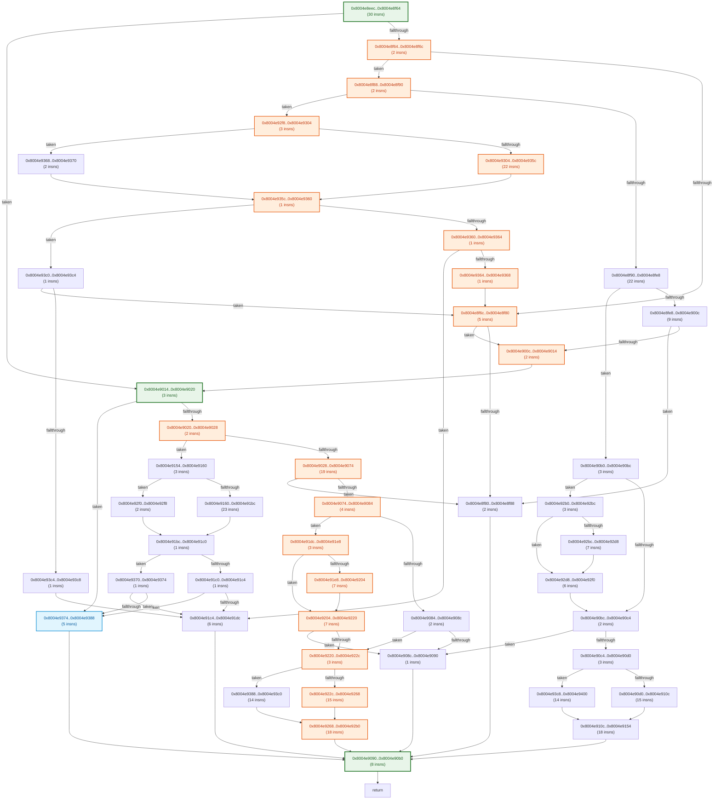

# Automated Stub & Static CFG Longest-Path Analysis (`main_300_bvhtree`)

## 1. Function Static CFG & Path Length Summary

| Function | Entry PC | Static ARM64 Insns | Basic Blocks | Loop Back-Edges | Est. Common Path (ARM64 Insns) | Est. Longest Path (ARM64 Insns) |
| :--- | :--- | ---: | ---: | ---: | ---: | ---: |
| `f_8004e71b0` | `0x8004e71b0` | 648 | 102 | 12 | 29 | 1243 |
| `f_8004e8eec` | `0x8004e8eec` | 325 | 47 | 0 | 63 | 158 |

## 2. Function Control Flow Graphs (CFGs)

### Function `f_8004e71b0` (`0x8004e71b0` – 648 insns, 102 blocks)

```mermaid
flowchart TD
    B_8004e71b0["0x8004e71b0..0x8004e71d0\n(8 insns)"]
    B_8004e71d0["0x8004e71d0..0x8004e71d8\n(2 insns)"]
    B_8004e71d8["0x8004e71d8..0x8004e71f4\n(7 insns)"]
    B_8004e71f4["0x8004e71f4..0x8004e71fc\n(2 insns)"]
    B_8004e71fc["0x8004e71fc..0x8004e7204\n(2 insns)"]
    B_8004e7204["0x8004e7204..0x8004e7210\n(3 insns, loop hdr)"]
    B_8004e7210["0x8004e7210..0x8004e721c\n(3 insns)"]
    B_8004e721c["0x8004e721c..0x8004e722c\n(4 insns, loop hdr)"]
    B_8004e722c["0x8004e722c..0x8004e726c\n(16 insns)"]
    B_8004e726c["0x8004e726c..0x8004e7280\n(5 insns)"]
    B_8004e7280["0x8004e7280..0x8004e72ac\n(11 insns, loop hdr)"]
    B_8004e72ac["0x8004e72ac..0x8004e72bc\n(4 insns)"]
    B_8004e72bc["0x8004e72bc..0x8004e72c0\n(1 insns)"]
    B_8004e72c0["0x8004e72c0..0x8004e72c4\n(1 insns)"]
    B_8004e72c4["0x8004e72c4..0x8004e72fc\n(14 insns)"]
    B_8004e72fc["0x8004e72fc..0x8004e7314\n(6 insns, loop hdr)"]
    B_8004e7314["0x8004e7314..0x8004e732c\n(6 insns)"]
    B_8004e732c["0x8004e732c..0x8004e7338\n(3 insns)"]
    B_8004e7338["0x8004e7338..0x8004e733c\n(1 insns)"]
    B_8004e733c["0x8004e733c..0x8004e735c\n(8 insns, loop hdr)"]
    B_8004e735c["0x8004e735c..0x8004e7368\n(3 insns)"]
    B_8004e7368["0x8004e7368..0x8004e7390\n(10 insns)"]
    B_8004e7390["0x8004e7390..0x8004e739c\n(3 insns)"]
    B_8004e739c["0x8004e739c..0x8004e73a8\n(3 insns)"]
    B_8004e73a8["0x8004e73a8..0x8004e73b4\n(3 insns, loop hdr)"]
    B_8004e73b4["0x8004e73b4..0x8004e73bc\n(2 insns)"]
    B_8004e73bc["0x8004e73bc..0x8004e73cc\n(4 insns, loop hdr)"]
    B_8004e73cc["0x8004e73cc..0x8004e73dc\n(4 insns)"]
    B_8004e73dc["0x8004e73dc..0x8004e73e8\n(3 insns)"]
    B_8004e73e8["0x8004e73e8..0x8004e73ec\n(1 insns)"]
    B_8004e73ec["0x8004e73ec..0x8004e73fc\n(4 insns, loop hdr)"]
    B_8004e73fc["0x8004e73fc..0x8004e7404\n(2 insns)"]
    B_8004e7404["0x8004e7404..0x8004e7414\n(4 insns, loop hdr)"]
    B_8004e7414["0x8004e7414..0x8004e741c\n(2 insns)"]
    B_8004e741c["0x8004e741c..0x8004e7424\n(2 insns)"]
    B_8004e7424["0x8004e7424..0x8004e7440\n(7 insns)"]
    B_8004e7440["0x8004e7440..0x8004e7444\n(1 insns)"]
    B_8004e7444["0x8004e7444..0x8004e7450\n(3 insns)"]
    B_8004e7450["0x8004e7450..0x8004e7460\n(4 insns)"]
    B_8004e7460["0x8004e7460..0x8004e7474\n(5 insns)"]
    B_8004e7474["0x8004e7474..0x8004e7480\n(3 insns)"]
    B_8004e7480["0x8004e7480..0x8004e7488\n(2 insns)"]
    B_8004e7488["0x8004e7488..0x8004e749c\n(5 insns)"]
    B_8004e749c["0x8004e749c..0x8004e74ac\n(4 insns)"]
    B_8004e74ac["0x8004e74ac..0x8004e7514\n(26 insns)"]
    B_8004e7514["0x8004e7514..0x8004e7528\n(5 insns)"]
    B_8004e7528["0x8004e7528..0x8004e755c\n(13 insns)"]
    B_8004e755c["0x8004e755c..0x8004e7570\n(5 insns)"]
    B_8004e7570["0x8004e7570..0x8004e7694\n(73 insns)"]
    B_8004e7694["0x8004e7694..0x8004e76a8\n(5 insns)"]
    B_8004e76a8["0x8004e76a8..0x8004e76b0\n(2 insns)"]
    B_8004e76b0["0x8004e76b0..0x8004e76b4\n(1 insns)"]
    B_8004e76b4["0x8004e76b4..0x8004e76c4\n(4 insns, loop hdr)"]
    B_8004e76c4["0x8004e76c4..0x8004e76c8\n(1 insns)"]
    B_8004e76c8["0x8004e76c8..0x8004e76cc\n(1 insns)"]
    B_8004e76cc["0x8004e76cc..0x8004e76f0\n(9 insns)"]
    B_8004e76f0["0x8004e76f0..0x8004e7710\n(8 insns)"]
    B_8004e7710["0x8004e7710..0x8004e771c\n(3 insns)"]
    B_8004e771c["0x8004e771c..0x8004e7724\n(2 insns)"]
    B_8004e7724["0x8004e7724..0x8004e772c\n(2 insns)"]
    B_8004e772c["0x8004e772c..0x8004e7734\n(2 insns)"]
    B_8004e7734["0x8004e7734..0x8004e7740\n(3 insns)"]
    B_8004e7740["0x8004e7740..0x8004e7748\n(2 insns)"]
    B_8004e7748["0x8004e7748..0x8004e777c\n(13 insns)"]
    B_8004e777c["0x8004e777c..0x8004e7784\n(2 insns)"]
    B_8004e7784["0x8004e7784..0x8004e7790\n(3 insns)"]
    B_8004e7790["0x8004e7790..0x8004e779c\n(3 insns)"]
    B_8004e779c["0x8004e779c..0x8004e77b0\n(5 insns)"]
    B_8004e77b0["0x8004e77b0..0x8004e77b4\n(1 insns)"]
    B_8004e77b4["0x8004e77b4..0x8004e77bc\n(2 insns)"]
    B_8004e77bc["0x8004e77bc..0x8004e77c4\n(2 insns)"]
    B_8004e77c4["0x8004e77c4..0x8004e77cc\n(2 insns)"]
    B_8004e77cc["0x8004e77cc..0x8004e77ec\n(8 insns)"]
    B_8004e77ec["0x8004e77ec..0x8004e77f0\n(1 insns)"]
    B_8004e77f0["0x8004e77f0..0x8004e7824\n(13 insns)"]
    B_8004e7824["0x8004e7824..0x8004e782c\n(2 insns)"]
    B_8004e782c["0x8004e782c..0x8004e7834\n(2 insns)"]
    B_8004e7834["0x8004e7834..0x8004e7840\n(3 insns)"]
    B_8004e7840["0x8004e7840..0x8004e7848\n(2 insns)"]
    B_8004e7848["0x8004e7848..0x8004e7878\n(12 insns)"]
    B_8004e7878["0x8004e7878..0x8004e7880\n(2 insns)"]
    B_8004e7880["0x8004e7880..0x8004e7884\n(1 insns)"]
    B_8004e7884["0x8004e7884..0x8004e7894\n(4 insns, loop hdr)"]
    B_8004e7894["0x8004e7894..0x8004e7898\n(1 insns)"]
    B_8004e7898["0x8004e7898..0x8004e78cc\n(13 insns)"]
    B_8004e78cc["0x8004e78cc..0x8004e7968\n(39 insns)"]
    B_8004e7968["0x8004e7968..0x8004e7984\n(7 insns)"]
    B_8004e7984["0x8004e7984..0x8004e79ac\n(10 insns)"]
    B_8004e79ac["0x8004e79ac..0x8004e79c8\n(7 insns)"]
    B_8004e79c8["0x8004e79c8..0x8004e79d4\n(3 insns, loop hdr)"]
    B_8004e79d4["0x8004e79d4..0x8004e79dc\n(2 insns)"]
    B_8004e79dc["0x8004e79dc..0x8004e79f0\n(5 insns)"]
    B_8004e79f0["0x8004e79f0..0x8004e79f4\n(1 insns)"]
    B_8004e79f4["0x8004e79f4..0x8004e7a08\n(5 insns)"]
    B_8004e7a08["0x8004e7a08..0x8004e7a14\n(3 insns)"]
    B_8004e7a14["0x8004e7a14..0x8004e7a20\n(3 insns)"]
    B_8004e7a20["0x8004e7a20..0x8004e7b6c\n(83 insns)"]
    B_8004e7b6c["0x8004e7b6c..0x8004e7b74\n(2 insns)"]
    B_8004e7b74["0x8004e7b74..0x8004e7b88\n(5 insns)"]
    B_8004e7b88["0x8004e7b88..0x8004e7bbc\n(13 insns)"]
    B_8004e7bbc["0x8004e7bbc..0x8004e7bc4\n(2 insns)"]
    B_8004e7bc4["0x8004e7bc4..0x8004e7bd0\n(3 insns)"]
    B_8004e71b0 -- "taken" --> B_8004e7724
    B_8004e71b0 -- "fallthrough" --> B_8004e71d0
    B_8004e71d0 -- "taken" --> B_8004e7724
    B_8004e71d0 -- "fallthrough" --> B_8004e71d8
    B_8004e71d8 -- "taken" --> B_8004e7724
    B_8004e71d8 -- "fallthrough" --> B_8004e71f4
    B_8004e71f4 -- "taken" --> B_8004e7790
    B_8004e71f4 -- "fallthrough" --> B_8004e71fc
    B_8004e71fc --> B_8004e7204
    B_8004e7204 -- "taken" --> B_8004e779c
    B_8004e7204 -- "fallthrough" --> B_8004e7210
    B_8004e7210 --> B_8004e721c
    B_8004e721c -- "taken" --> B_8004e771c
    B_8004e721c -- "fallthrough" --> B_8004e722c
    B_8004e722c -- "taken" --> B_8004e72ac
    B_8004e722c -- "fallthrough" --> B_8004e726c
    B_8004e726c --> B_8004e7280
    B_8004e7280 -. "loop back" .-> B_8004e7280
    B_8004e7280 -- "fallthrough" --> B_8004e72ac
    B_8004e72ac --> B_8004e72fc
    B_8004e72bc --> B_8004e72c0
    B_8004e72c0 --> B_8004e72c4
    B_8004e72c4 -- "taken" --> B_8004e7784
    B_8004e72c4 -. "loop back" .-> B_8004e72fc
    B_8004e72fc -- "taken" --> B_8004e72c0
    B_8004e72fc -- "fallthrough" --> B_8004e7314
    B_8004e7314 -- "taken" --> B_8004e72c4
    B_8004e7314 -- "fallthrough" --> B_8004e732c
    B_8004e732c -- "taken" --> B_8004e7390
    B_8004e732c -- "fallthrough" --> B_8004e7338
    B_8004e7338 --> B_8004e733c
    B_8004e733c -- "taken" --> B_8004e7390
    B_8004e733c -- "fallthrough" --> B_8004e735c
    B_8004e735c -- "taken" --> B_8004e772c
    B_8004e735c -- "fallthrough" --> B_8004e7368
    B_8004e7368 -. "loop back" .-> B_8004e733c
    B_8004e7368 -- "fallthrough" --> B_8004e7390
    B_8004e7390 -- "taken" --> B_8004e77b4
    B_8004e7390 -- "fallthrough" --> B_8004e739c
    B_8004e739c --> B_8004e73a8
    B_8004e73a8 -- "taken" --> B_8004e77bc
    B_8004e73a8 -- "fallthrough" --> B_8004e73b4
    B_8004e73b4 --> B_8004e73bc
    B_8004e73bc -- "taken" --> B_8004e7414
    B_8004e73bc -- "fallthrough" --> B_8004e73cc
    B_8004e73cc -- "taken" --> B_8004e7748
    B_8004e73cc -- "fallthrough" --> B_8004e73dc
    B_8004e73dc -- "taken" --> B_8004e7414
    B_8004e73dc -- "fallthrough" --> B_8004e73e8
    B_8004e73e8 --> B_8004e73ec
    B_8004e73ec -. "loop back" .-> B_8004e73ec
    B_8004e73ec -- "fallthrough" --> B_8004e73fc
    B_8004e73fc -- "taken" --> B_8004e7444
    B_8004e73fc -- "fallthrough" --> B_8004e7404
    B_8004e7404 -. "loop back" .-> B_8004e7404
    B_8004e7404 -- "fallthrough" --> B_8004e7414
    B_8004e7414 -- "taken" --> B_8004e777c
    B_8004e7414 -- "fallthrough" --> B_8004e741c
    B_8004e741c --> B_8004e7424
    B_8004e7424 -. "loop back" .-> B_8004e73bc
    B_8004e7424 -- "fallthrough" --> B_8004e7440
    B_8004e7440 --> B_8004e7724
    B_8004e7444 -- "taken" --> B_8004e7404
    B_8004e7444 -- "fallthrough" --> B_8004e7450
    B_8004e7450 -- "taken" --> B_8004e7414
    B_8004e7450 -- "fallthrough" --> B_8004e7460
    B_8004e7460 -- "taken" --> B_8004e77f0
    B_8004e7460 -- "fallthrough" --> B_8004e7474
    B_8004e7474 -- "taken" --> B_8004e7840
    B_8004e7474 -- "fallthrough" --> B_8004e7480
    B_8004e7480 -- "taken" --> B_8004e7824
    B_8004e7480 -- "fallthrough" --> B_8004e7488
    B_8004e7488 -- "taken" --> B_8004e7898
    B_8004e7488 -- "fallthrough" --> B_8004e749c
    B_8004e749c -- "taken" --> B_8004e78cc
    B_8004e749c -- "fallthrough" --> B_8004e74ac
    B_8004e74ac -- "taken" --> B_8004e7528
    B_8004e74ac -- "fallthrough" --> B_8004e7514
    B_8004e7514 -- "taken" --> B_8004e7734
    B_8004e7514 -- "fallthrough" --> B_8004e7528
    B_8004e7528 -- "taken" --> B_8004e7570
    B_8004e7528 -- "fallthrough" --> B_8004e755c
    B_8004e755c -- "taken" --> B_8004e7710
    B_8004e755c -- "fallthrough" --> B_8004e7570
    B_8004e7570 -- "taken" --> B_8004e76c4
    B_8004e7570 -- "fallthrough" --> B_8004e7694
    B_8004e7694 -- "taken" --> B_8004e7b88
    B_8004e7694 -- "fallthrough" --> B_8004e76a8
    B_8004e76a8 -- "taken" --> B_8004e76c4
    B_8004e76a8 -- "fallthrough" --> B_8004e76b0
    B_8004e76b0 --> B_8004e76b4
    B_8004e76b4 -. "loop back" .-> B_8004e76b4
    B_8004e76b4 -- "fallthrough" --> B_8004e76c4
    B_8004e76c4 -- "taken" --> B_8004e7968
    B_8004e76c4 -- "fallthrough" --> B_8004e76c8
    B_8004e76c8 -- "taken" --> B_8004e76f0
    B_8004e76c8 -- "fallthrough" --> B_8004e76cc
    B_8004e76cc -- "taken" --> B_8004e7740
    B_8004e76cc -- "fallthrough" --> B_8004e76f0
    B_8004e76f0 --> EXIT_8004e76f0["return"]
    B_8004e7710 --> B_8004e7570
    B_8004e771c -. "loop back" .-> B_8004e721c
    B_8004e7724 --> B_8004e76f0
    B_8004e772c --> B_8004e7368
    B_8004e7734 --> B_8004e7528
    B_8004e7740 --> B_8004e76f0
    B_8004e7748 --> B_8004e73dc
    B_8004e777c --> B_8004e7424
    B_8004e7784 --> B_8004e76c8
    B_8004e7790 --> B_8004e7210
    B_8004e779c -. "loop back" .-> B_8004e7204
    B_8004e779c -- "fallthrough" --> B_8004e77b0
    B_8004e77b0 --> B_8004e7210
    B_8004e77b4 --> B_8004e76c8
    B_8004e77bc -- "taken" --> B_8004e7bbc
    B_8004e77bc -- "fallthrough" --> B_8004e77c4
    B_8004e77c4 --> B_8004e77cc
    B_8004e77cc -. "loop back" .-> B_8004e73a8
    B_8004e77cc -- "fallthrough" --> B_8004e77ec
    B_8004e77ec --> B_8004e76f0
    B_8004e77f0 --> B_8004e7474
    B_8004e7824 -- "taken" --> B_8004e7840
    B_8004e7824 -- "fallthrough" --> B_8004e782c
    B_8004e782c -- "taken" --> B_8004e7840
    B_8004e782c -- "fallthrough" --> B_8004e7834
    B_8004e7834 -- "taken" --> B_8004e7488
    B_8004e7834 -- "fallthrough" --> B_8004e7840
    B_8004e7840 -- "taken" --> B_8004e7878
    B_8004e7840 -- "fallthrough" --> B_8004e7848
    B_8004e7848 --> B_8004e7878
    B_8004e7878 -- "taken" --> B_8004e7414
    B_8004e7878 -- "fallthrough" --> B_8004e7880
    B_8004e7880 --> B_8004e7884
    B_8004e7884 -. "loop back" .-> B_8004e7884
    B_8004e7884 -- "fallthrough" --> B_8004e7894
    B_8004e7894 --> B_8004e7414
    B_8004e7898 --> B_8004e749c
    B_8004e78cc --> B_8004e74ac
    B_8004e7968 -- "taken" --> B_8004e7b74
    B_8004e7968 -- "fallthrough" --> B_8004e7984
    B_8004e7984 -- "taken" --> B_8004e7b6c
    B_8004e7984 -- "fallthrough" --> B_8004e79ac
    B_8004e79ac --> B_8004e79c8
    B_8004e79c8 -- "taken" --> B_8004e79dc
    B_8004e79c8 -- "fallthrough" --> B_8004e79d4
    B_8004e79d4 -- "taken" --> B_8004e79f4
    B_8004e79d4 -- "fallthrough" --> B_8004e79dc
    B_8004e79dc -. "loop back" .-> B_8004e79c8
    B_8004e79dc -- "fallthrough" --> B_8004e79f0
    B_8004e79f0 --> B_8004e7b6c
    B_8004e79f4 -- "taken" --> B_8004e79dc
    B_8004e79f4 -- "fallthrough" --> B_8004e7a08
    B_8004e7a08 -- "taken" --> B_8004e79dc
    B_8004e7a08 -- "fallthrough" --> B_8004e7a14
    B_8004e7a14 -- "taken" --> B_8004e79dc
    B_8004e7a14 -- "fallthrough" --> B_8004e7a20
    B_8004e7a20 --> B_8004e7b6c
    B_8004e7b6c --> B_8004e7b74
    B_8004e7b74 --> B_8004e76c8
    B_8004e7b88 --> B_8004e76a8
    B_8004e7bbc --> B_8004e77cc
    B_8004e7bc4 --> EXIT_8004e7bc4["return"]
    %% Path Highlighting
    style B_8004e71b0 fill:#e8f5e9,stroke:#2e7d32,stroke-width:3px,color:#1b5e20
    style B_8004e71d0 fill:#ffeedd,stroke:#e65100,stroke-width:2px,color:#bf360c
    style B_8004e71d8 fill:#ffeedd,stroke:#e65100,stroke-width:2px,color:#bf360c
    style B_8004e71f4 fill:#ffeedd,stroke:#e65100,stroke-width:2px,color:#bf360c
    style B_8004e71fc fill:#ffeedd,stroke:#e65100,stroke-width:2px,color:#bf360c
    style B_8004e7204 fill:#ffeedd,stroke:#e65100,stroke-width:2px,color:#bf360c
    style B_8004e7210 fill:#ffeedd,stroke:#e65100,stroke-width:2px,color:#bf360c
    style B_8004e721c fill:#ffeedd,stroke:#e65100,stroke-width:2px,color:#bf360c
    style B_8004e722c fill:#ffeedd,stroke:#e65100,stroke-width:2px,color:#bf360c
    style B_8004e726c fill:#ffeedd,stroke:#e65100,stroke-width:2px,color:#bf360c
    style B_8004e7280 fill:#ffeedd,stroke:#e65100,stroke-width:2px,color:#bf360c
    style B_8004e72ac fill:#ffeedd,stroke:#e65100,stroke-width:2px,color:#bf360c
    style B_8004e72fc fill:#ffeedd,stroke:#e65100,stroke-width:2px,color:#bf360c
    style B_8004e7314 fill:#ffeedd,stroke:#e65100,stroke-width:2px,color:#bf360c
    style B_8004e732c fill:#ffeedd,stroke:#e65100,stroke-width:2px,color:#bf360c
    style B_8004e7338 fill:#ffeedd,stroke:#e65100,stroke-width:2px,color:#bf360c
    style B_8004e733c fill:#ffeedd,stroke:#e65100,stroke-width:2px,color:#bf360c
    style B_8004e735c fill:#ffeedd,stroke:#e65100,stroke-width:2px,color:#bf360c
    style B_8004e7368 fill:#ffeedd,stroke:#e65100,stroke-width:2px,color:#bf360c
    style B_8004e7390 fill:#ffeedd,stroke:#e65100,stroke-width:2px,color:#bf360c
    style B_8004e739c fill:#ffeedd,stroke:#e65100,stroke-width:2px,color:#bf360c
    style B_8004e73a8 fill:#ffeedd,stroke:#e65100,stroke-width:2px,color:#bf360c
    style B_8004e73b4 fill:#ffeedd,stroke:#e65100,stroke-width:2px,color:#bf360c
    style B_8004e73bc fill:#ffeedd,stroke:#e65100,stroke-width:2px,color:#bf360c
    style B_8004e73cc fill:#ffeedd,stroke:#e65100,stroke-width:2px,color:#bf360c
    style B_8004e73dc fill:#ffeedd,stroke:#e65100,stroke-width:2px,color:#bf360c
    style B_8004e73e8 fill:#ffeedd,stroke:#e65100,stroke-width:2px,color:#bf360c
    style B_8004e73ec fill:#ffeedd,stroke:#e65100,stroke-width:2px,color:#bf360c
    style B_8004e73fc fill:#ffeedd,stroke:#e65100,stroke-width:2px,color:#bf360c
    style B_8004e7444 fill:#ffeedd,stroke:#e65100,stroke-width:2px,color:#bf360c
    style B_8004e7450 fill:#ffeedd,stroke:#e65100,stroke-width:2px,color:#bf360c
    style B_8004e7460 fill:#ffeedd,stroke:#e65100,stroke-width:2px,color:#bf360c
    style B_8004e7474 fill:#ffeedd,stroke:#e65100,stroke-width:2px,color:#bf360c
    style B_8004e7480 fill:#ffeedd,stroke:#e65100,stroke-width:2px,color:#bf360c
    style B_8004e7488 fill:#ffeedd,stroke:#e65100,stroke-width:2px,color:#bf360c
    style B_8004e749c fill:#ffeedd,stroke:#e65100,stroke-width:2px,color:#bf360c
    style B_8004e74ac fill:#ffeedd,stroke:#e65100,stroke-width:2px,color:#bf360c
    style B_8004e7514 fill:#ffeedd,stroke:#e65100,stroke-width:2px,color:#bf360c
    style B_8004e7528 fill:#ffeedd,stroke:#e65100,stroke-width:2px,color:#bf360c
    style B_8004e755c fill:#ffeedd,stroke:#e65100,stroke-width:2px,color:#bf360c
    style B_8004e7570 fill:#ffeedd,stroke:#e65100,stroke-width:2px,color:#bf360c
    style B_8004e7694 fill:#ffeedd,stroke:#e65100,stroke-width:2px,color:#bf360c
    style B_8004e76a8 fill:#ffeedd,stroke:#e65100,stroke-width:2px,color:#bf360c
    style B_8004e76b0 fill:#ffeedd,stroke:#e65100,stroke-width:2px,color:#bf360c
    style B_8004e76b4 fill:#ffeedd,stroke:#e65100,stroke-width:2px,color:#bf360c
    style B_8004e76c4 fill:#ffeedd,stroke:#e65100,stroke-width:2px,color:#bf360c
    style B_8004e76c8 fill:#ffeedd,stroke:#e65100,stroke-width:2px,color:#bf360c
    style B_8004e76cc fill:#ffeedd,stroke:#e65100,stroke-width:2px,color:#bf360c
    style B_8004e76f0 fill:#e8f5e9,stroke:#2e7d32,stroke-width:3px,color:#1b5e20
    style B_8004e7710 fill:#ffeedd,stroke:#e65100,stroke-width:2px,color:#bf360c
    style B_8004e7724 fill:#e1f5fe,stroke:#0288d1,stroke-width:2px,color:#01579b
    style B_8004e772c fill:#ffeedd,stroke:#e65100,stroke-width:2px,color:#bf360c
    style B_8004e7734 fill:#ffeedd,stroke:#e65100,stroke-width:2px,color:#bf360c
    style B_8004e7740 fill:#ffeedd,stroke:#e65100,stroke-width:2px,color:#bf360c
    style B_8004e7748 fill:#ffeedd,stroke:#e65100,stroke-width:2px,color:#bf360c
    style B_8004e779c fill:#ffeedd,stroke:#e65100,stroke-width:2px,color:#bf360c
    style B_8004e77b0 fill:#ffeedd,stroke:#e65100,stroke-width:2px,color:#bf360c
    style B_8004e77f0 fill:#ffeedd,stroke:#e65100,stroke-width:2px,color:#bf360c
    style B_8004e7824 fill:#ffeedd,stroke:#e65100,stroke-width:2px,color:#bf360c
    style B_8004e782c fill:#ffeedd,stroke:#e65100,stroke-width:2px,color:#bf360c
    style B_8004e7834 fill:#ffeedd,stroke:#e65100,stroke-width:2px,color:#bf360c
    style B_8004e7898 fill:#ffeedd,stroke:#e65100,stroke-width:2px,color:#bf360c
    style B_8004e78cc fill:#ffeedd,stroke:#e65100,stroke-width:2px,color:#bf360c
    style B_8004e7968 fill:#ffeedd,stroke:#e65100,stroke-width:2px,color:#bf360c
    style B_8004e7984 fill:#ffeedd,stroke:#e65100,stroke-width:2px,color:#bf360c
    style B_8004e79ac fill:#ffeedd,stroke:#e65100,stroke-width:2px,color:#bf360c
    style B_8004e79c8 fill:#ffeedd,stroke:#e65100,stroke-width:2px,color:#bf360c
    style B_8004e79d4 fill:#ffeedd,stroke:#e65100,stroke-width:2px,color:#bf360c
    style B_8004e79f4 fill:#ffeedd,stroke:#e65100,stroke-width:2px,color:#bf360c
    style B_8004e7a08 fill:#ffeedd,stroke:#e65100,stroke-width:2px,color:#bf360c
    style B_8004e7a14 fill:#ffeedd,stroke:#e65100,stroke-width:2px,color:#bf360c
    style B_8004e7a20 fill:#ffeedd,stroke:#e65100,stroke-width:2px,color:#bf360c
    style B_8004e7b6c fill:#ffeedd,stroke:#e65100,stroke-width:2px,color:#bf360c
    style B_8004e7b74 fill:#ffeedd,stroke:#e65100,stroke-width:2px,color:#bf360c
    style B_8004e7b88 fill:#ffeedd,stroke:#e65100,stroke-width:2px,color:#bf360c
```

### Function `f_8004e8eec` (`0x8004e8eec` – 325 insns, 47 blocks)



## 3. External Callee Classification (5 total: 5 constant-zero, 0 pointer-alloc, 0 memory-copy, 0 branch-sensitive)

| External Symbol | Classification | Args Read | Longest-Path Return (`X0`) | Alt-Branch Return (`X0`) | Post-Call Analysis |
| :--- | :--- | ---: | :--- | :--- | :--- |
| `f_8004e7bd0` | `CONSTANT_ZERO` | 2 | `0x0` | `0x1` | Return value X0 unread/overwritten -> constant 0 |
| `f_8027e47f8` | `CONSTANT_ZERO` | 3 | `0x0` | `0x1` | Return value X0 unread/overwritten -> constant 0 |
| `f_80009bf90` | `CONSTANT_ZERO` | 2 | `0x0` | `0x1` | Return value X0 unread/overwritten -> constant 0 |
| `f_801c1ed1c` | `CONSTANT_ZERO` | 2 | `0x0` | `0x1` | Return value X0 unread/overwritten -> constant 0 |
| `f_80009bf94` | `CONSTANT_ZERO` | 2 | `0x0` | `0x1` | Return value X0 unread/overwritten -> constant 0 |
