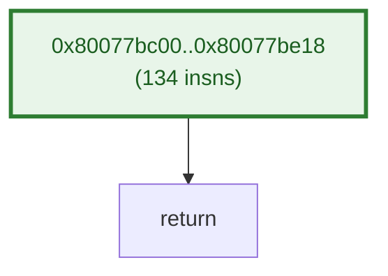
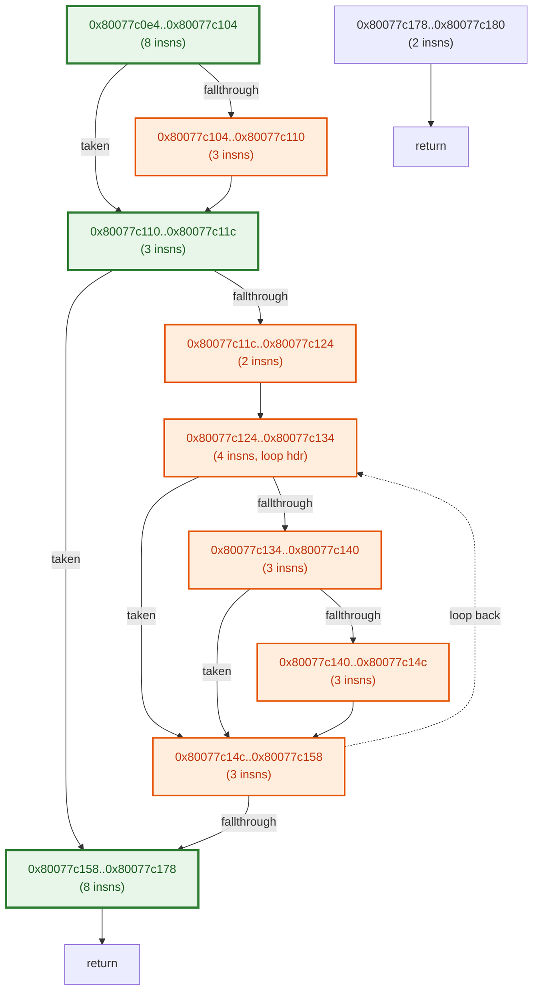
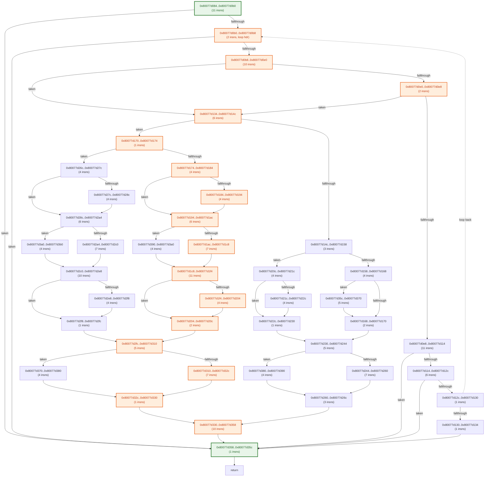

# Automated Stub & Static CFG Longest-Path Analysis (`main_432`)

## 1. Function Static CFG & Path Length Summary

| Function | Entry PC | Static ARM64 Insns | Basic Blocks | Loop Back-Edges | Est. Common Path (ARM64 Insns) | Est. Longest Path (ARM64 Insns) | CP-SAT Verified Longest |
| :--- | :--- | ---: | ---: | ---: | ---: | ---: | ---: |
| `f_80077bc00` | `0x80077bc00` | 127 | 1 | 0 | 134 | 134 | 134 |
| `f_80077be18` | `0x80077be18` | 179 | 36 | 2 | 164 | 577 | 577 |
| `f_80077c0e4` | `0x80077c0e4` | 39 | 10 | 1 | 41 | 76 | 76 |
| `f_80077c180` | `0x80077c180` | 961 | 243 | 20 | 335 | 3424 | 3424 |
| `f_80077d084` | `0x80077d084` | 203 | 43 | 1 | 46 | 190 | 190 |

## 2. Function Control Flow Graphs (CFGs)

### Function `f_80077bc00` (`0x80077bc00` – 127 insns, 1 blocks)



### Function `f_80077be18` (`0x80077be18` – 179 insns, 36 blocks)

```mermaid
flowchart TD
    B_80077be18["0x80077be18..0x80077be48\n(12 insns)"]
    B_80077be48["0x80077be48..0x80077be78\n(12 insns)"]
    B_80077be78["0x80077be78..0x80077be8c\n(5 insns, loop hdr)"]
    B_80077be8c["0x80077be8c..0x80077be9c\n(4 insns)"]
    B_80077be9c["0x80077be9c..0x80077bea4\n(2 insns)"]
    B_80077bea4["0x80077bea4..0x80077beac\n(2 insns)"]
    B_80077beac["0x80077beac..0x80077beb8\n(3 insns)"]
    B_80077beb8["0x80077beb8..0x80077bec4\n(3 insns)"]
    B_80077bec4["0x80077bec4..0x80077bed0\n(3 insns)"]
    B_80077bed0["0x80077bed0..0x80077bed8\n(2 insns)"]
    B_80077bed8["0x80077bed8..0x80077bee0\n(2 insns)"]
    B_80077bee0["0x80077bee0..0x80077bee8\n(2 insns)"]
    B_80077bee8["0x80077bee8..0x80077bef4\n(3 insns)"]
    B_80077bef4["0x80077bef4..0x80077befc\n(2 insns)"]
    B_80077befc["0x80077befc..0x80077bf04\n(2 insns)"]
    B_80077bf04["0x80077bf04..0x80077bf14\n(4 insns)"]
    B_80077bf14["0x80077bf14..0x80077bf20\n(3 insns)"]
    B_80077bf20["0x80077bf20..0x80077bf24\n(1 insns)"]
    B_80077bf24["0x80077bf24..0x80077bf2c\n(2 insns)"]
    B_80077bf2c["0x80077bf2c..0x80077bf30\n(1 insns)"]
    B_80077bf30["0x80077bf30..0x80077bf40\n(4 insns)"]
    B_80077bf40["0x80077bf40..0x80077bf44\n(1 insns)"]
    B_80077bf44["0x80077bf44..0x80077bf5c\n(6 insns)"]
    B_80077bf5c["0x80077bf5c..0x80077bfcc\n(28 insns)"]
    B_80077bfcc["0x80077bfcc..0x80077bfd0\n(1 insns)"]
    B_80077bfd0["0x80077bfd0..0x80077bff8\n(10 insns)"]
    B_80077bff8["0x80077bff8..0x80077c008\n(4 insns)"]
    B_80077c008["0x80077c008..0x80077c010\n(2 insns)"]
    B_80077c010["0x80077c010..0x80077c02c\n(7 insns)"]
    B_80077c02c["0x80077c02c..0x80077c034\n(2 insns)"]
    B_80077c034["0x80077c034..0x80077c040\n(3 insns)"]
    B_80077c040["0x80077c040..0x80077c070\n(12 insns, loop hdr)"]
    B_80077c070["0x80077c070..0x80077c090\n(8 insns)"]
    B_80077c090["0x80077c090..0x80077c098\n(2 insns)"]
    B_80077c098["0x80077c098..0x80077c0b8\n(8 insns)"]
    B_80077c0b8["0x80077c0b8..0x80077c0e4\n(11 insns)"]
    B_80077be18 -- "taken" --> B_80077c070
    B_80077be18 -- "fallthrough" --> B_80077be48
    B_80077be48 --> B_80077be78
    B_80077be78 -- "taken" --> B_80077bff8
    B_80077be78 -- "fallthrough" --> B_80077be8c
    B_80077be8c -- "taken" --> B_80077bff8
    B_80077be8c -- "fallthrough" --> B_80077be9c
    B_80077be9c -- "taken" --> B_80077c090
    B_80077be9c -- "fallthrough" --> B_80077bea4
    B_80077bea4 -- "taken" --> B_80077beb8
    B_80077bea4 -- "fallthrough" --> B_80077beac
    B_80077beac -- "taken" --> B_80077c090
    B_80077beac -- "fallthrough" --> B_80077beb8
    B_80077beb8 -- "taken" --> B_80077bef4
    B_80077beb8 -- "fallthrough" --> B_80077bec4
    B_80077bec4 -- "taken" --> B_80077bee0
    B_80077bec4 -- "fallthrough" --> B_80077bed0
    B_80077bed0 -- "taken" --> B_80077c090
    B_80077bed0 -- "fallthrough" --> B_80077bed8
    B_80077bed8 --> B_80077bee0
    B_80077bee0 -- "taken" --> B_80077bef4
    B_80077bee0 -- "fallthrough" --> B_80077bee8
    B_80077bee8 -- "taken" --> B_80077c090
    B_80077bee8 -- "fallthrough" --> B_80077bef4
    B_80077bef4 -- "taken" --> B_80077c090
    B_80077bef4 -- "fallthrough" --> B_80077befc
    B_80077befc -- "taken" --> B_80077c090
    B_80077befc -- "fallthrough" --> B_80077bf04
    B_80077bf04 -- "taken" --> B_80077bf2c
    B_80077bf04 -- "fallthrough" --> B_80077bf14
    B_80077bf14 -- "taken" --> B_80077bf30
    B_80077bf14 -- "fallthrough" --> B_80077bf20
    B_80077bf20 -- "taken" --> B_80077bf30
    B_80077bf20 -- "fallthrough" --> B_80077bf24
    B_80077bf24 -- "taken" --> B_80077c090
    B_80077bf24 -- "fallthrough" --> B_80077bf2c
    B_80077bf2c --> B_80077bf30
    B_80077bf30 -- "taken" --> B_80077c098
    B_80077bf30 -- "fallthrough" --> B_80077bf40
    B_80077bf40 -- "taken" --> B_80077bff8
    B_80077bf40 -- "fallthrough" --> B_80077bf44
    B_80077bf44 -- "taken" --> B_80077bff8
    B_80077bf44 -- "fallthrough" --> B_80077bf5c
    B_80077bf5c -- "taken" --> B_80077bfd0
    B_80077bf5c -- "fallthrough" --> B_80077bfcc
    B_80077bfcc --> B_80077bfd0
    B_80077bfd0 --> B_80077bff8
    B_80077bff8 -. "loop back" .-> B_80077be78
    B_80077bff8 -- "fallthrough" --> B_80077c008
    B_80077c008 -- "taken" --> B_80077c070
    B_80077c008 -- "fallthrough" --> B_80077c010
    B_80077c010 -- "taken" --> B_80077c034
    B_80077c010 -- "fallthrough" --> B_80077c02c
    B_80077c02c --> B_80077c034
    B_80077c034 --> B_80077c040
    B_80077c040 -. "loop back" .-> B_80077c040
    B_80077c040 -- "fallthrough" --> B_80077c070
    B_80077c070 --> EXIT_80077c070["return"]
    B_80077c090 --> B_80077bf30
    B_80077c098 -- "taken" --> B_80077bf40
    B_80077c098 -- "fallthrough" --> B_80077c0b8
    B_80077c0b8 --> B_80077bf40
    %% Path Highlighting
    style B_80077be18 fill:#e8f5e9,stroke:#2e7d32,stroke-width:3px,color:#1b5e20
    style B_80077be48 fill:#ffeedd,stroke:#e65100,stroke-width:2px,color:#bf360c
    style B_80077be78 fill:#ffeedd,stroke:#e65100,stroke-width:2px,color:#bf360c
    style B_80077be8c fill:#ffeedd,stroke:#e65100,stroke-width:2px,color:#bf360c
    style B_80077be9c fill:#ffeedd,stroke:#e65100,stroke-width:2px,color:#bf360c
    style B_80077bea4 fill:#ffeedd,stroke:#e65100,stroke-width:2px,color:#bf360c
    style B_80077beac fill:#ffeedd,stroke:#e65100,stroke-width:2px,color:#bf360c
    style B_80077beb8 fill:#ffeedd,stroke:#e65100,stroke-width:2px,color:#bf360c
    style B_80077bec4 fill:#ffeedd,stroke:#e65100,stroke-width:2px,color:#bf360c
    style B_80077bed0 fill:#ffeedd,stroke:#e65100,stroke-width:2px,color:#bf360c
    style B_80077bed8 fill:#ffeedd,stroke:#e65100,stroke-width:2px,color:#bf360c
    style B_80077bee0 fill:#ffeedd,stroke:#e65100,stroke-width:2px,color:#bf360c
    style B_80077bee8 fill:#ffeedd,stroke:#e65100,stroke-width:2px,color:#bf360c
    style B_80077bef4 fill:#ffeedd,stroke:#e65100,stroke-width:2px,color:#bf360c
    style B_80077befc fill:#ffeedd,stroke:#e65100,stroke-width:2px,color:#bf360c
    style B_80077bf04 fill:#ffeedd,stroke:#e65100,stroke-width:2px,color:#bf360c
    style B_80077bf14 fill:#ffeedd,stroke:#e65100,stroke-width:2px,color:#bf360c
    style B_80077bf20 fill:#ffeedd,stroke:#e65100,stroke-width:2px,color:#bf360c
    style B_80077bf24 fill:#ffeedd,stroke:#e65100,stroke-width:2px,color:#bf360c
    style B_80077bf30 fill:#ffeedd,stroke:#e65100,stroke-width:2px,color:#bf360c
    style B_80077bf40 fill:#ffeedd,stroke:#e65100,stroke-width:2px,color:#bf360c
    style B_80077bf44 fill:#ffeedd,stroke:#e65100,stroke-width:2px,color:#bf360c
    style B_80077bf5c fill:#ffeedd,stroke:#e65100,stroke-width:2px,color:#bf360c
    style B_80077bfcc fill:#ffeedd,stroke:#e65100,stroke-width:2px,color:#bf360c
    style B_80077bfd0 fill:#ffeedd,stroke:#e65100,stroke-width:2px,color:#bf360c
    style B_80077bff8 fill:#ffeedd,stroke:#e65100,stroke-width:2px,color:#bf360c
    style B_80077c008 fill:#ffeedd,stroke:#e65100,stroke-width:2px,color:#bf360c
    style B_80077c010 fill:#ffeedd,stroke:#e65100,stroke-width:2px,color:#bf360c
    style B_80077c02c fill:#ffeedd,stroke:#e65100,stroke-width:2px,color:#bf360c
    style B_80077c034 fill:#ffeedd,stroke:#e65100,stroke-width:2px,color:#bf360c
    style B_80077c040 fill:#ffeedd,stroke:#e65100,stroke-width:2px,color:#bf360c
    style B_80077c070 fill:#e8f5e9,stroke:#2e7d32,stroke-width:3px,color:#1b5e20
    style B_80077c090 fill:#ffeedd,stroke:#e65100,stroke-width:2px,color:#bf360c
    style B_80077c098 fill:#ffeedd,stroke:#e65100,stroke-width:2px,color:#bf360c
    style B_80077c0b8 fill:#ffeedd,stroke:#e65100,stroke-width:2px,color:#bf360c
```



### Function `f_80077c0e4` (`0x80077c0e4` – 39 insns, 10 blocks)



### Function `f_80077c180` (`0x80077c180` – 961 insns, 243 blocks)

```mermaid
flowchart TD
    B_80077c180["0x80077c180..0x80077c218\n(38 insns)"]
    B_80077c218["0x80077c218..0x80077c254\n(15 insns)"]
    B_80077c254["0x80077c254..0x80077c2d0\n(31 insns, loop hdr)"]
    B_80077c2d0["0x80077c2d0..0x80077c2f0\n(8 insns)"]
    B_80077c2f0["0x80077c2f0..0x80077c2fc\n(3 insns)"]
    B_80077c2fc["0x80077c2fc..0x80077c324\n(10 insns, loop hdr)"]
    B_80077c324["0x80077c324..0x80077c32c\n(2 insns)"]
    B_80077c32c["0x80077c32c..0x80077c334\n(2 insns)"]
    B_80077c334["0x80077c334..0x80077c33c\n(2 insns)"]
    B_80077c33c["0x80077c33c..0x80077c344\n(2 insns)"]
    B_80077c344["0x80077c344..0x80077c34c\n(2 insns)"]
    B_80077c34c["0x80077c34c..0x80077c354\n(2 insns)"]
    B_80077c354["0x80077c354..0x80077c35c\n(2 insns)"]
    B_80077c35c["0x80077c35c..0x80077c364\n(2 insns)"]
    B_80077c364["0x80077c364..0x80077c36c\n(2 insns)"]
    B_80077c36c["0x80077c36c..0x80077c380\n(5 insns)"]
    B_80077c380["0x80077c380..0x80077c394\n(5 insns)"]
    B_80077c394["0x80077c394..0x80077c398\n(1 insns)"]
    B_80077c398["0x80077c398..0x80077c3f4\n(23 insns)"]
    B_80077c3f4["0x80077c3f4..0x80077c3f8\n(1 insns)"]
    B_80077c3f8["0x80077c3f8..0x80077c3fc\n(1 insns)"]
    B_80077c3fc["0x80077c3fc..0x80077c400\n(1 insns)"]
    B_80077c400["0x80077c400..0x80077c408\n(2 insns)"]
    B_80077c408["0x80077c408..0x80077c414\n(3 insns)"]
    B_80077c414["0x80077c414..0x80077c420\n(3 insns)"]
    B_80077c420["0x80077c420..0x80077c42c\n(3 insns)"]
    B_80077c42c["0x80077c42c..0x80077c430\n(1 insns)"]
    B_80077c430["0x80077c430..0x80077c434\n(1 insns)"]
    B_80077c434["0x80077c434..0x80077c440\n(3 insns)"]
    B_80077c440["0x80077c440..0x80077c444\n(1 insns)"]
    B_80077c444["0x80077c444..0x80077c448\n(1 insns)"]
    B_80077c448["0x80077c448..0x80077c44c\n(1 insns)"]
    B_80077c44c["0x80077c44c..0x80077c46c\n(8 insns)"]
    B_80077c46c["0x80077c46c..0x80077c470\n(1 insns)"]
    B_80077c470["0x80077c470..0x80077c474\n(1 insns)"]
    B_80077c474["0x80077c474..0x80077c47c\n(2 insns)"]
    B_80077c47c["0x80077c47c..0x80077c494\n(6 insns, loop hdr)"]
    B_80077c494["0x80077c494..0x80077c4ac\n(6 insns)"]
    B_80077c4ac["0x80077c4ac..0x80077c4c4\n(6 insns)"]
    B_80077c4c4["0x80077c4c4..0x80077c4dc\n(6 insns)"]
    B_80077c4dc["0x80077c4dc..0x80077c4f4\n(6 insns)"]
    B_80077c4f4["0x80077c4f4..0x80077c50c\n(6 insns)"]
    B_80077c50c["0x80077c50c..0x80077c510\n(1 insns)"]
    B_80077c510["0x80077c510..0x80077c518\n(2 insns)"]
    B_80077c518["0x80077c518..0x80077c51c\n(1 insns)"]
    B_80077c51c["0x80077c51c..0x80077c534\n(6 insns)"]
    B_80077c534["0x80077c534..0x80077c54c\n(6 insns)"]
    B_80077c54c["0x80077c54c..0x80077c564\n(6 insns)"]
    B_80077c564["0x80077c564..0x80077c57c\n(6 insns)"]
    B_80077c57c["0x80077c57c..0x80077c594\n(6 insns)"]
    B_80077c594["0x80077c594..0x80077c5ac\n(6 insns)"]
    B_80077c5ac["0x80077c5ac..0x80077c5b0\n(1 insns)"]
    B_80077c5b0["0x80077c5b0..0x80077c5b8\n(2 insns)"]
    B_80077c5b8["0x80077c5b8..0x80077c5bc\n(1 insns)"]
    B_80077c5bc["0x80077c5bc..0x80077c5d4\n(6 insns)"]
    B_80077c5d4["0x80077c5d4..0x80077c5e8\n(5 insns, loop hdr)"]
    B_80077c5e8["0x80077c5e8..0x80077c5f8\n(4 insns)"]
    B_80077c5f8["0x80077c5f8..0x80077c608\n(4 insns)"]
    B_80077c608["0x80077c608..0x80077c618\n(4 insns)"]
    B_80077c618["0x80077c618..0x80077c628\n(4 insns)"]
    B_80077c628["0x80077c628..0x80077c638\n(4 insns)"]
    B_80077c638["0x80077c638..0x80077c648\n(4 insns)"]
    B_80077c648["0x80077c648..0x80077c658\n(4 insns)"]
    B_80077c658["0x80077c658..0x80077c668\n(4 insns)"]
    B_80077c668["0x80077c668..0x80077c678\n(4 insns)"]
    B_80077c678["0x80077c678..0x80077c688\n(4 insns)"]
    B_80077c688["0x80077c688..0x80077c698\n(4 insns)"]
    B_80077c698["0x80077c698..0x80077c6a8\n(4 insns)"]
    B_80077c6a8["0x80077c6a8..0x80077c6b4\n(3 insns)"]
    B_80077c6b4["0x80077c6b4..0x80077c6c4\n(4 insns)"]
    B_80077c6c4["0x80077c6c4..0x80077c6d4\n(4 insns)"]
    B_80077c6d4["0x80077c6d4..0x80077c6e4\n(4 insns)"]
    B_80077c6e4["0x80077c6e4..0x80077c6f4\n(4 insns)"]
    B_80077c6f4["0x80077c6f4..0x80077c704\n(4 insns)"]
    B_80077c704["0x80077c704..0x80077c714\n(4 insns)"]
    B_80077c714["0x80077c714..0x80077c724\n(4 insns)"]
    B_80077c724["0x80077c724..0x80077c734\n(4 insns)"]
    B_80077c734["0x80077c734..0x80077c744\n(4 insns)"]
    B_80077c744["0x80077c744..0x80077c754\n(4 insns)"]
    B_80077c754["0x80077c754..0x80077c758\n(1 insns)"]
    B_80077c758["0x80077c758..0x80077c764\n(3 insns)"]
    B_80077c764["0x80077c764..0x80077c774\n(4 insns)"]
    B_80077c774["0x80077c774..0x80077c784\n(4 insns)"]
    B_80077c784["0x80077c784..0x80077c790\n(3 insns)"]
    B_80077c790["0x80077c790..0x80077c7a8\n(6 insns, loop hdr)"]
    B_80077c7a8["0x80077c7a8..0x80077c7c0\n(6 insns)"]
    B_80077c7c0["0x80077c7c0..0x80077c7d0\n(4 insns)"]
    B_80077c7d0["0x80077c7d0..0x80077c7d4\n(1 insns)"]
    B_80077c7d4["0x80077c7d4..0x80077c7d8\n(1 insns)"]
    B_80077c7d8["0x80077c7d8..0x80077c7e0\n(2 insns)"]
    B_80077c7e0["0x80077c7e0..0x80077c7e4\n(1 insns)"]
    B_80077c7e4["0x80077c7e4..0x80077c878\n(37 insns)"]
    B_80077c878["0x80077c878..0x80077c894\n(7 insns)"]
    B_80077c894["0x80077c894..0x80077c8a0\n(3 insns)"]
    B_80077c8a0["0x80077c8a0..0x80077c8a8\n(2 insns)"]
    B_80077c8a8["0x80077c8a8..0x80077c8b0\n(2 insns)"]
    B_80077c8b0["0x80077c8b0..0x80077c8b8\n(2 insns)"]
    B_80077c8b8["0x80077c8b8..0x80077c8bc\n(1 insns)"]
    B_80077c8bc["0x80077c8bc..0x80077c8c4\n(2 insns)"]
    B_80077c8c4["0x80077c8c4..0x80077c8cc\n(2 insns)"]
    B_80077c8cc["0x80077c8cc..0x80077c8d0\n(1 insns)"]
    B_80077c8d0["0x80077c8d0..0x80077c8d4\n(1 insns)"]
    B_80077c8d4["0x80077c8d4..0x80077c8dc\n(2 insns)"]
    B_80077c8dc["0x80077c8dc..0x80077c8f4\n(6 insns, loop hdr)"]
    B_80077c8f4["0x80077c8f4..0x80077c90c\n(6 insns)"]
    B_80077c90c["0x80077c90c..0x80077c924\n(6 insns)"]
    B_80077c924["0x80077c924..0x80077c93c\n(6 insns)"]
    B_80077c93c["0x80077c93c..0x80077c954\n(6 insns)"]
    B_80077c954["0x80077c954..0x80077c96c\n(6 insns)"]
    B_80077c96c["0x80077c96c..0x80077c970\n(1 insns)"]
    B_80077c970["0x80077c970..0x80077c978\n(2 insns)"]
    B_80077c978["0x80077c978..0x80077c97c\n(1 insns)"]
    B_80077c97c["0x80077c97c..0x80077c994\n(6 insns)"]
    B_80077c994["0x80077c994..0x80077c9ac\n(6 insns)"]
    B_80077c9ac["0x80077c9ac..0x80077c9c4\n(6 insns)"]
    B_80077c9c4["0x80077c9c4..0x80077c9dc\n(6 insns)"]
    B_80077c9dc["0x80077c9dc..0x80077c9f4\n(6 insns)"]
    B_80077c9f4["0x80077c9f4..0x80077ca0c\n(6 insns)"]
    B_80077ca0c["0x80077ca0c..0x80077ca10\n(1 insns)"]
    B_80077ca10["0x80077ca10..0x80077ca18\n(2 insns)"]
    B_80077ca18["0x80077ca18..0x80077ca1c\n(1 insns)"]
    B_80077ca1c["0x80077ca1c..0x80077ca20\n(1 insns)"]
    B_80077ca20["0x80077ca20..0x80077ca2c\n(3 insns, loop hdr)"]
    B_80077ca2c["0x80077ca2c..0x80077ca3c\n(4 insns)"]
    B_80077ca3c["0x80077ca3c..0x80077ca40\n(1 insns)"]
    B_80077ca40["0x80077ca40..0x80077ca48\n(2 insns)"]
    B_80077ca48["0x80077ca48..0x80077ca50\n(2 insns)"]
    B_80077ca50["0x80077ca50..0x80077ca58\n(2 insns)"]
    B_80077ca58["0x80077ca58..0x80077ca5c\n(1 insns)"]
    B_80077ca5c["0x80077ca5c..0x80077ca80\n(9 insns)"]
    B_80077ca80["0x80077ca80..0x80077ca9c\n(7 insns, loop hdr)"]
    B_80077ca9c["0x80077ca9c..0x80077cab4\n(6 insns)"]
    B_80077cab4["0x80077cab4..0x80077cacc\n(6 insns)"]
    B_80077cacc["0x80077cacc..0x80077cae4\n(6 insns)"]
    B_80077cae4["0x80077cae4..0x80077cafc\n(6 insns)"]
    B_80077cafc["0x80077cafc..0x80077cb14\n(6 insns)"]
    B_80077cb14["0x80077cb14..0x80077cb20\n(3 insns)"]
    B_80077cb20["0x80077cb20..0x80077cb24\n(1 insns)"]
    B_80077cb24["0x80077cb24..0x80077cb3c\n(6 insns)"]
    B_80077cb3c["0x80077cb3c..0x80077cb54\n(6 insns)"]
    B_80077cb54["0x80077cb54..0x80077cb6c\n(6 insns)"]
    B_80077cb6c["0x80077cb6c..0x80077cb84\n(6 insns)"]
    B_80077cb84["0x80077cb84..0x80077cb9c\n(6 insns)"]
    B_80077cb9c["0x80077cb9c..0x80077cbb4\n(6 insns)"]
    B_80077cbb4["0x80077cbb4..0x80077cbb8\n(1 insns)"]
    B_80077cbb8["0x80077cbb8..0x80077cbc0\n(2 insns)"]
    B_80077cbc0["0x80077cbc0..0x80077cbcc\n(3 insns)"]
    B_80077cbcc["0x80077cbcc..0x80077cbec\n(8 insns)"]
    B_80077cbec["0x80077cbec..0x80077cbf0\n(1 insns)"]
    B_80077cbf0["0x80077cbf0..0x80077cc00\n(4 insns)"]
    B_80077cc00["0x80077cc00..0x80077cc58\n(22 insns)"]
    B_80077cc58["0x80077cc58..0x80077cc60\n(2 insns)"]
    B_80077cc60["0x80077cc60..0x80077cc6c\n(3 insns)"]
    B_80077cc6c["0x80077cc6c..0x80077cc78\n(3 insns, loop hdr)"]
    B_80077cc78["0x80077cc78..0x80077cc80\n(2 insns)"]
    B_80077cc80["0x80077cc80..0x80077cc84\n(1 insns, loop hdr)"]
    B_80077cc84["0x80077cc84..0x80077cc94\n(4 insns, loop hdr)"]
    B_80077cc94["0x80077cc94..0x80077cc98\n(1 insns)"]
    B_80077cc98["0x80077cc98..0x80077cca0\n(2 insns)"]
    B_80077cca0["0x80077cca0..0x80077ccb0\n(4 insns)"]
    B_80077ccb0["0x80077ccb0..0x80077ccbc\n(3 insns)"]
    B_80077ccbc["0x80077ccbc..0x80077ccc8\n(3 insns, loop hdr)"]
    B_80077ccc8["0x80077ccc8..0x80077ccd8\n(4 insns)"]
    B_80077ccd8["0x80077ccd8..0x80077ccdc\n(1 insns)"]
    B_80077ccdc["0x80077ccdc..0x80077ccec\n(4 insns, loop hdr)"]
    B_80077ccec["0x80077ccec..0x80077ccf0\n(1 insns)"]
    B_80077ccf0["0x80077ccf0..0x80077cd18\n(10 insns)"]
    B_80077cd18["0x80077cd18..0x80077cd28\n(4 insns)"]
    B_80077cd28["0x80077cd28..0x80077cd3c\n(5 insns)"]
    B_80077cd3c["0x80077cd3c..0x80077cd40\n(1 insns)"]
    B_80077cd40["0x80077cd40..0x80077cd50\n(4 insns)"]
    B_80077cd50["0x80077cd50..0x80077cd54\n(1 insns)"]
    B_80077cd54["0x80077cd54..0x80077cd8c\n(14 insns)"]
    B_80077cd8c["0x80077cd8c..0x80077cd94\n(2 insns)"]
    B_80077cd94["0x80077cd94..0x80077cd98\n(1 insns)"]
    B_80077cd98["0x80077cd98..0x80077cd9c\n(1 insns)"]
    B_80077cd9c["0x80077cd9c..0x80077cda4\n(2 insns)"]
    B_80077cda4["0x80077cda4..0x80077cda8\n(1 insns)"]
    B_80077cda8["0x80077cda8..0x80077cdac\n(1 insns)"]
    B_80077cdac["0x80077cdac..0x80077cdb4\n(2 insns)"]
    B_80077cdb4["0x80077cdb4..0x80077cdb8\n(1 insns)"]
    B_80077cdb8["0x80077cdb8..0x80077cdd8\n(8 insns)"]
    B_80077cdd8["0x80077cdd8..0x80077cde0\n(2 insns)"]
    B_80077cde0["0x80077cde0..0x80077cde8\n(2 insns)"]
    B_80077cde8["0x80077cde8..0x80077cdf4\n(3 insns)"]
    B_80077cdf4["0x80077cdf4..0x80077ce04\n(4 insns)"]
    B_80077ce04["0x80077ce04..0x80077ce10\n(3 insns)"]
    B_80077ce10["0x80077ce10..0x80077ce20\n(4 insns)"]
    B_80077ce20["0x80077ce20..0x80077ce34\n(5 insns)"]
    B_80077ce34["0x80077ce34..0x80077ce44\n(4 insns)"]
    B_80077ce44["0x80077ce44..0x80077ce64\n(8 insns)"]
    B_80077ce64["0x80077ce64..0x80077ce70\n(3 insns)"]
    B_80077ce70["0x80077ce70..0x80077ce7c\n(3 insns)"]
    B_80077ce7c["0x80077ce7c..0x80077ce88\n(3 insns)"]
    B_80077ce88["0x80077ce88..0x80077ce90\n(2 insns)"]
    B_80077ce90["0x80077ce90..0x80077ce98\n(2 insns)"]
    B_80077ce98["0x80077ce98..0x80077ce9c\n(1 insns)"]
    B_80077ce9c["0x80077ce9c..0x80077cea4\n(2 insns)"]
    B_80077cea4["0x80077cea4..0x80077ceac\n(2 insns)"]
    B_80077ceac["0x80077ceac..0x80077ceb0\n(1 insns)"]
    B_80077ceb0["0x80077ceb0..0x80077ceb8\n(2 insns)"]
    B_80077ceb8["0x80077ceb8..0x80077cec0\n(2 insns)"]
    B_80077cec0["0x80077cec0..0x80077cec4\n(1 insns)"]
    B_80077cec4["0x80077cec4..0x80077cecc\n(2 insns)"]
    B_80077cecc["0x80077cecc..0x80077ced4\n(2 insns)"]
    B_80077ced4["0x80077ced4..0x80077ced8\n(1 insns)"]
    B_80077ced8["0x80077ced8..0x80077cefc\n(9 insns)"]
    B_80077cefc["0x80077cefc..0x80077cf00\n(1 insns)"]
    B_80077cf00["0x80077cf00..0x80077cf08\n(2 insns)"]
    B_80077cf08["0x80077cf08..0x80077cf10\n(2 insns)"]
    B_80077cf10["0x80077cf10..0x80077cf1c\n(3 insns)"]
    B_80077cf1c["0x80077cf1c..0x80077cf28\n(3 insns)"]
    B_80077cf28["0x80077cf28..0x80077cf38\n(4 insns)"]
    B_80077cf38["0x80077cf38..0x80077cf40\n(2 insns)"]
    B_80077cf40["0x80077cf40..0x80077cf48\n(2 insns)"]
    B_80077cf48["0x80077cf48..0x80077cf50\n(2 insns)"]
    B_80077cf50["0x80077cf50..0x80077cf58\n(2 insns)"]
    B_80077cf58["0x80077cf58..0x80077cf60\n(2 insns)"]
    B_80077cf60["0x80077cf60..0x80077cf6c\n(3 insns)"]
    B_80077cf6c["0x80077cf6c..0x80077cf74\n(2 insns)"]
    B_80077cf74["0x80077cf74..0x80077cf78\n(1 insns)"]
    B_80077cf78["0x80077cf78..0x80077cf80\n(2 insns)"]
    B_80077cf80["0x80077cf80..0x80077cf8c\n(3 insns)"]
    B_80077cf8c["0x80077cf8c..0x80077cf94\n(2 insns)"]
    B_80077cf94["0x80077cf94..0x80077cf9c\n(2 insns)"]
    B_80077cf9c["0x80077cf9c..0x80077cfb0\n(5 insns)"]
    B_80077cfb0["0x80077cfb0..0x80077cfb4\n(1 insns)"]
    B_80077cfb4["0x80077cfb4..0x80077cfc0\n(3 insns, loop hdr)"]
    B_80077cfc0["0x80077cfc0..0x80077cfc4\n(1 insns, loop hdr)"]
    B_80077cfc4["0x80077cfc4..0x80077cfd4\n(4 insns, loop hdr)"]
    B_80077cfd4["0x80077cfd4..0x80077cfd8\n(1 insns)"]
    B_80077cfd8["0x80077cfd8..0x80077cfe0\n(2 insns)"]
    B_80077cfe0["0x80077cfe0..0x80077cff0\n(4 insns)"]
    B_80077cff0["0x80077cff0..0x80077cffc\n(3 insns)"]
    B_80077cffc["0x80077cffc..0x80077d008\n(3 insns, loop hdr)"]
    B_80077d008["0x80077d008..0x80077d018\n(4 insns)"]
    B_80077d018["0x80077d018..0x80077d01c\n(1 insns)"]
    B_80077d01c["0x80077d01c..0x80077d02c\n(4 insns, loop hdr)"]
    B_80077d02c["0x80077d02c..0x80077d030\n(1 insns)"]
    B_80077d030["0x80077d030..0x80077d068\n(14 insns)"]
    B_80077d068["0x80077d068..0x80077d070\n(2 insns)"]
    B_80077d070["0x80077d070..0x80077d078\n(2 insns)"]
    B_80077d078["0x80077d078..0x80077d084\n(3 insns)"]
    B_80077c180 -- "taken" --> B_80077d068
    B_80077c180 -- "fallthrough" --> B_80077c218
    B_80077c218 --> B_80077c254
    B_80077c254 -- "taken" --> B_80077cf94
    B_80077c254 -- "fallthrough" --> B_80077c2d0
    B_80077c2d0 --> B_80077c2fc
    B_80077c2f0 -- "taken" --> B_80077cc60
    B_80077c2f0 -. "loop back" .-> B_80077c2fc
    B_80077c2fc -- "taken" --> B_80077ce64
    B_80077c2fc -- "fallthrough" --> B_80077c324
    B_80077c324 -- "taken" --> B_80077c36c
    B_80077c324 -- "fallthrough" --> B_80077c32c
    B_80077c32c -- "taken" --> B_80077c33c
    B_80077c32c -- "fallthrough" --> B_80077c334
    B_80077c334 -- "taken" --> B_80077cf6c
    B_80077c334 -- "fallthrough" --> B_80077c33c
    B_80077c33c -- "taken" --> B_80077ce88
    B_80077c33c -- "fallthrough" --> B_80077c344
    B_80077c344 -- "taken" --> B_80077ce9c
    B_80077c344 -- "fallthrough" --> B_80077c34c
    B_80077c34c -- "taken" --> B_80077ceb0
    B_80077c34c -- "fallthrough" --> B_80077c354
    B_80077c354 -- "taken" --> B_80077c364
    B_80077c354 -- "fallthrough" --> B_80077c35c
    B_80077c35c -- "taken" --> B_80077cf78
    B_80077c35c -- "fallthrough" --> B_80077c364
    B_80077c364 -- "taken" --> B_80077cec4
    B_80077c364 -- "fallthrough" --> B_80077c36c
    B_80077c36c -- "taken" --> B_80077ced8
    B_80077c36c -- "fallthrough" --> B_80077c380
    B_80077c380 -- "taken" --> B_80077cf08
    B_80077c380 -- "fallthrough" --> B_80077c394
    B_80077c394 --> B_80077c398
    B_80077c398 -- "taken" --> B_80077cf10
    B_80077c398 -- "fallthrough" --> B_80077c3f4
    B_80077c3f4 --> B_80077c3f8
    B_80077c3f8 -- "taken" --> B_80077cf1c
    B_80077c3f8 -- "fallthrough" --> B_80077c3fc
    B_80077c3fc --> B_80077c400
    B_80077c400 -- "taken" --> B_80077cf28
    B_80077c400 -- "fallthrough" --> B_80077c408
    B_80077c408 --> B_80077c414
    B_80077c414 -- "taken" --> B_80077cf38
    B_80077c414 -- "fallthrough" --> B_80077c420
    B_80077c420 -- "taken" --> B_80077cf40
    B_80077c420 -- "fallthrough" --> B_80077c42c
    B_80077c42c -- "taken" --> B_80077cf48
    B_80077c42c -- "fallthrough" --> B_80077c430
    B_80077c430 --> B_80077c434
    B_80077c434 -- "taken" --> B_80077c444
    B_80077c434 -- "fallthrough" --> B_80077c440
    B_80077c440 --> B_80077c444
    B_80077c444 -- "taken" --> B_80077cf50
    B_80077c444 -- "fallthrough" --> B_80077c448
    B_80077c448 --> B_80077c44c
    B_80077c44c -- "taken" --> B_80077c47c
    B_80077c44c -- "fallthrough" --> B_80077c46c
    B_80077c46c --> B_80077c7d8
    B_80077c470 --> B_80077c474
    B_80077c474 -- "taken" --> B_80077c7d8
    B_80077c474 -. "loop back" .-> B_80077c47c
    B_80077c47c -- "taken" --> B_80077c510
    B_80077c47c -- "fallthrough" --> B_80077c494
    B_80077c494 -- "taken" --> B_80077c510
    B_80077c494 -- "fallthrough" --> B_80077c4ac
    B_80077c4ac -- "taken" --> B_80077c510
    B_80077c4ac -- "fallthrough" --> B_80077c4c4
    B_80077c4c4 -- "taken" --> B_80077c510
    B_80077c4c4 -- "fallthrough" --> B_80077c4dc
    B_80077c4dc -- "taken" --> B_80077c510
    B_80077c4dc -- "fallthrough" --> B_80077c4f4
    B_80077c4f4 -- "taken" --> B_80077c8a0
    B_80077c4f4 -- "fallthrough" --> B_80077c50c
    B_80077c50c --> B_80077c510
    B_80077c510 --> B_80077c518
    B_80077c518 -- "taken" --> B_80077c474
    B_80077c518 -- "fallthrough" --> B_80077c51c
    B_80077c51c -- "taken" --> B_80077c5b0
    B_80077c51c -- "fallthrough" --> B_80077c534
    B_80077c534 -- "taken" --> B_80077c5b0
    B_80077c534 -- "fallthrough" --> B_80077c54c
    B_80077c54c -- "taken" --> B_80077c5b0
    B_80077c54c -- "fallthrough" --> B_80077c564
    B_80077c564 -- "taken" --> B_80077c5b0
    B_80077c564 -- "fallthrough" --> B_80077c57c
    B_80077c57c -- "taken" --> B_80077c5b0
    B_80077c57c -- "fallthrough" --> B_80077c594
    B_80077c594 -- "taken" --> B_80077c8a8
    B_80077c594 -- "fallthrough" --> B_80077c5ac
    B_80077c5ac --> B_80077c5b0
    B_80077c5b0 --> B_80077c5b8
    B_80077c5b8 -- "taken" --> B_80077c470
    B_80077c5b8 -- "fallthrough" --> B_80077c5bc
    B_80077c5bc --> B_80077c5d4
    B_80077c5d4 -- "taken" --> B_80077cf8c
    B_80077c5d4 -- "fallthrough" --> B_80077c5e8
    B_80077c5e8 -- "taken" --> B_80077c8bc
    B_80077c5e8 -- "fallthrough" --> B_80077c5f8
    B_80077c5f8 -- "taken" --> B_80077c8bc
    B_80077c5f8 -- "fallthrough" --> B_80077c608
    B_80077c608 -- "taken" --> B_80077c8bc
    B_80077c608 -- "fallthrough" --> B_80077c618
    B_80077c618 -- "taken" --> B_80077c8bc
    B_80077c618 -- "fallthrough" --> B_80077c628
    B_80077c628 -- "taken" --> B_80077c8bc
    B_80077c628 -- "fallthrough" --> B_80077c638
    B_80077c638 -- "taken" --> B_80077c8bc
    B_80077c638 -- "fallthrough" --> B_80077c648
    B_80077c648 -- "taken" --> B_80077c8bc
    B_80077c648 -- "fallthrough" --> B_80077c658
    B_80077c658 -- "taken" --> B_80077c8bc
    B_80077c658 -- "fallthrough" --> B_80077c668
    B_80077c668 -- "taken" --> B_80077c8bc
    B_80077c668 -- "fallthrough" --> B_80077c678
    B_80077c678 -- "taken" --> B_80077c8bc
    B_80077c678 -- "fallthrough" --> B_80077c688
    B_80077c688 -- "taken" --> B_80077c8bc
    B_80077c688 -- "fallthrough" --> B_80077c698
    B_80077c698 --> B_80077c6a8
    B_80077c6a8 -- "taken" --> B_80077c758
    B_80077c6a8 -- "fallthrough" --> B_80077c6b4
    B_80077c6b4 -- "taken" --> B_80077cdd8
    B_80077c6b4 -- "fallthrough" --> B_80077c6c4
    B_80077c6c4 -- "taken" --> B_80077cdd8
    B_80077c6c4 -- "fallthrough" --> B_80077c6d4
    B_80077c6d4 -- "taken" --> B_80077cdd8
    B_80077c6d4 -- "fallthrough" --> B_80077c6e4
    B_80077c6e4 -- "taken" --> B_80077cdd8
    B_80077c6e4 -- "fallthrough" --> B_80077c6f4
    B_80077c6f4 -- "taken" --> B_80077cdd8
    B_80077c6f4 -- "fallthrough" --> B_80077c704
    B_80077c704 -- "taken" --> B_80077cdd8
    B_80077c704 -- "fallthrough" --> B_80077c714
    B_80077c714 -- "taken" --> B_80077cdd8
    B_80077c714 -- "fallthrough" --> B_80077c724
    B_80077c724 -- "taken" --> B_80077cdd8
    B_80077c724 -- "fallthrough" --> B_80077c734
    B_80077c734 -- "taken" --> B_80077cdd8
    B_80077c734 -- "fallthrough" --> B_80077c744
    B_80077c744 --> B_80077c754
    B_80077c754 --> B_80077c758
    B_80077c758 -- "taken" --> B_80077c7d0
    B_80077c758 -- "fallthrough" --> B_80077c764
    B_80077c764 -- "taken" --> B_80077c8b0
    B_80077c764 -- "fallthrough" --> B_80077c774
    B_80077c774 -- "taken" --> B_80077c8b0
    B_80077c774 -- "fallthrough" --> B_80077c784
    B_80077c784 --> B_80077c790
    B_80077c790 -- "taken" --> B_80077c8b0
    B_80077c790 -- "fallthrough" --> B_80077c7a8
    B_80077c7a8 -- "taken" --> B_80077c8b0
    B_80077c7a8 -- "fallthrough" --> B_80077c7c0
    B_80077c7c0 -. "loop back" .-> B_80077c790
    B_80077c7c0 -- "fallthrough" --> B_80077c7d0
    B_80077c7d0 -- "taken" --> B_80077c8b0
    B_80077c7d0 -- "fallthrough" --> B_80077c7d4
    B_80077c7d4 --> B_80077c7d8
    B_80077c7d8 -- "taken" --> B_80077cf58
    B_80077c7d8 -- "fallthrough" --> B_80077c7e0
    B_80077c7e0 --> B_80077c7e4
    B_80077c7e4 -- "taken" --> B_80077c8dc
    B_80077c7e4 -- "fallthrough" --> B_80077c878
    B_80077c878 -- "taken" --> B_80077c8c4
    B_80077c878 -- "fallthrough" --> B_80077c894
    B_80077c894 --> B_80077ca80
    B_80077c8a0 --> B_80077c518
    B_80077c8a8 --> B_80077c5b8
    B_80077c8b0 -. "loop back" .-> B_80077c5d4
    B_80077c8b0 -- "fallthrough" --> B_80077c8b8
    B_80077c8b8 --> B_80077c7d8
    B_80077c8bc --> B_80077c6a8
    B_80077c8c4 --> B_80077cbf0
    B_80077c8cc --> B_80077c8d0
    B_80077c8d0 --> B_80077c8d4
    B_80077c8d4 -- "taken" --> B_80077c878
    B_80077c8d4 -. "loop back" .-> B_80077c8dc
    B_80077c8dc -- "taken" --> B_80077c970
    B_80077c8dc -- "fallthrough" --> B_80077c8f4
    B_80077c8f4 -- "taken" --> B_80077c970
    B_80077c8f4 -- "fallthrough" --> B_80077c90c
    B_80077c90c -- "taken" --> B_80077c970
    B_80077c90c -- "fallthrough" --> B_80077c924
    B_80077c924 -- "taken" --> B_80077c970
    B_80077c924 -- "fallthrough" --> B_80077c93c
    B_80077c93c -- "taken" --> B_80077c970
    B_80077c93c -- "fallthrough" --> B_80077c954
    B_80077c954 -- "taken" --> B_80077ca40
    B_80077c954 -- "fallthrough" --> B_80077c96c
    B_80077c96c --> B_80077c970
    B_80077c970 --> B_80077c978
    B_80077c978 -- "taken" --> B_80077c8d4
    B_80077c978 -- "fallthrough" --> B_80077c97c
    B_80077c97c -- "taken" --> B_80077ca10
    B_80077c97c -- "fallthrough" --> B_80077c994
    B_80077c994 -- "taken" --> B_80077ca10
    B_80077c994 -- "fallthrough" --> B_80077c9ac
    B_80077c9ac -- "taken" --> B_80077ca10
    B_80077c9ac -- "fallthrough" --> B_80077c9c4
    B_80077c9c4 -- "taken" --> B_80077ca10
    B_80077c9c4 -- "fallthrough" --> B_80077c9dc
    B_80077c9dc -- "taken" --> B_80077ca10
    B_80077c9dc -- "fallthrough" --> B_80077c9f4
    B_80077c9f4 -- "taken" --> B_80077ca48
    B_80077c9f4 -- "fallthrough" --> B_80077ca0c
    B_80077ca0c --> B_80077ca10
    B_80077ca10 --> B_80077ca18
    B_80077ca18 -- "taken" --> B_80077c8d0
    B_80077ca18 -- "fallthrough" --> B_80077ca1c
    B_80077ca1c --> B_80077ca20
    B_80077ca20 -. "loop back" .-> B_80077ca20
    B_80077ca20 -- "fallthrough" --> B_80077ca2c
    B_80077ca2c -- "taken" --> B_80077c2f0
    B_80077ca2c -- "fallthrough" --> B_80077ca3c
    B_80077ca3c --> B_80077cc00
    B_80077ca40 --> B_80077c978
    B_80077ca48 --> B_80077ca18
    B_80077ca50 --> B_80077ca58
    B_80077ca58 -- "taken" --> B_80077cde0
    B_80077ca58 -- "fallthrough" --> B_80077ca5c
    B_80077ca5c -- "taken" --> B_80077cbcc
    B_80077ca5c -. "loop back" .-> B_80077ca80
    B_80077ca80 -- "taken" --> B_80077cbc0
    B_80077ca80 -- "fallthrough" --> B_80077ca9c
    B_80077ca9c -- "taken" --> B_80077cbc0
    B_80077ca9c -- "fallthrough" --> B_80077cab4
    B_80077cab4 -- "taken" --> B_80077cbc0
    B_80077cab4 -- "fallthrough" --> B_80077cacc
    B_80077cacc -- "taken" --> B_80077cbc0
    B_80077cacc -- "fallthrough" --> B_80077cae4
    B_80077cae4 -- "taken" --> B_80077cbc0
    B_80077cae4 -- "fallthrough" --> B_80077cafc
    B_80077cafc -- "taken" --> B_80077cbc0
    B_80077cafc -- "fallthrough" --> B_80077cb14
    B_80077cb14 --> B_80077cb20
    B_80077cb20 -- "taken" --> B_80077ca5c
    B_80077cb20 -- "fallthrough" --> B_80077cb24
    B_80077cb24 -- "taken" --> B_80077ca50
    B_80077cb24 -- "fallthrough" --> B_80077cb3c
    B_80077cb3c -- "taken" --> B_80077ca50
    B_80077cb3c -- "fallthrough" --> B_80077cb54
    B_80077cb54 -- "taken" --> B_80077ca50
    B_80077cb54 -- "fallthrough" --> B_80077cb6c
    B_80077cb6c -- "taken" --> B_80077ca50
    B_80077cb6c -- "fallthrough" --> B_80077cb84
    B_80077cb84 -- "taken" --> B_80077ca50
    B_80077cb84 -- "fallthrough" --> B_80077cb9c
    B_80077cb9c -- "taken" --> B_80077cc58
    B_80077cb9c -- "fallthrough" --> B_80077cbb4
    B_80077cbb4 --> B_80077ca50
    B_80077cbb8 --> B_80077cbc0
    B_80077cbc0 --> B_80077cb20
    B_80077cbcc --> B_80077cbec
    B_80077cbec --> B_80077cbf0
    B_80077cbf0 -- "taken" --> B_80077c2f0
    B_80077cbf0 -- "fallthrough" --> B_80077cc00
    B_80077cc00 --> B_80077c2f0
    B_80077cc58 --> B_80077ca58
    B_80077cc60 -- "taken" --> B_80077cf9c
    B_80077cc60 -- "fallthrough" --> B_80077cc6c
    B_80077cc6c -. "loop back" .-> B_80077cc6c
    B_80077cc6c -- "fallthrough" --> B_80077cc78
    B_80077cc78 --> B_80077cc80
    B_80077cc80 --> B_80077cc84
    B_80077cc84 -- "taken" --> B_80077cf60
    B_80077cc84 -- "fallthrough" --> B_80077cc94
    B_80077cc94 -- "taken" --> B_80077cca0
    B_80077cc94 -- "fallthrough" --> B_80077cc98
    B_80077cc98 --> B_80077cca0
    B_80077cca0 -. "loop back" .-> B_80077cc84
    B_80077cca0 -- "fallthrough" --> B_80077ccb0
    B_80077ccb0 -- "taken" --> B_80077ccdc
    B_80077ccb0 -- "fallthrough" --> B_80077ccbc
    B_80077ccbc -- "taken" --> B_80077ccf0
    B_80077ccbc -- "fallthrough" --> B_80077ccc8
    B_80077ccc8 -. "loop back" .-> B_80077ccbc
    B_80077ccc8 -- "fallthrough" --> B_80077ccd8
    B_80077ccd8 -. "loop back" .-> B_80077cc80
    B_80077ccdc -. "loop back" .-> B_80077cc80
    B_80077ccdc -- "fallthrough" --> B_80077ccec
    B_80077ccec -. "loop back" .-> B_80077ccdc
    B_80077ccf0 --> B_80077cd18
    B_80077cd18 -- "taken" --> B_80077cd3c
    B_80077cd18 -- "fallthrough" --> B_80077cd28
    B_80077cd28 -- "taken" --> B_80077cfb0
    B_80077cd28 -- "fallthrough" --> B_80077cd3c
    B_80077cd3c --> B_80077cd40
    B_80077cd40 -. "loop back" .-> B_80077c254
    B_80077cd40 -- "fallthrough" --> B_80077cd50
    B_80077cd50 --> B_80077cd54
    B_80077cd54 -- "taken" --> B_80077cd98
    B_80077cd54 -- "fallthrough" --> B_80077cd8c
    B_80077cd8c -- "taken" --> B_80077cd98
    B_80077cd8c -- "fallthrough" --> B_80077cd94
    B_80077cd94 --> B_80077cd98
    B_80077cd98 -- "taken" --> B_80077cda8
    B_80077cd98 -- "fallthrough" --> B_80077cd9c
    B_80077cd9c -- "taken" --> B_80077cda8
    B_80077cd9c -- "fallthrough" --> B_80077cda4
    B_80077cda4 --> B_80077cda8
    B_80077cda8 -- "taken" --> B_80077cdb8
    B_80077cda8 -- "fallthrough" --> B_80077cdac
    B_80077cdac -- "taken" --> B_80077cdb8
    B_80077cdac -- "fallthrough" --> B_80077cdb4
    B_80077cdb4 --> B_80077cdb8
    B_80077cdb8 --> EXIT_80077cdb8["return"]
    B_80077cdd8 --> B_80077c754
    B_80077cde0 -- "taken" --> B_80077cbec
    B_80077cde0 -- "fallthrough" --> B_80077cde8
    B_80077cde8 -- "taken" --> B_80077ce04
    B_80077cde8 -- "fallthrough" --> B_80077cdf4
    B_80077cdf4 --> B_80077ce04
    B_80077ce04 -- "taken" --> B_80077ce20
    B_80077ce04 -- "fallthrough" --> B_80077ce10
    B_80077ce10 --> B_80077ce20
    B_80077ce20 -- "taken" --> B_80077ce44
    B_80077ce20 -- "fallthrough" --> B_80077ce34
    B_80077ce34 --> B_80077ce44
    B_80077ce44 --> B_80077cbec
    B_80077ce64 -- "taken" --> B_80077c324
    B_80077ce64 -- "fallthrough" --> B_80077ce70
    B_80077ce70 -- "taken" --> B_80077c324
    B_80077ce70 -- "fallthrough" --> B_80077ce7c
    B_80077ce7c --> B_80077c324
    B_80077ce88 -- "taken" --> B_80077c344
    B_80077ce88 -- "fallthrough" --> B_80077ce90
    B_80077ce90 -- "taken" --> B_80077c344
    B_80077ce90 -- "fallthrough" --> B_80077ce98
    B_80077ce98 --> B_80077cf80
    B_80077ce9c -- "taken" --> B_80077c34c
    B_80077ce9c -- "fallthrough" --> B_80077cea4
    B_80077cea4 -- "taken" --> B_80077c34c
    B_80077cea4 -- "fallthrough" --> B_80077ceac
    B_80077ceac --> B_80077cf80
    B_80077ceb0 -- "taken" --> B_80077c354
    B_80077ceb0 -- "fallthrough" --> B_80077ceb8
    B_80077ceb8 -- "taken" --> B_80077c354
    B_80077ceb8 -- "fallthrough" --> B_80077cec0
    B_80077cec0 --> B_80077cf80
    B_80077cec4 -- "taken" --> B_80077c36c
    B_80077cec4 -- "fallthrough" --> B_80077cecc
    B_80077cecc -- "taken" --> B_80077c36c
    B_80077cecc -- "fallthrough" --> B_80077ced4
    B_80077ced4 --> B_80077cf80
    B_80077ced8 -- "taken" --> B_80077d070
    B_80077ced8 -- "fallthrough" --> B_80077cefc
    B_80077cefc --> B_80077cf00
    B_80077cf00 --> B_80077c380
    B_80077cf08 --> B_80077c398
    B_80077cf10 --> B_80077c3f8
    B_80077cf1c --> B_80077c400
    B_80077cf28 --> B_80077c414
    B_80077cf38 --> B_80077c420
    B_80077cf40 --> B_80077c42c
    B_80077cf48 --> B_80077c434
    B_80077cf50 --> B_80077c44c
    B_80077cf58 --> B_80077c7e4
    B_80077cf60 --> B_80077cc94
    B_80077cf6c -- "taken" --> B_80077c33c
    B_80077cf6c -- "fallthrough" --> B_80077cf74
    B_80077cf74 --> B_80077cf80
    B_80077cf78 -- "taken" --> B_80077c364
    B_80077cf78 -- "fallthrough" --> B_80077cf80
    B_80077cf80 --> B_80077c36c
    B_80077cf8c --> B_80077c6a8
    B_80077cf94 --> B_80077cf9c
    B_80077cf9c --> B_80077cd18
    B_80077cfb0 --> B_80077cfb4
    B_80077cfb4 -. "loop back" .-> B_80077cfb4
    B_80077cfb4 -- "fallthrough" --> B_80077cfc0
    B_80077cfc0 --> B_80077cfc4
    B_80077cfc4 -- "taken" --> B_80077d078
    B_80077cfc4 -- "fallthrough" --> B_80077cfd4
    B_80077cfd4 -- "taken" --> B_80077cfe0
    B_80077cfd4 -- "fallthrough" --> B_80077cfd8
    B_80077cfd8 --> B_80077cfe0
    B_80077cfe0 -. "loop back" .-> B_80077cfc4
    B_80077cfe0 -- "fallthrough" --> B_80077cff0
    B_80077cff0 -- "taken" --> B_80077d01c
    B_80077cff0 -- "fallthrough" --> B_80077cffc
    B_80077cffc -- "taken" --> B_80077d030
    B_80077cffc -- "fallthrough" --> B_80077d008
    B_80077d008 -. "loop back" .-> B_80077cffc
    B_80077d008 -- "fallthrough" --> B_80077d018
    B_80077d018 -. "loop back" .-> B_80077cfc0
    B_80077d01c -. "loop back" .-> B_80077cfc0
    B_80077d01c -- "fallthrough" --> B_80077d02c
    B_80077d02c -. "loop back" .-> B_80077d01c
    B_80077d030 --> B_80077cd40
    B_80077d068 --> B_80077cd54
    B_80077d070 --> B_80077cf00
    B_80077d078 --> B_80077cfd4
    %% Path Highlighting
    style B_80077c180 fill:#e8f5e9,stroke:#2e7d32,stroke-width:3px,color:#1b5e20
    style B_80077c218 fill:#ffeedd,stroke:#e65100,stroke-width:2px,color:#bf360c
    style B_80077c254 fill:#ffeedd,stroke:#e65100,stroke-width:2px,color:#bf360c
    style B_80077c2d0 fill:#ffeedd,stroke:#e65100,stroke-width:2px,color:#bf360c
    style B_80077c2f0 fill:#ffeedd,stroke:#e65100,stroke-width:2px,color:#bf360c
    style B_80077c2fc fill:#ffeedd,stroke:#e65100,stroke-width:2px,color:#bf360c
    style B_80077c324 fill:#ffeedd,stroke:#e65100,stroke-width:2px,color:#bf360c
    style B_80077c32c fill:#ffeedd,stroke:#e65100,stroke-width:2px,color:#bf360c
    style B_80077c334 fill:#ffeedd,stroke:#e65100,stroke-width:2px,color:#bf360c
    style B_80077c33c fill:#ffeedd,stroke:#e65100,stroke-width:2px,color:#bf360c
    style B_80077c344 fill:#ffeedd,stroke:#e65100,stroke-width:2px,color:#bf360c
    style B_80077c34c fill:#ffeedd,stroke:#e65100,stroke-width:2px,color:#bf360c
    style B_80077c354 fill:#ffeedd,stroke:#e65100,stroke-width:2px,color:#bf360c
    style B_80077c35c fill:#ffeedd,stroke:#e65100,stroke-width:2px,color:#bf360c
    style B_80077c364 fill:#ffeedd,stroke:#e65100,stroke-width:2px,color:#bf360c
    style B_80077c36c fill:#ffeedd,stroke:#e65100,stroke-width:2px,color:#bf360c
    style B_80077c380 fill:#ffeedd,stroke:#e65100,stroke-width:2px,color:#bf360c
    style B_80077c398 fill:#ffeedd,stroke:#e65100,stroke-width:2px,color:#bf360c
    style B_80077c3f8 fill:#ffeedd,stroke:#e65100,stroke-width:2px,color:#bf360c
    style B_80077c400 fill:#ffeedd,stroke:#e65100,stroke-width:2px,color:#bf360c
    style B_80077c414 fill:#ffeedd,stroke:#e65100,stroke-width:2px,color:#bf360c
    style B_80077c420 fill:#ffeedd,stroke:#e65100,stroke-width:2px,color:#bf360c
    style B_80077c42c fill:#ffeedd,stroke:#e65100,stroke-width:2px,color:#bf360c
    style B_80077c434 fill:#ffeedd,stroke:#e65100,stroke-width:2px,color:#bf360c
    style B_80077c440 fill:#ffeedd,stroke:#e65100,stroke-width:2px,color:#bf360c
    style B_80077c444 fill:#ffeedd,stroke:#e65100,stroke-width:2px,color:#bf360c
    style B_80077c44c fill:#ffeedd,stroke:#e65100,stroke-width:2px,color:#bf360c
    style B_80077c47c fill:#ffeedd,stroke:#e65100,stroke-width:2px,color:#bf360c
    style B_80077c494 fill:#ffeedd,stroke:#e65100,stroke-width:2px,color:#bf360c
    style B_80077c4ac fill:#ffeedd,stroke:#e65100,stroke-width:2px,color:#bf360c
    style B_80077c4c4 fill:#ffeedd,stroke:#e65100,stroke-width:2px,color:#bf360c
    style B_80077c4dc fill:#ffeedd,stroke:#e65100,stroke-width:2px,color:#bf360c
    style B_80077c4f4 fill:#ffeedd,stroke:#e65100,stroke-width:2px,color:#bf360c
    style B_80077c50c fill:#ffeedd,stroke:#e65100,stroke-width:2px,color:#bf360c
    style B_80077c510 fill:#ffeedd,stroke:#e65100,stroke-width:2px,color:#bf360c
    style B_80077c518 fill:#ffeedd,stroke:#e65100,stroke-width:2px,color:#bf360c
    style B_80077c51c fill:#ffeedd,stroke:#e65100,stroke-width:2px,color:#bf360c
    style B_80077c534 fill:#ffeedd,stroke:#e65100,stroke-width:2px,color:#bf360c
    style B_80077c54c fill:#ffeedd,stroke:#e65100,stroke-width:2px,color:#bf360c
    style B_80077c564 fill:#ffeedd,stroke:#e65100,stroke-width:2px,color:#bf360c
    style B_80077c57c fill:#ffeedd,stroke:#e65100,stroke-width:2px,color:#bf360c
    style B_80077c594 fill:#ffeedd,stroke:#e65100,stroke-width:2px,color:#bf360c
    style B_80077c5ac fill:#ffeedd,stroke:#e65100,stroke-width:2px,color:#bf360c
    style B_80077c5b0 fill:#ffeedd,stroke:#e65100,stroke-width:2px,color:#bf360c
    style B_80077c5b8 fill:#ffeedd,stroke:#e65100,stroke-width:2px,color:#bf360c
    style B_80077c5bc fill:#ffeedd,stroke:#e65100,stroke-width:2px,color:#bf360c
    style B_80077c5d4 fill:#ffeedd,stroke:#e65100,stroke-width:2px,color:#bf360c
    style B_80077c5e8 fill:#ffeedd,stroke:#e65100,stroke-width:2px,color:#bf360c
    style B_80077c5f8 fill:#ffeedd,stroke:#e65100,stroke-width:2px,color:#bf360c
    style B_80077c608 fill:#ffeedd,stroke:#e65100,stroke-width:2px,color:#bf360c
    style B_80077c618 fill:#ffeedd,stroke:#e65100,stroke-width:2px,color:#bf360c
    style B_80077c628 fill:#ffeedd,stroke:#e65100,stroke-width:2px,color:#bf360c
    style B_80077c638 fill:#ffeedd,stroke:#e65100,stroke-width:2px,color:#bf360c
    style B_80077c648 fill:#ffeedd,stroke:#e65100,stroke-width:2px,color:#bf360c
    style B_80077c658 fill:#ffeedd,stroke:#e65100,stroke-width:2px,color:#bf360c
    style B_80077c668 fill:#ffeedd,stroke:#e65100,stroke-width:2px,color:#bf360c
    style B_80077c678 fill:#ffeedd,stroke:#e65100,stroke-width:2px,color:#bf360c
    style B_80077c688 fill:#ffeedd,stroke:#e65100,stroke-width:2px,color:#bf360c
    style B_80077c698 fill:#ffeedd,stroke:#e65100,stroke-width:2px,color:#bf360c
    style B_80077c6a8 fill:#ffeedd,stroke:#e65100,stroke-width:2px,color:#bf360c
    style B_80077c6b4 fill:#ffeedd,stroke:#e65100,stroke-width:2px,color:#bf360c
    style B_80077c6c4 fill:#ffeedd,stroke:#e65100,stroke-width:2px,color:#bf360c
    style B_80077c6d4 fill:#ffeedd,stroke:#e65100,stroke-width:2px,color:#bf360c
    style B_80077c6e4 fill:#ffeedd,stroke:#e65100,stroke-width:2px,color:#bf360c
    style B_80077c6f4 fill:#ffeedd,stroke:#e65100,stroke-width:2px,color:#bf360c
    style B_80077c704 fill:#ffeedd,stroke:#e65100,stroke-width:2px,color:#bf360c
    style B_80077c714 fill:#ffeedd,stroke:#e65100,stroke-width:2px,color:#bf360c
    style B_80077c724 fill:#ffeedd,stroke:#e65100,stroke-width:2px,color:#bf360c
    style B_80077c734 fill:#ffeedd,stroke:#e65100,stroke-width:2px,color:#bf360c
    style B_80077c744 fill:#ffeedd,stroke:#e65100,stroke-width:2px,color:#bf360c
    style B_80077c754 fill:#ffeedd,stroke:#e65100,stroke-width:2px,color:#bf360c
    style B_80077c758 fill:#ffeedd,stroke:#e65100,stroke-width:2px,color:#bf360c
    style B_80077c764 fill:#ffeedd,stroke:#e65100,stroke-width:2px,color:#bf360c
    style B_80077c774 fill:#ffeedd,stroke:#e65100,stroke-width:2px,color:#bf360c
    style B_80077c784 fill:#ffeedd,stroke:#e65100,stroke-width:2px,color:#bf360c
    style B_80077c790 fill:#ffeedd,stroke:#e65100,stroke-width:2px,color:#bf360c
    style B_80077c7a8 fill:#ffeedd,stroke:#e65100,stroke-width:2px,color:#bf360c
    style B_80077c7c0 fill:#ffeedd,stroke:#e65100,stroke-width:2px,color:#bf360c
    style B_80077c7d0 fill:#ffeedd,stroke:#e65100,stroke-width:2px,color:#bf360c
    style B_80077c7d8 fill:#ffeedd,stroke:#e65100,stroke-width:2px,color:#bf360c
    style B_80077c7e4 fill:#ffeedd,stroke:#e65100,stroke-width:2px,color:#bf360c
    style B_80077c878 fill:#ffeedd,stroke:#e65100,stroke-width:2px,color:#bf360c
    style B_80077c894 fill:#ffeedd,stroke:#e65100,stroke-width:2px,color:#bf360c
    style B_80077c8b0 fill:#ffeedd,stroke:#e65100,stroke-width:2px,color:#bf360c
    style B_80077c8b8 fill:#ffeedd,stroke:#e65100,stroke-width:2px,color:#bf360c
    style B_80077c8d0 fill:#ffeedd,stroke:#e65100,stroke-width:2px,color:#bf360c
    style B_80077c8d4 fill:#ffeedd,stroke:#e65100,stroke-width:2px,color:#bf360c
    style B_80077c8dc fill:#ffeedd,stroke:#e65100,stroke-width:2px,color:#bf360c
    style B_80077c8f4 fill:#ffeedd,stroke:#e65100,stroke-width:2px,color:#bf360c
    style B_80077c90c fill:#ffeedd,stroke:#e65100,stroke-width:2px,color:#bf360c
    style B_80077c924 fill:#ffeedd,stroke:#e65100,stroke-width:2px,color:#bf360c
    style B_80077c93c fill:#ffeedd,stroke:#e65100,stroke-width:2px,color:#bf360c
    style B_80077c954 fill:#ffeedd,stroke:#e65100,stroke-width:2px,color:#bf360c
    style B_80077c96c fill:#ffeedd,stroke:#e65100,stroke-width:2px,color:#bf360c
    style B_80077c970 fill:#ffeedd,stroke:#e65100,stroke-width:2px,color:#bf360c
    style B_80077c978 fill:#ffeedd,stroke:#e65100,stroke-width:2px,color:#bf360c
    style B_80077c97c fill:#ffeedd,stroke:#e65100,stroke-width:2px,color:#bf360c
    style B_80077c994 fill:#ffeedd,stroke:#e65100,stroke-width:2px,color:#bf360c
    style B_80077c9ac fill:#ffeedd,stroke:#e65100,stroke-width:2px,color:#bf360c
    style B_80077c9c4 fill:#ffeedd,stroke:#e65100,stroke-width:2px,color:#bf360c
    style B_80077c9dc fill:#ffeedd,stroke:#e65100,stroke-width:2px,color:#bf360c
    style B_80077c9f4 fill:#ffeedd,stroke:#e65100,stroke-width:2px,color:#bf360c
    style B_80077ca0c fill:#ffeedd,stroke:#e65100,stroke-width:2px,color:#bf360c
    style B_80077ca10 fill:#ffeedd,stroke:#e65100,stroke-width:2px,color:#bf360c
    style B_80077ca18 fill:#ffeedd,stroke:#e65100,stroke-width:2px,color:#bf360c
    style B_80077ca50 fill:#ffeedd,stroke:#e65100,stroke-width:2px,color:#bf360c
    style B_80077ca58 fill:#ffeedd,stroke:#e65100,stroke-width:2px,color:#bf360c
    style B_80077ca80 fill:#ffeedd,stroke:#e65100,stroke-width:2px,color:#bf360c
    style B_80077ca9c fill:#ffeedd,stroke:#e65100,stroke-width:2px,color:#bf360c
    style B_80077cab4 fill:#ffeedd,stroke:#e65100,stroke-width:2px,color:#bf360c
    style B_80077cacc fill:#ffeedd,stroke:#e65100,stroke-width:2px,color:#bf360c
    style B_80077cae4 fill:#ffeedd,stroke:#e65100,stroke-width:2px,color:#bf360c
    style B_80077cafc fill:#ffeedd,stroke:#e65100,stroke-width:2px,color:#bf360c
    style B_80077cb20 fill:#ffeedd,stroke:#e65100,stroke-width:2px,color:#bf360c
    style B_80077cb24 fill:#ffeedd,stroke:#e65100,stroke-width:2px,color:#bf360c
    style B_80077cb3c fill:#ffeedd,stroke:#e65100,stroke-width:2px,color:#bf360c
    style B_80077cb54 fill:#ffeedd,stroke:#e65100,stroke-width:2px,color:#bf360c
    style B_80077cb6c fill:#ffeedd,stroke:#e65100,stroke-width:2px,color:#bf360c
    style B_80077cb84 fill:#ffeedd,stroke:#e65100,stroke-width:2px,color:#bf360c
    style B_80077cb9c fill:#ffeedd,stroke:#e65100,stroke-width:2px,color:#bf360c
    style B_80077cbb4 fill:#ffeedd,stroke:#e65100,stroke-width:2px,color:#bf360c
    style B_80077cbc0 fill:#ffeedd,stroke:#e65100,stroke-width:2px,color:#bf360c
    style B_80077cbec fill:#ffeedd,stroke:#e65100,stroke-width:2px,color:#bf360c
    style B_80077cbf0 fill:#ffeedd,stroke:#e65100,stroke-width:2px,color:#bf360c
    style B_80077cc00 fill:#ffeedd,stroke:#e65100,stroke-width:2px,color:#bf360c
    style B_80077cc60 fill:#ffeedd,stroke:#e65100,stroke-width:2px,color:#bf360c
    style B_80077cc6c fill:#ffeedd,stroke:#e65100,stroke-width:2px,color:#bf360c
    style B_80077cc78 fill:#ffeedd,stroke:#e65100,stroke-width:2px,color:#bf360c
    style B_80077cc80 fill:#ffeedd,stroke:#e65100,stroke-width:2px,color:#bf360c
    style B_80077cc84 fill:#ffeedd,stroke:#e65100,stroke-width:2px,color:#bf360c
    style B_80077cc94 fill:#ffeedd,stroke:#e65100,stroke-width:2px,color:#bf360c
    style B_80077cc98 fill:#ffeedd,stroke:#e65100,stroke-width:2px,color:#bf360c
    style B_80077cca0 fill:#ffeedd,stroke:#e65100,stroke-width:2px,color:#bf360c
    style B_80077ccb0 fill:#ffeedd,stroke:#e65100,stroke-width:2px,color:#bf360c
    style B_80077ccbc fill:#ffeedd,stroke:#e65100,stroke-width:2px,color:#bf360c
    style B_80077ccf0 fill:#ffeedd,stroke:#e65100,stroke-width:2px,color:#bf360c
    style B_80077cd18 fill:#ffeedd,stroke:#e65100,stroke-width:2px,color:#bf360c
    style B_80077cd28 fill:#ffeedd,stroke:#e65100,stroke-width:2px,color:#bf360c
    style B_80077cd40 fill:#ffeedd,stroke:#e65100,stroke-width:2px,color:#bf360c
    style B_80077cd50 fill:#ffeedd,stroke:#e65100,stroke-width:2px,color:#bf360c
    style B_80077cd54 fill:#e8f5e9,stroke:#2e7d32,stroke-width:3px,color:#1b5e20
    style B_80077cd8c fill:#ffeedd,stroke:#e65100,stroke-width:2px,color:#bf360c
    style B_80077cd94 fill:#ffeedd,stroke:#e65100,stroke-width:2px,color:#bf360c
    style B_80077cd98 fill:#e8f5e9,stroke:#2e7d32,stroke-width:3px,color:#1b5e20
    style B_80077cd9c fill:#ffeedd,stroke:#e65100,stroke-width:2px,color:#bf360c
    style B_80077cda4 fill:#ffeedd,stroke:#e65100,stroke-width:2px,color:#bf360c
    style B_80077cda8 fill:#e8f5e9,stroke:#2e7d32,stroke-width:3px,color:#1b5e20
    style B_80077cdac fill:#ffeedd,stroke:#e65100,stroke-width:2px,color:#bf360c
    style B_80077cdb4 fill:#ffeedd,stroke:#e65100,stroke-width:2px,color:#bf360c
    style B_80077cdb8 fill:#e8f5e9,stroke:#2e7d32,stroke-width:3px,color:#1b5e20
    style B_80077cde0 fill:#ffeedd,stroke:#e65100,stroke-width:2px,color:#bf360c
    style B_80077cde8 fill:#ffeedd,stroke:#e65100,stroke-width:2px,color:#bf360c
    style B_80077cdf4 fill:#ffeedd,stroke:#e65100,stroke-width:2px,color:#bf360c
    style B_80077ce04 fill:#ffeedd,stroke:#e65100,stroke-width:2px,color:#bf360c
    style B_80077ce10 fill:#ffeedd,stroke:#e65100,stroke-width:2px,color:#bf360c
    style B_80077ce20 fill:#ffeedd,stroke:#e65100,stroke-width:2px,color:#bf360c
    style B_80077ce34 fill:#ffeedd,stroke:#e65100,stroke-width:2px,color:#bf360c
    style B_80077ce44 fill:#ffeedd,stroke:#e65100,stroke-width:2px,color:#bf360c
    style B_80077ce64 fill:#ffeedd,stroke:#e65100,stroke-width:2px,color:#bf360c
    style B_80077ce70 fill:#ffeedd,stroke:#e65100,stroke-width:2px,color:#bf360c
    style B_80077ce7c fill:#ffeedd,stroke:#e65100,stroke-width:2px,color:#bf360c
    style B_80077ce88 fill:#ffeedd,stroke:#e65100,stroke-width:2px,color:#bf360c
    style B_80077ce90 fill:#ffeedd,stroke:#e65100,stroke-width:2px,color:#bf360c
    style B_80077ce9c fill:#ffeedd,stroke:#e65100,stroke-width:2px,color:#bf360c
    style B_80077cea4 fill:#ffeedd,stroke:#e65100,stroke-width:2px,color:#bf360c
    style B_80077ceb0 fill:#ffeedd,stroke:#e65100,stroke-width:2px,color:#bf360c
    style B_80077ceb8 fill:#ffeedd,stroke:#e65100,stroke-width:2px,color:#bf360c
    style B_80077cec4 fill:#ffeedd,stroke:#e65100,stroke-width:2px,color:#bf360c
    style B_80077cecc fill:#ffeedd,stroke:#e65100,stroke-width:2px,color:#bf360c
    style B_80077ced4 fill:#ffeedd,stroke:#e65100,stroke-width:2px,color:#bf360c
    style B_80077ced8 fill:#ffeedd,stroke:#e65100,stroke-width:2px,color:#bf360c
    style B_80077cf00 fill:#ffeedd,stroke:#e65100,stroke-width:2px,color:#bf360c
    style B_80077cf08 fill:#ffeedd,stroke:#e65100,stroke-width:2px,color:#bf360c
    style B_80077cf10 fill:#ffeedd,stroke:#e65100,stroke-width:2px,color:#bf360c
    style B_80077cf1c fill:#ffeedd,stroke:#e65100,stroke-width:2px,color:#bf360c
    style B_80077cf28 fill:#ffeedd,stroke:#e65100,stroke-width:2px,color:#bf360c
    style B_80077cf38 fill:#ffeedd,stroke:#e65100,stroke-width:2px,color:#bf360c
    style B_80077cf40 fill:#ffeedd,stroke:#e65100,stroke-width:2px,color:#bf360c
    style B_80077cf48 fill:#ffeedd,stroke:#e65100,stroke-width:2px,color:#bf360c
    style B_80077cf50 fill:#ffeedd,stroke:#e65100,stroke-width:2px,color:#bf360c
    style B_80077cf58 fill:#ffeedd,stroke:#e65100,stroke-width:2px,color:#bf360c
    style B_80077cf60 fill:#ffeedd,stroke:#e65100,stroke-width:2px,color:#bf360c
    style B_80077cf6c fill:#ffeedd,stroke:#e65100,stroke-width:2px,color:#bf360c
    style B_80077cf78 fill:#ffeedd,stroke:#e65100,stroke-width:2px,color:#bf360c
    style B_80077cf80 fill:#ffeedd,stroke:#e65100,stroke-width:2px,color:#bf360c
    style B_80077cfb0 fill:#ffeedd,stroke:#e65100,stroke-width:2px,color:#bf360c
    style B_80077cfb4 fill:#ffeedd,stroke:#e65100,stroke-width:2px,color:#bf360c
    style B_80077cfc0 fill:#ffeedd,stroke:#e65100,stroke-width:2px,color:#bf360c
    style B_80077cfc4 fill:#ffeedd,stroke:#e65100,stroke-width:2px,color:#bf360c
    style B_80077cfd4 fill:#ffeedd,stroke:#e65100,stroke-width:2px,color:#bf360c
    style B_80077cfd8 fill:#ffeedd,stroke:#e65100,stroke-width:2px,color:#bf360c
    style B_80077cfe0 fill:#ffeedd,stroke:#e65100,stroke-width:2px,color:#bf360c
    style B_80077cff0 fill:#ffeedd,stroke:#e65100,stroke-width:2px,color:#bf360c
    style B_80077cffc fill:#ffeedd,stroke:#e65100,stroke-width:2px,color:#bf360c
    style B_80077d030 fill:#ffeedd,stroke:#e65100,stroke-width:2px,color:#bf360c
    style B_80077d068 fill:#e1f5fe,stroke:#0288d1,stroke-width:2px,color:#01579b
    style B_80077d070 fill:#ffeedd,stroke:#e65100,stroke-width:2px,color:#bf360c
    style B_80077d078 fill:#ffeedd,stroke:#e65100,stroke-width:2px,color:#bf360c
```

### Function `f_80077d084` (`0x80077d084` – 203 insns, 43 blocks)



## 3. External Callee Classification (23 total: 13 constant-zero, 2 pointer-alloc, 0 memory-copy, 8 branch-sensitive)

| External Symbol | Classification | Args Read | Longest-Path Return (`X0`) | Alt-Branch Return (`X0`) | Post-Call Analysis |
| :--- | :--- | ---: | :--- | :--- | :--- |
| `f_8003f9d50` | `CONSTANT_ZERO` | 3 | `0x0` | `0x1` | Return value X0 unread/overwritten -> constant 0 |
| `f_8000340bc` | `CONSTANT_ZERO` | 2 | `0x0` | `0x1` | Return value X0 unread/overwritten -> constant 0 |
| `f_800789c30` | `CONSTANT_ZERO` | 2 | `0x0` | `0x1` | Return value X0 unread/overwritten -> constant 0 |
| `f_800b54d3c` | `CONSTANT_ZERO` | 5 | `0x0` | `0x1` | Return value X0 unread/overwritten -> constant 0 |
| `f_800781d60` | `CONSTANT_ZERO` | 3 | `0x0` | `0x1` | Return value X0 unread/overwritten -> constant 0 |
| `f_8001a1590` | `POINTER_ALLOC` | 3 | `guest_alloc()` | `0x0` | Known heap allocator f_8001a1590 called at 0x80077bf6c |
| `f_800079d20` | **BRANCH_SENSITIVE** | 4 | `0x1` | `0x0` | CBZ on return register x0 at 0x80077c028 |
| `f_802ba39a0` | **BRANCH_SENSITIVE** | 2 | `0x1` | `0x0` | CBZ on return register w8 at 0x80077c0b4 |
| `f_802ba39b0` | `CONSTANT_ZERO` | 2 | `0x0` | `0x1` | Return value X0 unread/overwritten -> constant 0 |
| `f_802ba40a0` | **BRANCH_SENSITIVE** | 2 | `0x0` | `0x1` | TBNZ bit #0 at 0x80077c13c |
| `f_802ba40b0` | `CONSTANT_ZERO` | 2 | `0x0` | `0x1` | Return value X0 unread/overwritten -> constant 0 |
| `f_802ba41b0` | `CONSTANT_ZERO` | 2 | `0x0` | `0x1` | Return value X0 unread/overwritten -> constant 0 |
| `f_802ba4a70` | `CONSTANT_ZERO` | 2 | `0x0` | `0x1` | Return value X0 unread/overwritten -> constant 0 |
| `f_80077fee0` | `CONSTANT_ZERO` | 4 | `0x0` | `0x1` | Return value X0 unread/overwritten -> constant 0 |
| `f_802ba4080` | `CONSTANT_ZERO` | 3 | `0x0` | `0x1` | Return value X0 unread/overwritten -> constant 0 |
| `f_8001a6c10` | `POINTER_ALLOC` | 3 | `guest_alloc()` | `0x0` | Known heap allocator f_8001a6c10 called at 0x80077c2ac |
| `f_80077d3b0` | `CONSTANT_ZERO` | 5 | `0x0` | `0x1` | Return value X0 unread/overwritten -> constant 0 |
| `f_80077fec4` | **BRANCH_SENSITIVE** | 2 | `0x1` | `0x0` | CBNZ on return register x0 at 0x80077c404 |
| `f_8001797dc` | **BRANCH_SENSITIVE** | 2 | `0x1` | `0x0` | CBZ on return register x0 at 0x80077cd24 |
| `f_80084d7f0` | **BRANCH_SENSITIVE** | 2 | `0x1` | `0x0` | CBNZ on return register x0 at 0x80077cd38 |
| `f_8002152a0` | **BRANCH_SENSITIVE** | 2 | `0x1` | `0x0` | CBZ on return register x0 at 0x80077cdb0 |
| `f_802ba3ac0` | **BRANCH_SENSITIVE** | 2 | `0x0` | `0x1` | CBZ on return register x0 at 0x80077cef8 |
| `f_8027d342c` | `CONSTANT_ZERO` | 2 | `0x0` | `0x1` | Return value X0 unread/overwritten -> constant 0 |

## 4. Constraint-Solved Parameters for Maximal Finite & Common Paths

### Function `f_80077bc00` (`0x80077bc00`) — Solver Backend: `Python Native Symbolic BV/Interval Solver`

| Parameter / Attribute | Maximal Finite Path (`path_mode = 0`) | Common Path (`path_mode = 1`) |
| :--- | :--- | :--- |
| **Static ARM64 Instructions** | **134 insns** (1 basic blocks) | **134 insns** (1 basic blocks) |
| **Path Predicates Solved** | 0 branch/switch constraints | 0 branch/switch constraints |
| **`g_stub_branch_policy`** | `0x0` | `0xff` |
| **Entry Register `X0`** | `fbase + 0x1000` | `fbase + 0x1000` |
| **Entry Register `X1`** | `fbase + 0x2000` | `fbase + 0x2000` |
| **Stub Return `f_8000340bc` (`X0`)** | `0x0` | `0x0` |
| **Stub Return `f_800079d20` (`X0`)** | `0x1 (policy bit #0=0)` | `0x0 (policy bit #0=1)` |
| **Stub Return `f_8001797dc` (`X0`)** | `0x1 (policy bit #4=0)` | `0x0 (policy bit #4=1)` |
| **Stub Return `f_8001a1590` (`X0`)** | `guest_alloc(128)` | `guest_alloc(128)` |
| **Stub Return `f_8001a6c10` (`X0`)** | `guest_alloc(128)` | `guest_alloc(128)` |
| **Stub Return `f_8002152a0` (`X0`)** | `0x1 (policy bit #6=0)` | `0x0 (policy bit #6=1)` |
| **Stub Return `f_8003f9d50` (`X0`)** | `0x0` | `0x0` |
| **Stub Return `f_80077d3b0` (`X0`)** | `0x0` | `0x0` |
| **Stub Return `f_80077fec4` (`X0`)** | `0x1 (policy bit #3=0)` | `0x0 (policy bit #3=1)` |
| **Stub Return `f_80077fee0` (`X0`)** | `0x0` | `0x0` |
| **Stub Return `f_800781d60` (`X0`)** | `0x0` | `0x0` |
| **Stub Return `f_800789c30` (`X0`)** | `0x0` | `0x0` |
| **Stub Return `f_80084d7f0` (`X0`)** | `0x1 (policy bit #5=0)` | `0x0 (policy bit #5=1)` |
| **Stub Return `f_800b54d3c` (`X0`)** | `0x0` | `0x0` |
| **Stub Return `f_8027d342c` (`X0`)** | `0x0` | `0x0` |
| **Stub Return `f_802ba39a0` (`X0`)** | `0x1 (policy bit #1=0)` | `0x0 (policy bit #1=1)` |
| **Stub Return `f_802ba39b0` (`X0`)** | `0x0` | `0x0` |
| **Stub Return `f_802ba3ac0` (`X0`)** | `0x0 (policy bit #7=0)` | `0x1 (policy bit #7=1)` |
| **Stub Return `f_802ba4080` (`X0`)** | `0x0` | `0x0` |
| **Stub Return `f_802ba40a0` (`X0`)** | `0x0 (policy bit #2=0)` | `0x1 (policy bit #2=1)` |
| **Stub Return `f_802ba40b0` (`X0`)** | `0x0` | `0x0` |
| **Stub Return `f_802ba41b0` (`X0`)** | `0x0` | `0x0` |
| **Stub Return `f_802ba4a70` (`X0`)** | `0x0` | `0x0` |

### Function `f_80077be18` (`0x80077be18`) — Solver Backend: `OR-Tools CP-SAT MaxSAT (OPTIMAL) + Native BV Solver`

| Parameter / Attribute | Maximal Finite Path (`path_mode = 0`) | Common Path (`path_mode = 1`) |
| :--- | :--- | :--- |
| **Static ARM64 Instructions** | **577 insns** (35 basic blocks) | **164 insns** (6 basic blocks) |
| **Path Predicates Solved** | 26 branch/switch constraints | 4 branch/switch constraints |
| **`g_stub_branch_policy`** | `0x0` | `0xff` |
| **Entry Register `X0`** | `fbase + 0x1000` | `fbase + 0x1000` |
| **Entry Register `X1`** | `fbase + 0x2000` | `fbase + 0x2000` |
| **Entry Register `X2`** | `0x2 (2)` | ``0x0`` |
| **Stub Return `f_8000340bc` (`X0`)** | `0x0` | `0x0` |
| **Stub Return `f_800079d20` (`X0`)** | `0x1 (policy bit #0=0)` | `0x0 (policy bit #0=1)` |
| **Stub Return `f_8001797dc` (`X0`)** | `0x1 (policy bit #4=0)` | `0x0 (policy bit #4=1)` |
| **Stub Return `f_8001a1590` (`X0`)** | `guest_alloc(128)` | `guest_alloc(128)` |
| **Stub Return `f_8001a6c10` (`X0`)** | `guest_alloc(128)` | `guest_alloc(128)` |
| **Stub Return `f_8002152a0` (`X0`)** | `0x1 (policy bit #6=0)` | `0x0 (policy bit #6=1)` |
| **Stub Return `f_8003f9d50` (`X0`)** | `0x0` | `0x0` |
| **Stub Return `f_80077d3b0` (`X0`)** | `0x0` | `0x0` |
| **Stub Return `f_80077fec4` (`X0`)** | `0x1 (policy bit #3=0)` | `0x0 (policy bit #3=1)` |
| **Stub Return `f_80077fee0` (`X0`)** | `0x0` | `0x0` |
| **Stub Return `f_800781d60` (`X0`)** | `0x0` | `0x0` |
| **Stub Return `f_800789c30` (`X0`)** | `0x0` | `0x0` |
| **Stub Return `f_80084d7f0` (`X0`)** | `0x1 (policy bit #5=0)` | `0x0 (policy bit #5=1)` |
| **Stub Return `f_800b54d3c` (`X0`)** | `0x0` | `0x0` |
| **Stub Return `f_8027d342c` (`X0`)** | `0x0` | `0x0` |
| **Stub Return `f_802ba39a0` (`X0`)** | `0x1 (policy bit #1=0)` | `0x0 (policy bit #1=1)` |
| **Stub Return `f_802ba39b0` (`X0`)** | `0x0` | `0x0` |
| **Stub Return `f_802ba3ac0` (`X0`)** | `0x0 (policy bit #7=0)` | `0x1 (policy bit #7=1)` |
| **Stub Return `f_802ba4080` (`X0`)** | `0x0` | `0x0` |
| **Stub Return `f_802ba40a0` (`X0`)** | `0x0 (policy bit #2=0)` | `0x1 (policy bit #2=1)` |
| **Stub Return `f_802ba40b0` (`X0`)** | `0x0` | `0x0` |
| **Stub Return `f_802ba41b0` (`X0`)** | `0x0` | `0x0` |
| **Stub Return `f_802ba4a70` (`X0`)** | `0x0` | `0x0` |

#### Extracted Maximal-Path Predicate Constraints:

- `0x80077be44: MEM[X0+0x68] ge 1`
- `0x80077be88: bit #1 of MEM[MEM[X0+0x70]+0x30] == 1 -> MEM[MEM[X0+0x70]+0x30] |= 0x2`
- `0x80077be98: csel arm X1 >= 2`
- `0x80077be98: csel arm X2 >= 2`
- `0x80077bea0: bit #1 of MEM[MEM[X0+0x70]+0x0] == 1 -> MEM[MEM[X0+0x70]+0x0] |= 0x2`
- `0x80077bea8: MEM[MEM[X0+0x70]+0x18] != NULL (valid 64-bit pointer)`
- `0x80077beb4: MEM[MEM[X0+0x70]+0x10] ne 1`
- `0x80077bec0: MEM[MEM[X0+0x70]+0x8] != NULL (valid 64-bit pointer)`
- `0x80077becc: MEM[MEM[MEM[X0+0x70]+0x8]+0xd2] hs 2`
- `0x80077bed4: MEM[MEM[MEM[X0+0x70]+0x8]+0xd2] eq 6`
- `0x80077bee4: MEM[MEM[MEM[X0+0x70]+0x8]+0xd2] ne 1`
- `0x80077bef0: MEM[MEM[MEM[X0+0x70]+0x8]+0xc] ne 7`
- `0x80077bef8: bit #3 of MEM[MEM[X0+0x70]+0x0] == 1 -> MEM[MEM[X0+0x70]+0x0] |= 0x8`
- `0x80077bf00: MEM[MEM[X0+0x70]+0x8] != NULL (valid 64-bit pointer)`
- `0x80077bf10: MEM[MEM[MEM[X0+0x70]+0x8]+0xc] ne 14`
- `0x80077bf1c: MEM[MEM[MEM[X0+0x70]+0x8]+0xc] eq 8`
- `0x80077bf20: MEM[MEM[MEM[X0+0x70]+0x8]+0x28] != NULL (valid 64-bit pointer)`
- `0x80077bf28: bit #4 of MEM[MEM[MEM[X0+0x70]+0x8]+0x4] == 1 -> MEM[MEM[MEM[X0+0x70]+0x8]+0x4] |= 0x10`
- `0x80077bf3c: bit #0 of MEM[GLOBAL+0x80394cd40] == 0`
- `0x80077c0b4: RET_f_802ba39a0 ne 0`

### Function `f_80077c0e4` (`0x80077c0e4`) — Solver Backend: `OR-Tools CP-SAT MaxSAT (OPTIMAL) + Native BV Solver`

| Parameter / Attribute | Maximal Finite Path (`path_mode = 0`) | Common Path (`path_mode = 1`) |
| :--- | :--- | :--- |
| **Static ARM64 Instructions** | **76 insns** (9 basic blocks) | **41 insns** (6 basic blocks) |
| **Path Predicates Solved** | 5 branch/switch constraints | 4 branch/switch constraints |
| **`g_stub_branch_policy`** | `0x0` | `0xff` |
| **Entry Register `X0`** | `fbase + 0x1000` | `fbase + 0x1000` |
| **Entry Register `X1`** | `fbase + 0x2000` | `fbase + 0x2000` |
| **Stub Return `f_8000340bc` (`X0`)** | `0x0` | `0x0` |
| **Stub Return `f_800079d20` (`X0`)** | `0x1 (policy bit #0=0)` | `0x0 (policy bit #0=1)` |
| **Stub Return `f_8001797dc` (`X0`)** | `0x1 (policy bit #4=0)` | `0x0 (policy bit #4=1)` |
| **Stub Return `f_8001a1590` (`X0`)** | `guest_alloc(128)` | `guest_alloc(128)` |
| **Stub Return `f_8001a6c10` (`X0`)** | `guest_alloc(128)` | `guest_alloc(128)` |
| **Stub Return `f_8002152a0` (`X0`)** | `0x1 (policy bit #6=0)` | `0x0 (policy bit #6=1)` |
| **Stub Return `f_8003f9d50` (`X0`)** | `0x0` | `0x0` |
| **Stub Return `f_80077d3b0` (`X0`)** | `0x0` | `0x0` |
| **Stub Return `f_80077fec4` (`X0`)** | `0x1 (policy bit #3=0)` | `0x0 (policy bit #3=1)` |
| **Stub Return `f_80077fee0` (`X0`)** | `0x0` | `0x0` |
| **Stub Return `f_800781d60` (`X0`)** | `0x0` | `0x0` |
| **Stub Return `f_800789c30` (`X0`)** | `0x0` | `0x0` |
| **Stub Return `f_80084d7f0` (`X0`)** | `0x1 (policy bit #5=0)` | `0x0 (policy bit #5=1)` |
| **Stub Return `f_800b54d3c` (`X0`)** | `0x0` | `0x0` |
| **Stub Return `f_8027d342c` (`X0`)** | `0x0` | `0x0` |
| **Stub Return `f_802ba39a0` (`X0`)** | `0x1 (policy bit #1=0)` | `0x0 (policy bit #1=1)` |
| **Stub Return `f_802ba39b0` (`X0`)** | `0x0` | `0x0` |
| **Stub Return `f_802ba3ac0` (`X0`)** | `0x0 (policy bit #7=0)` | `0x1 (policy bit #7=1)` |
| **Stub Return `f_802ba4080` (`X0`)** | `0x0` | `0x0` |
| **Stub Return `f_802ba40a0` (`X0`)** | `0x0 (policy bit #2=0)` | `0x1 (policy bit #2=1)` |
| **Stub Return `f_802ba40b0` (`X0`)** | `0x0` | `0x0` |
| **Stub Return `f_802ba41b0` (`X0`)** | `0x0` | `0x0` |
| **Stub Return `f_802ba4a70` (`X0`)** | `0x0` | `0x0` |

#### Extracted Maximal-Path Predicate Constraints:

- `0x80077c100: bit #0 of RET_f_802ba40a0 == 0`
- `0x80077c118: MEM[MEM[X0+0x20]+0x40] ne 0`
- `0x80077c130: MEM[MEM[MEM[X0+0x20]+0x10]+0xa8] != NULL (valid 64-bit pointer)`
- `0x80077c13c: bit #0 of RET_f_802ba40a0_2 == 0`
- `0x80077c154: MEM[MEM[X0+0x20]+0x40] eq 256`

### Function `f_80077c180` (`0x80077c180`) — Solver Backend: `OR-Tools CP-SAT MaxSAT (OPTIMAL) + Native BV Solver`

| Parameter / Attribute | Maximal Finite Path (`path_mode = 0`) | Common Path (`path_mode = 1`) |
| :--- | :--- | :--- |
| **Static ARM64 Instructions** | **3424 insns** (197 basic blocks) | **335 insns** (16 basic blocks) |
| **Path Predicates Solved** | 140 branch/switch constraints | 10 branch/switch constraints |
| **`g_stub_branch_policy`** | `0x78` | `0xff` |
| **Entry Register `X0`** | `fbase + 0x1000` | `fbase + 0x1000` |
| **Entry Register `X1`** | `fbase + 0x2000` | `fbase + 0x2000` |
| **Stub Return `f_8000340bc` (`X0`)** | `0x0` | `0x0` |
| **Stub Return `f_800079d20` (`X0`)** | `0x1 (policy bit #0=0)` | `0x0 (policy bit #0=1)` |
| **Stub Return `f_8001797dc` (`X0`)** | `0x0 (policy bit #4=1)` | `0x0 (policy bit #4=1)` |
| **Stub Return `f_8001a1590` (`X0`)** | `guest_alloc(128)` | `guest_alloc(128)` |
| **Stub Return `f_8001a6c10` (`X0`)** | `guest_alloc(128)` | `guest_alloc(128)` |
| **Stub Return `f_8002152a0` (`X0`)** | `0x0 (policy bit #6=1)` | `0x0 (policy bit #6=1)` |
| **Stub Return `f_8003f9d50` (`X0`)** | `0x0` | `0x0` |
| **Stub Return `f_80077d3b0` (`X0`)** | `0x0` | `0x0` |
| **Stub Return `f_80077fec4` (`X0`)** | `0x0 (policy bit #3=1)` | `0x0 (policy bit #3=1)` |
| **Stub Return `f_80077fee0` (`X0`)** | `0x0` | `0x0` |
| **Stub Return `f_800781d60` (`X0`)** | `0x0` | `0x0` |
| **Stub Return `f_800789c30` (`X0`)** | `0x0` | `0x0` |
| **Stub Return `f_80084d7f0` (`X0`)** | `0x0 (policy bit #5=1)` | `0x0 (policy bit #5=1)` |
| **Stub Return `f_800b54d3c` (`X0`)** | `0x0` | `0x0` |
| **Stub Return `f_8027d342c` (`X0`)** | `0x0` | `0x0` |
| **Stub Return `f_802ba39a0` (`X0`)** | `0x1 (policy bit #1=0)` | `0x0 (policy bit #1=1)` |
| **Stub Return `f_802ba39b0` (`X0`)** | `0x0` | `0x0` |
| **Stub Return `f_802ba3ac0` (`X0`)** | `0x0 (policy bit #7=0)` | `0x1 (policy bit #7=1)` |
| **Stub Return `f_802ba4080` (`X0`)** | `0x0` | `0x0` |
| **Stub Return `f_802ba40a0` (`X0`)** | `0x0 (policy bit #2=0)` | `0x1 (policy bit #2=1)` |
| **Stub Return `f_802ba40b0` (`X0`)** | `0x0` | `0x0` |
| **Stub Return `f_802ba41b0` (`X0`)** | `0x0` | `0x0` |
| **Stub Return `f_802ba4a70` (`X0`)** | `0x0` | `0x0` |

#### Extracted Maximal-Path Predicate Constraints:

- `0x80077c214: MEM[MEM[X0+0x10]+0x40] ne 0`
- `0x80077c2cc: MEM[MEM[MEM[X0+0x10]+0x10]+0xe8] ne 0`
- `0x80077c320: MEM[MEM[MEM[MEM[MEM[X0+0x10]+0x10]+0x88]+0x20]+0x0] eq 0`
- `0x80077ce6c: MEM[MEM[MEM[MEM[MEM[X0+0x10]+0x10]+0x88]+0x20]+0x0] eq 0`
- `0x80077ce78: MEM[MEM[MEM[MEM[MEM[X0+0x10]+0x10]+0x88]+0x20]+0x0] eq 0`
- `0x80077c328: MEM[MEM[MEM[MEM[MEM[MEM[X0+0x10]+0x10]+0x88]+0x20]+0x0]+0x78] != NULL (valid 64-bit pointer)`
- `0x80077c330: MEM[MEM[MEM[MEM[MEM[MEM[MEM[X0+0x10]+0x10]+0x88]+0x20]+0x0]+0x78]+0x0] != NULL (valid 64-bit pointer)`
- `0x80077c338: MEM[MEM[MEM[MEM[MEM[MEM[MEM[MEM[X0+0x10]+0x10]+0x88]+0x20]+0x0]+0x78]+0x0]+0x58] != NULL (valid 64-bit pointer)`
- `0x80077cf70: MEM[MEM[MEM[MEM[MEM[MEM[MEM[MEM[MEM[X0+0x10]+0x10]+0x88]+0x20]+0x0]+0x78]+0x0]+0x58]+0x18] eq 0`
- `0x80077c340: MEM[MEM[MEM[MEM[MEM[MEM[MEM[X0+0x10]+0x10]+0x88]+0x20]+0x0]+0x78]+0x8] != NULL (valid 64-bit pointer)`
- `0x80077ce8c: MEM[MEM[MEM[MEM[MEM[MEM[MEM[MEM[X0+0x10]+0x10]+0x88]+0x20]+0x0]+0x78]+0x8]+0x58] != NULL (valid 64-bit pointer)`
- `0x80077ce94: MEM[MEM[MEM[MEM[MEM[MEM[MEM[MEM[MEM[X0+0x10]+0x10]+0x88]+0x20]+0x0]+0x78]+0x8]+0x58]+0x18] eq 0`
- `0x80077c348: MEM[MEM[MEM[MEM[MEM[MEM[MEM[X0+0x10]+0x10]+0x88]+0x20]+0x0]+0x78]+0x10] != NULL (valid 64-bit pointer)`
- `0x80077cea0: MEM[MEM[MEM[MEM[MEM[MEM[MEM[MEM[X0+0x10]+0x10]+0x88]+0x20]+0x0]+0x78]+0x10]+0x58] != NULL (valid 64-bit pointer)`
- `0x80077cea8: MEM[MEM[MEM[MEM[MEM[MEM[MEM[MEM[MEM[X0+0x10]+0x10]+0x88]+0x20]+0x0]+0x78]+0x10]+0x58]+0x18] eq 0`
- `0x80077c350: MEM[MEM[MEM[MEM[MEM[MEM[MEM[X0+0x10]+0x10]+0x88]+0x20]+0x0]+0x78]+0x18] != NULL (valid 64-bit pointer)`
- `0x80077ceb4: MEM[MEM[MEM[MEM[MEM[MEM[MEM[MEM[X0+0x10]+0x10]+0x88]+0x20]+0x0]+0x78]+0x18]+0x58] != NULL (valid 64-bit pointer)`
- `0x80077cebc: MEM[MEM[MEM[MEM[MEM[MEM[MEM[MEM[MEM[X0+0x10]+0x10]+0x88]+0x20]+0x0]+0x78]+0x18]+0x58]+0x18] eq 0`
- `0x80077c358: MEM[MEM[MEM[MEM[MEM[MEM[MEM[X0+0x10]+0x10]+0x88]+0x20]+0x0]+0x78]+0x20] != NULL (valid 64-bit pointer)`
- `0x80077c360: MEM[MEM[MEM[MEM[MEM[MEM[MEM[MEM[X0+0x10]+0x10]+0x88]+0x20]+0x0]+0x78]+0x20]+0x58] != NULL (valid 64-bit pointer)`

### Function `f_80077d084` (`0x80077d084`) — Solver Backend: `OR-Tools CP-SAT MaxSAT (OPTIMAL) + Native BV Solver`

| Parameter / Attribute | Maximal Finite Path (`path_mode = 0`) | Common Path (`path_mode = 1`) |
| :--- | :--- | :--- |
| **Static ARM64 Instructions** | **190 insns** (18 basic blocks) | **46 insns** (3 basic blocks) |
| **Path Predicates Solved** | 10 branch/switch constraints | 2 branch/switch constraints |
| **`g_stub_branch_policy`** | `0x0` | `0xff` |
| **Entry Register `X0`** | `fbase + 0x1000` | `fbase + 0x1000` |
| **Entry Register `X1`** | `fbase + 0x2000` | `fbase + 0x2000` |
| **Entry Register `X2`** | `fbase + 0x3000` | `fbase + 0x3000` |
| **Stub Return `f_8000340bc` (`X0`)** | `0x0` | `0x0` |
| **Stub Return `f_800079d20` (`X0`)** | `0x1 (policy bit #0=0)` | `0x0 (policy bit #0=1)` |
| **Stub Return `f_8001797dc` (`X0`)** | `0x1 (policy bit #4=0)` | `0x0 (policy bit #4=1)` |
| **Stub Return `f_8001a1590` (`X0`)** | `guest_alloc(128)` | `guest_alloc(128)` |
| **Stub Return `f_8001a6c10` (`X0`)** | `guest_alloc(128)` | `guest_alloc(128)` |
| **Stub Return `f_8002152a0` (`X0`)** | `0x1 (policy bit #6=0)` | `0x0 (policy bit #6=1)` |
| **Stub Return `f_8003f9d50` (`X0`)** | `0x0` | `0x0` |
| **Stub Return `f_80077d3b0` (`X0`)** | `0x0` | `0x0` |
| **Stub Return `f_80077fec4` (`X0`)** | `0x1 (policy bit #3=0)` | `0x0 (policy bit #3=1)` |
| **Stub Return `f_80077fee0` (`X0`)** | `0x0` | `0x0` |
| **Stub Return `f_800781d60` (`X0`)** | `0x0` | `0x0` |
| **Stub Return `f_800789c30` (`X0`)** | `0x0` | `0x0` |
| **Stub Return `f_80084d7f0` (`X0`)** | `0x1 (policy bit #5=0)` | `0x0 (policy bit #5=1)` |
| **Stub Return `f_800b54d3c` (`X0`)** | `0x0` | `0x0` |
| **Stub Return `f_8027d342c` (`X0`)** | `0x0` | `0x0` |
| **Stub Return `f_802ba39a0` (`X0`)** | `0x1 (policy bit #1=0)` | `0x0 (policy bit #1=1)` |
| **Stub Return `f_802ba39b0` (`X0`)** | `0x0` | `0x0` |
| **Stub Return `f_802ba3ac0` (`X0`)** | `0x0 (policy bit #7=0)` | `0x1 (policy bit #7=1)` |
| **Stub Return `f_802ba4080` (`X0`)** | `0x0` | `0x0` |
| **Stub Return `f_802ba40a0` (`X0`)** | `0x0 (policy bit #2=0)` | `0x1 (policy bit #2=1)` |
| **Stub Return `f_802ba40b0` (`X0`)** | `0x0` | `0x0` |
| **Stub Return `f_802ba41b0` (`X0`)** | `0x0` | `0x0` |
| **Stub Return `f_802ba4a70` (`X0`)** | `0x0` | `0x0` |

#### Extracted Maximal-Path Predicate Constraints:

- `0x80077d0ac: MEM[X2+0x8] ne 2`
- `0x80077d0b4: bit #0 of MEM[OBJ_ANON+0x10] == 0`
- `0x80077d0dc: MEM[OBJ_ANON+0x0] != NULL (valid 64-bit pointer)`
- `0x80077d0e4: bit #0 of MEM[MEM[OBJ_ANON+0x0]+0x10] == 1 -> MEM[MEM[OBJ_ANON+0x0]+0x10] |= 0x1`
- `0x80077d170: bit #0 of MEM[X2+0x0] == 1 -> MEM[X2+0x0] |= 0x1`
- `0x80077d180: MEM[MEM[OBJ_ANON+0x8]+0x0] != NULL (valid 64-bit pointer)`
- `0x80077d1a8: (MEM[OBJ_ANON+0x10] & 0xfffffffffffffffe) != 0 -> MEM[OBJ_ANON+0x10] |= 0xfffffffffffffffe`
- `0x80077d1f0: MEM[MEM[OBJ_ANON+0x8]+0x8] != NULL (valid 64-bit pointer)`
- `0x80077d30c: (MEM[OBJ_ANON+0x8] & 0xfffffffffffffffe) != 0 -> MEM[OBJ_ANON+0x8] |= 0xfffffffffffffffe`
