# Automated Stub & Static CFG Longest-Path Analysis (`main_475_threadpool`)

## 1. Function Static CFG & Path Length Summary

| Function | Entry PC | Static ARM64 Insns | Basic Blocks | Loop Back-Edges | Est. Common Path (ARM64 Insns) | Est. Longest Path (ARM64 Insns) |
| :--- | :--- | ---: | ---: | ---: | ---: | ---: |
| `f_80084d7f0` | `0x80084d7f0` | 310 | 107 | 9 | 105 | 508 |

## 2. Function Control Flow Graphs (CFGs)

### Function `f_80084d7f0` (`0x80084d7f0` – 310 insns, 107 blocks)

```mermaid
flowchart TD
    B_80084d7f0["0x80084d7f0..0x80084d80c\n(7 insns)"]
    B_80084d80c["0x80084d80c..0x80084d81c\n(4 insns)"]
    B_80084d81c["0x80084d81c..0x80084d820\n(1 insns)"]
    B_80084d820["0x80084d820..0x80084d830\n(4 insns)"]
    B_80084d830["0x80084d830..0x80084d83c\n(3 insns)"]
    B_80084d83c["0x80084d83c..0x80084d844\n(2 insns)"]
    B_80084d844["0x80084d844..0x80084d854\n(4 insns, loop hdr)"]
    B_80084d854["0x80084d854..0x80084d858\n(1 insns)"]
    B_80084d858["0x80084d858..0x80084d860\n(2 insns)"]
    B_80084d860["0x80084d860..0x80084d878\n(6 insns)"]
    B_80084d878["0x80084d878..0x80084d890\n(6 insns)"]
    B_80084d890["0x80084d890..0x80084d898\n(2 insns)"]
    B_80084d898["0x80084d898..0x80084d8a4\n(3 insns)"]
    B_80084d8a4["0x80084d8a4..0x80084d8ac\n(2 insns)"]
    B_80084d8ac["0x80084d8ac..0x80084d8bc\n(4 insns, loop hdr)"]
    B_80084d8bc["0x80084d8bc..0x80084d8c0\n(1 insns)"]
    B_80084d8c0["0x80084d8c0..0x80084d8c8\n(2 insns)"]
    B_80084d8c8["0x80084d8c8..0x80084d8e0\n(6 insns)"]
    B_80084d8e0["0x80084d8e0..0x80084d8f0\n(4 insns)"]
    B_80084d8f0["0x80084d8f0..0x80084d8f4\n(1 insns)"]
    B_80084d8f4["0x80084d8f4..0x80084d908\n(5 insns)"]
    B_80084d908["0x80084d908..0x80084d918\n(4 insns)"]
    B_80084d918["0x80084d918..0x80084d928\n(4 insns)"]
    B_80084d928["0x80084d928..0x80084d938\n(4 insns)"]
    B_80084d938["0x80084d938..0x80084d944\n(3 insns)"]
    B_80084d944["0x80084d944..0x80084d94c\n(2 insns)"]
    B_80084d94c["0x80084d94c..0x80084d958\n(3 insns)"]
    B_80084d958["0x80084d958..0x80084d95c\n(1 insns)"]
    B_80084d95c["0x80084d95c..0x80084d960\n(1 insns)"]
    B_80084d960["0x80084d960..0x80084d978\n(6 insns, switch)"]
    B_80084d978["0x80084d978..0x80084d990\n(6 insns, loop hdr)"]
    B_80084d990["0x80084d990..0x80084d994\n(1 insns)"]
    B_80084d994["0x80084d994..0x80084d99c\n(2 insns)"]
    B_80084d99c["0x80084d99c..0x80084d9a0\n(1 insns)"]
    B_80084d9a0["0x80084d9a0..0x80084d9a4\n(1 insns)"]
    B_80084d9a4["0x80084d9a4..0x80084d9ac\n(2 insns)"]
    B_80084d9ac["0x80084d9ac..0x80084d9b4\n(2 insns)"]
    B_80084d9b4["0x80084d9b4..0x80084d9cc\n(6 insns)"]
    B_80084d9cc["0x80084d9cc..0x80084d9d0\n(1 insns)"]
    B_80084d9d0["0x80084d9d0..0x80084d9d8\n(2 insns)"]
    B_80084d9d8["0x80084d9d8..0x80084d9e8\n(4 insns)"]
    B_80084d9e8["0x80084d9e8..0x80084d9f0\n(2 insns)"]
    B_80084d9f0["0x80084d9f0..0x80084da00\n(4 insns)"]
    B_80084da00["0x80084da00..0x80084da08\n(2 insns)"]
    B_80084da08["0x80084da08..0x80084da10\n(2 insns)"]
    B_80084da10["0x80084da10..0x80084da18\n(2 insns)"]
    B_80084da18["0x80084da18..0x80084da2c\n(5 insns)"]
    B_80084da2c["0x80084da2c..0x80084da34\n(2 insns)"]
    B_80084da34["0x80084da34..0x80084da38\n(1 insns)"]
    B_80084da38["0x80084da38..0x80084da40\n(2 insns)"]
    B_80084da40["0x80084da40..0x80084da54\n(5 insns)"]
    B_80084da54["0x80084da54..0x80084da58\n(1 insns)"]
    B_80084da58["0x80084da58..0x80084da60\n(2 insns)"]
    B_80084da60["0x80084da60..0x80084da70\n(4 insns)"]
    B_80084da70["0x80084da70..0x80084da84\n(5 insns)"]
    B_80084da84["0x80084da84..0x80084da9c\n(6 insns)"]
    B_80084da9c["0x80084da9c..0x80084daa4\n(2 insns)"]
    B_80084daa4["0x80084daa4..0x80084dab8\n(5 insns)"]
    B_80084dab8["0x80084dab8..0x80084dabc\n(1 insns)"]
    B_80084dabc["0x80084dabc..0x80084dacc\n(4 insns)"]
    B_80084dacc["0x80084dacc..0x80084dad4\n(2 insns)"]
    B_80084dad4["0x80084dad4..0x80084dadc\n(2 insns)"]
    B_80084dadc["0x80084dadc..0x80084dae0\n(1 insns)"]
    B_80084dae0["0x80084dae0..0x80084dae8\n(2 insns)"]
    B_80084dae8["0x80084dae8..0x80084daf8\n(4 insns)"]
    B_80084daf8["0x80084daf8..0x80084db04\n(3 insns)"]
    B_80084db04["0x80084db04..0x80084db14\n(4 insns, loop hdr)"]
    B_80084db14["0x80084db14..0x80084db18\n(1 insns)"]
    B_80084db18["0x80084db18..0x80084db1c\n(1 insns)"]
    B_80084db1c["0x80084db1c..0x80084db2c\n(4 insns)"]
    B_80084db2c["0x80084db2c..0x80084db38\n(3 insns)"]
    B_80084db38["0x80084db38..0x80084db48\n(4 insns)"]
    B_80084db48["0x80084db48..0x80084db50\n(2 insns)"]
    B_80084db50["0x80084db50..0x80084db64\n(5 insns)"]
    B_80084db64["0x80084db64..0x80084db70\n(3 insns)"]
    B_80084db70["0x80084db70..0x80084db74\n(1 insns, loop hdr)"]
    B_80084db74["0x80084db74..0x80084db8c\n(6 insns)"]
    B_80084db8c["0x80084db8c..0x80084db90\n(1 insns)"]
    B_80084db90["0x80084db90..0x80084dba4\n(5 insns)"]
    B_80084dba4["0x80084dba4..0x80084dbac\n(2 insns)"]
    B_80084dbac["0x80084dbac..0x80084dbb0\n(1 insns)"]
    B_80084dbb0["0x80084dbb0..0x80084dbb8\n(2 insns)"]
    B_80084dbb8["0x80084dbb8..0x80084dbbc\n(1 insns)"]
    B_80084dbbc["0x80084dbbc..0x80084dbcc\n(4 insns)"]
    B_80084dbcc["0x80084dbcc..0x80084dbdc\n(4 insns, loop hdr)"]
    B_80084dbdc["0x80084dbdc..0x80084dbe8\n(3 insns)"]
    B_80084dbe8["0x80084dbe8..0x80084dbec\n(1 insns)"]
    B_80084dbec["0x80084dbec..0x80084dbf8\n(3 insns)"]
    B_80084dbf8["0x80084dbf8..0x80084dc00\n(2 insns, loop hdr)"]
    B_80084dc00["0x80084dc00..0x80084dc10\n(4 insns)"]
    B_80084dc10["0x80084dc10..0x80084dc18\n(2 insns)"]
    B_80084dc18["0x80084dc18..0x80084dc1c\n(1 insns)"]
    B_80084dc1c["0x80084dc1c..0x80084dc38\n(7 insns)"]
    B_80084dc38["0x80084dc38..0x80084dc3c\n(1 insns)"]
    B_80084dc3c["0x80084dc3c..0x80084dc40\n(1 insns)"]
    B_80084dc40["0x80084dc40..0x80084dc44\n(1 insns)"]
    B_80084dc44["0x80084dc44..0x80084dc54\n(4 insns, loop hdr)"]
    B_80084dc54["0x80084dc54..0x80084dc60\n(3 insns)"]
    B_80084dc60["0x80084dc60..0x80084dc70\n(4 insns)"]
    B_80084dc70["0x80084dc70..0x80084dc88\n(6 insns)"]
    B_80084dc88["0x80084dc88..0x80084dc8c\n(1 insns)"]
    B_80084dc8c["0x80084dc8c..0x80084dc94\n(2 insns)"]
    B_80084dc94["0x80084dc94..0x80084dca4\n(4 insns, loop hdr)"]
    B_80084dca4["0x80084dca4..0x80084dcb0\n(3 insns)"]
    B_80084dcb0["0x80084dcb0..0x80084dcb8\n(2 insns)"]
    B_80084dcb8["0x80084dcb8..0x80084dcbc\n(1 insns)"]
    B_80084dcbc["0x80084dcbc..0x80084dcc8\n(3 insns)"]
    B_80084d7f0 -- "taken" --> B_80084d978
    B_80084d7f0 -- "fallthrough" --> B_80084d80c
    B_80084d80c -- "taken" --> B_80084da84
    B_80084d80c -- "fallthrough" --> B_80084d81c
    B_80084d81c -- "taken" --> B_80084d8f4
    B_80084d81c -- "fallthrough" --> B_80084d820
    B_80084d820 -- "taken" --> B_80084da70
    B_80084d820 -- "fallthrough" --> B_80084d830
    B_80084d830 -- "taken" --> B_80084da70
    B_80084d830 -- "fallthrough" --> B_80084d83c
    B_80084d83c --> B_80084d844
    B_80084d844 -. "loop back" .-> B_80084d844
    B_80084d844 -- "fallthrough" --> B_80084d854
    B_80084d854 -- "taken" --> B_80084da58
    B_80084d854 -- "fallthrough" --> B_80084d858
    B_80084d858 -- "taken" --> B_80084da58
    B_80084d858 -- "fallthrough" --> B_80084d860
    B_80084d860 -- "taken" --> B_80084d908
    B_80084d860 -- "fallthrough" --> B_80084d878
    B_80084d878 -- "taken" --> B_80084da9c
    B_80084d878 -- "fallthrough" --> B_80084d890
    B_80084d890 -- "taken" --> B_80084da18
    B_80084d890 -- "fallthrough" --> B_80084d898
    B_80084d898 -- "taken" --> B_80084da18
    B_80084d898 -- "fallthrough" --> B_80084d8a4
    B_80084d8a4 --> B_80084d8ac
    B_80084d8ac -. "loop back" .-> B_80084d8ac
    B_80084d8ac -- "fallthrough" --> B_80084d8bc
    B_80084d8bc -- "taken" --> B_80084d99c
    B_80084d8bc -- "fallthrough" --> B_80084d8c0
    B_80084d8c0 -- "taken" --> B_80084d8f4
    B_80084d8c0 -- "fallthrough" --> B_80084d8c8
    B_80084d8c8 -- "taken" --> B_80084d8f0
    B_80084d8c8 -- "fallthrough" --> B_80084d8e0
    B_80084d8e0 -- "taken" --> B_80084d95c
    B_80084d8e0 -- "fallthrough" --> B_80084d8f0
    B_80084d8f0 --> B_80084d8f4
    B_80084d8f4 --> EXIT_80084d8f4["return"]
    B_80084d908 -- "taken" --> B_80084d9f0
    B_80084d908 -- "fallthrough" --> B_80084d918
    B_80084d918 -- "taken" --> B_80084da40
    B_80084d918 -- "fallthrough" --> B_80084d928
    B_80084d928 -- "taken" --> B_80084daa4
    B_80084d928 -- "fallthrough" --> B_80084d938
    B_80084d938 --> B_80084d944
    B_80084d944 -- "taken" --> B_80084da34
    B_80084d944 -- "fallthrough" --> B_80084d94c
    B_80084d94c -- "taken" --> B_80084d8a4
    B_80084d94c -- "fallthrough" --> B_80084d958
    B_80084d958 --> B_80084da38
    B_80084d95c --> B_80084d960
    B_80084d960 -. "loop back" .-> B_80084d978
    B_80084d978 -- "taken" --> B_80084d9d8
    B_80084d978 -- "fallthrough" --> B_80084d990
    B_80084d990 -- "taken" --> B_80084d8f4
    B_80084d990 -- "fallthrough" --> B_80084d994
    B_80084d994 --> B_80084d8f4
    B_80084d99c --> B_80084d9a0
    B_80084d9a0 -- "taken" --> B_80084dabc
    B_80084d9a0 -- "fallthrough" --> B_80084d9a4
    B_80084d9a4 -- "taken" --> B_80084dabc
    B_80084d9a4 -- "fallthrough" --> B_80084d9ac
    B_80084d9ac -- "taken" --> B_80084dabc
    B_80084d9ac -- "fallthrough" --> B_80084d9b4
    B_80084d9b4 -- "taken" --> B_80084dab8
    B_80084d9b4 -- "fallthrough" --> B_80084d9cc
    B_80084d9cc -- "taken" --> B_80084d8c8
    B_80084d9cc -- "fallthrough" --> B_80084d9d0
    B_80084d9d0 --> B_80084d8c8
    B_80084d9d8 -- "taken" --> B_80084dbb8
    B_80084d9d8 -- "fallthrough" --> B_80084d9e8
    B_80084d9e8 --> B_80084d960
    B_80084d9f0 -- "taken" --> B_80084da60
    B_80084d9f0 -- "fallthrough" --> B_80084da00
    B_80084da00 --> B_80084da08
    B_80084da08 -- "taken" --> B_80084da34
    B_80084da08 -- "fallthrough" --> B_80084da10
    B_80084da10 --> B_80084d94c
    B_80084da18 -- "taken" --> B_80084dbec
    B_80084da18 -- "fallthrough" --> B_80084da2c
    B_80084da2c --> B_80084da34
    B_80084da34 --> B_80084da38
    B_80084da38 --> B_80084d8ac
    B_80084da40 -- "taken" --> B_80084d8a4
    B_80084da40 -- "fallthrough" --> B_80084da54
    B_80084da54 --> B_80084da38
    B_80084da58 --> B_80084da38
    B_80084da60 --> B_80084da08
    B_80084da70 --> B_80084d9a0
    B_80084da84 --> EXIT_80084da84["return"]
    B_80084da9c --> B_80084d890
    B_80084daa4 --> B_80084d944
    B_80084dab8 --> B_80084dabc
    B_80084dabc -- "taken" --> B_80084dadc
    B_80084dabc -- "fallthrough" --> B_80084dacc
    B_80084dacc -- "taken" --> B_80084dadc
    B_80084dacc -- "fallthrough" --> B_80084dad4
    B_80084dad4 -- "taken" --> B_80084db90
    B_80084dad4 -- "fallthrough" --> B_80084dadc
    B_80084dadc -- "taken" --> B_80084dae8
    B_80084dadc -- "fallthrough" --> B_80084dae0
    B_80084dae0 -- "taken" --> B_80084dc1c
    B_80084dae0 -- "fallthrough" --> B_80084dae8
    B_80084dae8 -- "taken" --> B_80084db38
    B_80084dae8 -- "fallthrough" --> B_80084daf8
    B_80084daf8 -- "taken" --> B_80084dbcc
    B_80084daf8 -- "fallthrough" --> B_80084db04
    B_80084db04 -- "taken" --> B_80084db2c
    B_80084db04 -- "fallthrough" --> B_80084db14
    B_80084db14 --> B_80084db18
    B_80084db18 --> B_80084db1c
    B_80084db1c --> B_80084d8c0
    B_80084db2c -. "loop back" .-> B_80084db04
    B_80084db2c -- "fallthrough" --> B_80084db38
    B_80084db38 -- "taken" --> B_80084dc60
    B_80084db38 -- "fallthrough" --> B_80084db48
    B_80084db48 -- "taken" --> B_80084dc40
    B_80084db48 -- "fallthrough" --> B_80084db50
    B_80084db50 -- "taken" --> B_80084db18
    B_80084db50 -- "fallthrough" --> B_80084db64
    B_80084db64 --> B_80084db70
    B_80084db70 -- "taken" --> B_80084dc60
    B_80084db70 -- "fallthrough" --> B_80084db74
    B_80084db74 -- "taken" --> B_80084db18
    B_80084db74 -- "fallthrough" --> B_80084db8c
    B_80084db8c -. "loop back" .-> B_80084db70
    B_80084db90 -- "taken" --> B_80084dadc
    B_80084db90 -- "fallthrough" --> B_80084dba4
    B_80084dba4 -- "taken" --> B_80084db1c
    B_80084dba4 -- "fallthrough" --> B_80084dbac
    B_80084dbac --> B_80084dbb0
    B_80084dbb0 --> B_80084db1c
    B_80084dbb8 -- "taken" --> B_80084d8f4
    B_80084dbb8 -- "fallthrough" --> B_80084dbbc
    B_80084dbbc --> B_80084d960
    B_80084dbcc -- "taken" --> B_80084dbb0
    B_80084dbcc -- "fallthrough" --> B_80084dbdc
    B_80084dbdc -. "loop back" .-> B_80084dbcc
    B_80084dbdc -- "fallthrough" --> B_80084dbe8
    B_80084dbe8 --> B_80084db38
    B_80084dbec -- "taken" --> B_80084dc94
    B_80084dbec -- "fallthrough" --> B_80084dbf8
    B_80084dbf8 -- "taken" --> B_80084dc10
    B_80084dbf8 -- "fallthrough" --> B_80084dc00
    B_80084dc00 -- "taken" --> B_80084dcbc
    B_80084dc00 -- "fallthrough" --> B_80084dc10
    B_80084dc10 -- "taken" --> B_80084da2c
    B_80084dc10 -- "fallthrough" --> B_80084dc18
    B_80084dc18 -. "loop back" .-> B_80084dbf8
    B_80084dc1c -- "taken" --> B_80084db18
    B_80084dc1c -- "fallthrough" --> B_80084dc38
    B_80084dc38 -- "taken" --> B_80084db1c
    B_80084dc38 -- "fallthrough" --> B_80084dc3c
    B_80084dc3c --> B_80084dae8
    B_80084dc40 --> B_80084dc44
    B_80084dc44 -- "taken" --> B_80084dbb0
    B_80084dc44 -- "fallthrough" --> B_80084dc54
    B_80084dc54 -. "loop back" .-> B_80084dc44
    B_80084dc54 -- "fallthrough" --> B_80084dc60
    B_80084dc60 -- "taken" --> B_80084dc8c
    B_80084dc60 -- "fallthrough" --> B_80084dc70
    B_80084dc70 -- "taken" --> B_80084db18
    B_80084dc70 -- "fallthrough" --> B_80084dc88
    B_80084dc88 -- "taken" --> B_80084db1c
    B_80084dc88 -- "fallthrough" --> B_80084dc8c
    B_80084dc8c --> B_80084db1c
    B_80084dc94 -- "taken" --> B_80084dcb0
    B_80084dc94 -- "fallthrough" --> B_80084dca4
    B_80084dca4 -- "taken" --> B_80084dcbc
    B_80084dca4 -- "fallthrough" --> B_80084dcb0
    B_80084dcb0 -- "taken" --> B_80084da2c
    B_80084dcb0 -- "fallthrough" --> B_80084dcb8
    B_80084dcb8 -. "loop back" .-> B_80084dc94
    B_80084dcbc --> B_80084d8a4
    %% Path Highlighting
    style B_80084d7f0 fill:#e8f5e9,stroke:#2e7d32,stroke-width:3px,color:#1b5e20
    style B_80084d80c fill:#e1f5fe,stroke:#0288d1,stroke-width:2px,color:#01579b
    style B_80084d960 fill:#ffeedd,stroke:#e65100,stroke-width:2px,color:#bf360c
    style B_80084d978 fill:#ffeedd,stroke:#e65100,stroke-width:2px,color:#bf360c
    style B_80084d9d8 fill:#ffeedd,stroke:#e65100,stroke-width:2px,color:#bf360c
    style B_80084da84 fill:#e1f5fe,stroke:#0288d1,stroke-width:2px,color:#01579b
    style B_80084dbb8 fill:#ffeedd,stroke:#e65100,stroke-width:2px,color:#bf360c
    style B_80084dbbc fill:#ffeedd,stroke:#e65100,stroke-width:2px,color:#bf360c
```

## 3. External Callee Classification (5 total: 3 constant-zero, 0 pointer-alloc, 0 memory-copy, 2 branch-sensitive)

| External Symbol | Classification | Args Read | Longest-Path Return (`X0`) | Alt-Branch Return (`X0`) | Post-Call Analysis |
| :--- | :--- | ---: | :--- | :--- | :--- |
| `f_802ba3ac0` | **BRANCH_SENSITIVE** | 2 | `0x1` | `0x0` | CBZ on return register x0 at 0x80084d838 |
| `f_802ba4060` | `CONSTANT_ZERO` | 2 | `0x0` | `0x1` | Return value X0 unread/overwritten -> constant 0 |
| `f_802ba4070` | `CONSTANT_ZERO` | 2 | `0x0` | `0x1` | Return value X0 unread/overwritten -> constant 0 |
| `f_800099ae0` | `CONSTANT_ZERO` | 2 | `0x0` | `0x1` | Return value X0 unread/overwritten -> constant 0 |
| `f_8002908bc` | **BRANCH_SENSITIVE** | 2 | `0x0` | `0x1` | CBNZ on return register x21 at 0x80084dc88 |
