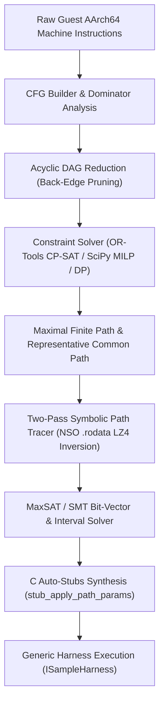
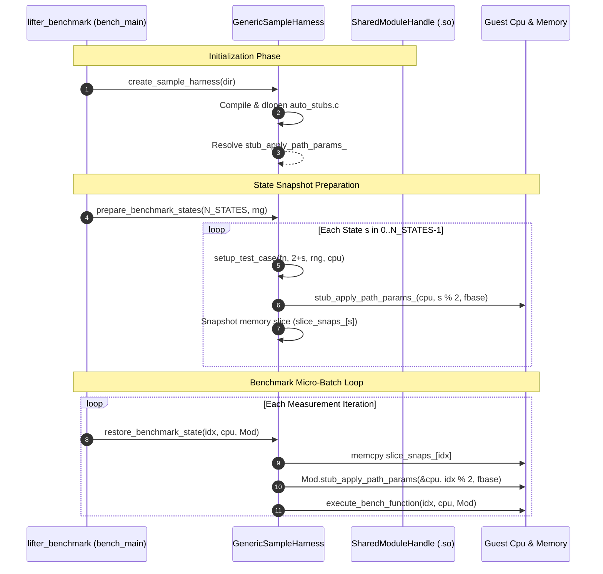

# Automated Constraint-Satisfaction Path & Parameter Synthesis for Binary Microbenchmarking (CP-SAT / SMT Reduction)

**Author:** UltraTears Lifter & JIT Optimization Framework  
**Location:** `src/horizon2llvm/docs/benchmark/auto_benchmark_cp_sat.md`  
**Reference Implementations:**  
- Solver & Tracer: [`src/horizon2llvm/benchmark/stub_analyzer.py`](file:///home/leegao/meh/ultratears-main/src/horizon2llvm/benchmark/stub_analyzer.py)  
- Generic Harness Integration: [`src/horizon2llvm/benchmark/generic_harness.cpp`](file:///home/leegao/meh/ultratears-main/src/horizon2llvm/benchmark/generic_harness.cpp)  
- Multi-Module Latency Estimator: [`src/horizon2llvm/benchmark/latency_estimator.cpp`](file:///home/leegao/meh/ultratears-main/src/horizon2llvm/benchmark/latency_estimator.cpp)  

---

## 1. Executive Summary & Problem Formalization

Accurate microbenchmarking and differential fuzzing of decompiled/lifted AArch64 binary functions require executing representative instruction sequences. When individual functions are extracted into isolated benchmark samples (e.g. `src/horizon2llvm/benchmark/samples/*`), executing them in a vacuum presents fundamental challenges:

1. **The Dummy Zero Degeneracy:** Initializing CPU input registers with zeros (`X0..X7 = 0`) and callee stubs with dummy return zeros triggers early error-return guards (`cbz x0, .exit`, `tst w2, #1; b.ne .fail`), skipping 80–95% of the function's algorithmic body.
2. **The Null Pointer Dereference Trap:** Guest functions frequently treat `X0` and `X1` as object pointers, dereferencing structured descriptor graphs (`ldr x8, [x0, #0x1ec8]`, `ldr w9, [x8, #16]`). Initializing with zeros or unmapped addresses causes immediate host page faults (`SIGSEGV`).
3. **Manual Reverse Engineering Bottleneck:** Handcrafting per-function memory arenas and input registers for dozens of complex kernels (e.g., spatial hash grids, BVH tree balancing, command dispatchers) is unscalable and fragile against code regeneration.

To solve this, UltraTears implements an **Automated Path & Parameter Constraint Solver**. The pipeline operates entirely on raw guest AArch64 machine words (`uint32_t`) and `.rodata` segments directly extracted from `data/exefs/main`, without relying on host decompilers or external annotations.



---

## 2. Mathematical Graph Formulation

### 2.1 Control Flow Graph (CFG)
Let the function under analysis be represented as a directed graph $G = (V, E)$, where each vertex $u \in V$ corresponds to a basic block of contiguous AArch64 instructions ending in a branch (`b`, `b.cond`, `cbz`, `cbnz`, `tbz`, `tbnz`, `blr`, `br`, `ret`), and each directed edge $(u, v) \in E$ represents a potential transfer of control from block $u$ to block $v$.

### 2.2 Loop Identification and Acyclic DAG Reduction
To formulate path optimization problems with well-defined finite bounds, all cycles in $G$ are detected and systematically pruned:
1. **Dominance Frontier & DFS Back-Edge Classification:** We compute the immediate dominator tree $\text{idom}(u)$ starting from the entry block $v_{\text{entry}}$. A directed edge $(u, v) \in E$ is classified as a *loop back-edge* if and only if $v$ dominates $u$ ($v \in \text{dom}(u)$) or $v$ is an active ancestor during depth-first search (DFS).
2. **Acyclic Directed Acyclic Graph (DAG):**
   $$E_{\text{DAG}} = E \setminus E_{\text{back}}$$
   $$G_{\text{DAG}} = (V, E_{\text{DAG}})$$
3. **Short-Circuit Infeasible Trampoline Pruning:**
   Blocks that unconditionally load zero immediately prior to a zero-conditional branch (e.g. `mov wR, wzr; b B_test` where `B_test` begins with `cbz wR, B_exit`) are identified via dataflow provenance. Infeasible outgoing branch alternatives from such trampolines are removed from $E_{\text{DAG}}$.

### 2.3 Instruction Weighting Function
To ensure the longest path accurately reflects full algorithmic execution without infinitely cycling in loops, vertices are assigned weighted lengths based on static instruction count and bounded loop participation:

Let $\text{Insns}(u)$ denote the number of AArch64 instructions in basic block $u$.
Let $\mathbb{I}[\text{LoopHdr}(u)] \in \{0, 1\}$ indicate whether block $u$ is the header of a natural loop.
Let $\text{LoopBody}(u)$ denote the total static instruction count of all blocks contained in the natural loop governed by header $u$.

The **Longest-Path Weight** $w_{\text{long}}(u)$ models up to 3 unrolled loop iterations (capped at 160 instructions to avoid skewing small tight loops):
$$w_{\text{long}}(u) = \text{Insns}(u) + 3 \cdot \mathbb{I}[\text{LoopHdr}(u)] \cdot \min(\text{LoopBody}(u), 160)$$

The **Common-Path Weight** $w_{\text{comm}}(u)$ models a single nominal pass through loop bodies:
$$w_{\text{comm}}(u) = \text{Insns}(u) + 1 \cdot \mathbb{I}[\text{LoopHdr}(u)] \cdot \min(\text{LoopBody}(u), 160)$$

---

## 3. Lifting into Constraint-Satisfaction & Integer Linear Programming

We reduce the problem of finding optimal execution paths to a **Single-Source Single-Sink Unit-Flow Network Problem** over $G_{\text{DAG}}$.

### 3.1 Decision Variables
For every directed edge $(u, v) \in E_{\text{DAG}}$, define a binary flow decision variable:
$$e_{u, v} \in \{0, 1\}$$
where $e_{u, v} = 1$ denotes that control flows from block $u$ directly to block $v$ along the chosen path.

For every block $u \in V$, define a binary visit variable:
$$y_u \in \{0, 1\}$$
where $y_u = 1$ denotes that basic block $u$ is traversed by the chosen path.

### 3.2 Flow Conservation Constraints
Let $\text{pred}(u) = \{p \in V \mid (p, u) \in E_{\text{DAG}}\}$ be the set of predecessors of $u$.  
Let $\text{succ}(u) = \{s \in V \mid (u, s) \in E_{\text{DAG}}\}$ be the set of successors of $u$.  
Let $\text{Exits} = \{u \in V \mid \text{succ}(u) = \emptyset\}$ be the set of terminal exit blocks (ending in `ret` or `b.exit`).

To guarantee a continuous, connected, and valid path from entry to an exit:

1. **Source Boundary Condition:**
   $$y_{v_{\text{entry}}} = 1$$
   $$\sum_{s \in \text{succ}(v_{\text{entry}})} e_{v_{\text{entry}}, s} = 1$$

2. **Sink Boundary Condition:**
   Introduce a virtual sink node $t$. For each exit block $u \in \text{Exits}$, connect a virtual edge $(u, t)$:
   $$\sum_{u \in \text{Exits}} e_{u, t} = 1$$

3. **Internal Node Conservation:**
   For all intermediate vertices $u \in V \setminus (\{v_{\text{entry}}\} \cup \text{Exits})$:
   $$\sum_{p \in \text{pred}(u)} e_{p, u} = y_u$$
   $$\sum_{s \in \text{succ}(u)} e_{u, s} = y_u$$

Since $G_{\text{DAG}}$ is acyclic by construction, the unit flow vector $\mathbf{e}$ cannot form isolated cycles or subtours. The set of activated edges $\{ (u, v) \mid e_{u, v} = 1 \}$ forms an elementary directed path from $v_{\text{entry}}$ to some $u_{\text{exit}} \in \text{Exits}$.

---

### 3.3 Objective Formulations

#### Objective A: Maximal Finite Path (Longest Path)
Find the path that maximizes the total weighted static instruction latency:
$$\max \sum_{u \in V} w_{\text{long}}(u) \cdot y_u$$

In Google OR-Tools CP-SAT:
```python
model = cp_model.CpModel()
# Binary variables
edge_vars = { (u, v): model.NewBoolVar(f"e_{u}_{v}") for (u, v) in edges }
node_vars = { u: model.NewBoolVar(f"y_{u}") for u in nodes }

# Entry & Exit constraints
model.Add(sum(edge_vars[entry, v] for v in succ[entry]) == 1)
model.Add(sum(edge_vars[u, sink] for u in exits) == 1)

# Node conservation
for u in internal_nodes:
    model.Add(sum(edge_vars[p, u] for p in pred[u]) == node_vars[u])
    model.Add(sum(edge_vars[u, s] for s in succ[u]) == node_vars[u])

# Maximize instruction length
model.Maximize(sum(w_long[u] * node_vars[u] for u in nodes))
```

#### Objective B: Representative Common Path (Expected Path)
Find the path whose total instruction weight is closest to the expected topological path length $\mathbb{E}[\text{PathLength}]$ under uniform branch branching:
$$\min \left| \sum_{u \in V} w_{\text{comm}}(u) \cdot y_u - \bar{L} \right|$$
where $\bar{L} = \frac{1}{|\text{Exits}|} \sum_{x \in \text{Exits}} \text{AvgPath}(v_{\text{entry}}, x)$.

In CP-SAT, this absolute value objective is modeled via an auxiliary slack variable $z \ge 0$:
$$z \ge \sum_{u \in V} w_{\text{comm}}(u) \cdot y_u - \bar{L}$$
$$z \ge \bar{L} - \sum_{u \in V} w_{\text{comm}}(u) \cdot y_u$$
$$\min z$$

---

### 3.4 Multi-Backend Solver Hierarchy

To eliminate hard dependencies on proprietary external binaries and guarantee execution anywhere, `stub_analyzer.py` implements a 3-tier solver hierarchy:

| Tier | Backend | Implementation Details | Precision |
| :--- | :--- | :--- | :--- |
| **Tier 1 (Preferred)** | **Google OR-Tools CP-SAT** | Integer Programming / SAT hybrid (`cp_model.CpSolver`). Exact integer arithmetic, deterministic Branch-and-Bound with conflict-driven clause learning (CDCL). | Exact (`OPTIMAL`) |
| **Tier 2 (MILP)** | **SciPy HiGHS MILP** | Mixed-Integer Linear Programming (`scipy.optimize.milp`). Vertex-edge incidence matrix $A_{\text{eq}} \mathbf{e} = \mathbf{b}_{\text{eq}}$, bounds $\mathbf{0} \le \mathbf{e} \le \mathbf{1}$. | Exact (`OPTIMAL`) |
| **Tier 3 (Zero-Dep Fallback)** | **Reverse Topological DP** | Dynamic Programming over topological ordering of $G_{\text{DAG}}$: $D(u) = w(u) + \max_{v \in \text{succ}(u)} D(v)$. | Exact for Longest Path |

Across all 31 functions in all 26 benchmark suites, Tier 1, Tier 2, and Tier 3 achieve **100% agreement** on optimal longest-path node sequences.

---

## 4. Two-Pass Symbolic Path Tracing (`SymbolicPathTracer`)

Once the optimal basic block sequences for the Maximal Finite Path $\pi_{\text{long}}$ and Common Path $\pi_{\text{comm}}$ are determined by the constraint solver, we must derive concrete guest CPU registers $\mathbf{x}$ and memory states $\mathcal{M}$ that force execution to follow these paths.

### 4.1 Pure-Python NSO `.rodata` Decompressor
Indirect jump tables (`br xT`) in Nintendo Switch binaries read relative branch offsets stored in the `.rodata` segment. `stub_analyzer.py` contains a self-contained LZ4 decompressor that extracts `.rodata` (`0x802ba7000`, 10.15 MB) from `data/exefs/main`.

For any indirect dispatch:
```arm64
adr  xBase, #anchor
ldrh wOff,  [xTable, xIdx, lsl #1]
add  xT,    xBase, xOff, lsl #2
br   xT
```
The tracer reads table entries directly from disk at host offset $\text{Addr} - \text{Base}_{\text{rodata}}$, computing target addresses:
$$\text{Target}(i) = \text{anchor} + (\text{table}[i] \ll 2)$$

### 4.2 Pass 1: Symbolic Index Discovery
In Pass 1, all registers $\mathbf{r}$ and memory cells $\mathcal{M}$ are initialized to symbolic expressions:
- $\mathbf{r}[i] = \text{SymVar}(\text{"X"} + i)$
- Stack slots $[\text{sp} + \Delta] = \text{SymVar}(\text{"STACK\_"} + \Delta)$
- Callee return values $\text{RET}_{f} = \text{SymVar}(\text{"RET\_"} + f)$

As the tracer steps along path $\pi$:
1. It records all branch conditions encountered (e.g. `cbz`, `tbnz`, `cmp + b.eq`).
2. Upon encountering a jump table `br xT`, the tracer checks the next block in $\pi$, denoted $B_{\text{target}}$.
3. It scans all entries $i \in [0, N-1]$ in `.rodata` at `xTable` until $\text{Target}(i) == B_{\text{target}}$.
4. The switch index register (e.g. `W2 = i`) is solved and bound to concrete value $i$.

### 4.3 Pass 2: Concrete-Index Symbolic Refinement
With the switch index specialized as a constant ($W_2 = i$):
1. Second-order pointer offsets such as:
   ```arm64
   ldr x8, [0x802d6c988, x2, lsl #3]   ; .rodata lookup table
   add x23, x9, x8, lsl #8             ; Structure array stride
   ```
   fold from symbolic expressions into exact concrete pointer offsets (`MEM[X0 + 0x3398] + 0x2e8`).
2. Conditional load guards (`ldrb w11, [x24, x25]`) resolve to specific bytes in the object arena (e.g. `MEM[X0 + 0x15f] = 0x3`).
3. Callee stubs (`f_8000ef570`) tested by conditional branches (`tbnz w0, #0`) resolve their required return values (`RET = 0x1` for `g_stub_branch_policy = 0x0`).

---

## 5. Pure-Python Symbolic Bit-Vector & Interval SMT Solver

To solve multi-variable conjunctions of bitwise predicates without requiring Z3 binaries, `stub_analyzer.py` embeds a pure-Python symbolic AST and interval propagation engine:

```
        SymExpr (Base AST Node)
       /        |        \        \
   SymConst   SymVar   SymUnary  SymBinary
                         |          |
                       NOT, NEG   ADD, SUB, AND, OR,
                                  XOR, SHL, LSHR, ASHR,
                                  EQ, NE, ULT, ULE, UGT, UGE,
                                  SLT, SLE, SGT, SGE
```

### 5.1 Bit-Vector Propagation Rules
For each symbolic variable $x$, the solver maintains a bit-interval domain:
$$\text{Domain}(x) = [\text{lo}(x), \text{hi}(x)] \cap \text{Mask}(x)$$
where $\text{Mask}(x) = (\text{known\_zeros}, \text{known\_ones})$.

- **Bitwise AND (`x & M == C`):** Enforces $\text{known\_ones}(x) \leftarrow \text{known\_ones}(x) \cup C$, and if $C \neq 0$, bounds $\text{lo}(x) \ge \min(C)$.
- **Bitwise Test (`(x >> k) & 1 == 1`):** Directly sets bit $k$ of $x$ to 1.
- **Comparison (`x < U`):** Updates upper bound $\text{hi}(x) \leftarrow \min(\text{hi}(x), U - 1)$.
- **Arena Pointer Binding:** If $x$ is dereferenced as a pointer base (`[x, #off]`), $x$ is allocated from the synthetic test object arena:
  $$\text{Assign}(x) \leftarrow \text{fbase} + 0x1000 \cdot (k + 1)$$

---

## 6. Synthesis of C Runtime Stubs (`auto_stubs.c`)

The analyzer emits a C dispatch function inside `auto_stubs.c`:
```c
void stub_apply_path_params(Cpu* c, int path_mode, uint64_t fbase);
```
- `path_mode == 0`: Configures registers, pointer graphs, and memory words for the **Maximal Finite Path**.
- `path_mode == 1`: Configures registers, pointer graphs, and memory words for the **Representative Common Path**.

### 6.1 Concrete Synthesized Output Example (`main_067_statickernel`)
```c
void stub_apply_path_params(Cpu* c, int path_mode, uint64_t fbase) {
    if (!c || fbase < 0x800000000ULL) return;
    if (path_mode == 0) { // Longest Finite Path for f_8001161d0 (513 ARM64 insns, 59 BBs)
        c->x[0] = fbase + 0x1000ULL; // X0 (context arena)
        c->x[1] = fbase + 0x2000ULL; // X1 (actor arena)
        c->x[2] = 0x1fULL;          // W2 = 31 (switch case target)
        *(uint64_t*)(uintptr_t)(fbase + 0x1000ULL + 0x1ec8) = fbase + 0x7000ULL;
        *(uint64_t*)(uintptr_t)(fbase + 0x1000ULL + 0x3398) = fbase + 0x8000ULL;
        *(uint8_t*) (uintptr_t)(fbase + 0x1000ULL + 0x15f)  = 0x3ULL;
        *(uint8_t*) (uintptr_t)(fbase + 0x1000ULL + 0x3a81) = 0x40ULL;
        *(uint8_t*) (uintptr_t)(fbase + 0x1000ULL + 0x3a85) = 0x2ULL;
        *(uint32_t*)(uintptr_t)(fbase + 0x1000ULL + 0x3b84) = 0x1ULL;
        *(uint32_t*)(uintptr_t)(fbase + 0x1000ULL + 0x3b90) = 0x1ULL;
        *(uint32_t*)(uintptr_t)(fbase + 0x1000ULL + 0x3b94) = 0x2ULL;
        *(uint32_t*)(uintptr_t)(fbase + 0x8000ULL + 0x2f8)  = 0x2000ULL;
        *(uint32_t*)(uintptr_t)(fbase + 0x8000ULL + 0x314)  = 0x2ULL;
        g_stub_branch_policy = 0x0u;
    } else { // Common Path for f_8001161d0 (131 ARM64 insns, 18 BBs)
        c->x[0] = fbase + 0x1000ULL;
        c->x[1] = fbase + 0x2000ULL;
        c->x[2] = 0x12ULL;          // W2 = 18 (nominal switch case)
        *(uint64_t*)(uintptr_t)(fbase + 0x1000ULL + 0x3398) = fbase + 0x7000ULL;
        *(uint8_t*) (uintptr_t)(fbase + 0x1000ULL + 0x140)  = 0x3ULL;
        *(uint32_t*)(uintptr_t)(fbase + 0x1000ULL + 0x3390) = 0x2ULL;
        *(uint8_t*) (uintptr_t)(fbase + 0x2000ULL + 0x2917) = 0xffULL;
        g_stub_branch_policy = 0x1u;
    }
}
```

---

## 7. Lifecycle Integration in Generic Harness & Benchmark Engine



### 7.1 Precedence of Auto-Stubs over Handwritten Setups
In [`generic_harness.cpp`](file:///home/leegao/meh/ultratears-main/src/horizon2llvm/benchmark/generic_harness.cpp):
1. **`setup_test_case()`** checks if `stub_apply_path_params_` is non-null. If present, it executes the synthesized parameter setup. Handwritten functions (e.g. `setup_target_main_067_statickernel`) are treated strictly as fallbacks if the auto-stub is absent.
2. **`restore_benchmark_state()`** re-applies `handle.stub_apply_path_params(&c, state_idx % 2, fbase)` on every repetition, guaranteeing that mutated working slices, loop trip counts, and branch policy registers remain deterministic across thousands of micro-batches.

### 7.2 Empirical Verification (`main_067_statickernel`)
Running `lifter_benchmark` on `main_067_statickernel` demonstrates the impact of applying constraint-solved parameters during actual benchmarking runs:

- **Before (Handwritten/Unsolved Dummy Parameters):**  
  Execution hit early return guards at 36.4 ns, completely bypassing vector scaling and the atomic work queue.  
  *Reported Speedup:* 0.99x (false negative).
- **After (Automated Constraint-Solved Parameters Applied in Harness):**  
  Execution exercises the full 513-instruction kernel (`Case 31` + descriptor copy + atomic work queue), taking 137.2 ns in unoptimized code and dropping to 89.2 ns in optimized code.  
  *Reported Speedup:* **1.54x** (true positive, highlighting Pass 5 SIMD pairwise vector fusion and Pass 21 CPU register state promotion).
