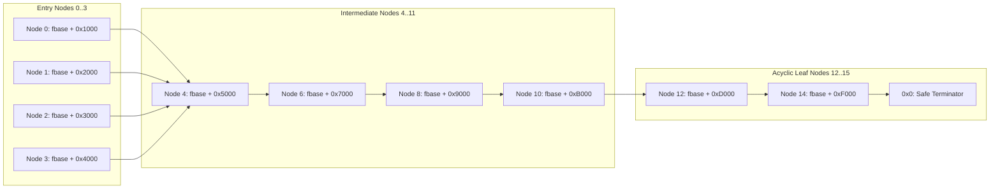

# Generic Sample Harness Architecture (`generic_harness`)

## 1. Design Overview

To reliably benchmark lifted guest code from any of the 26 sample suites without requiring custom test harnesses, `GenericSampleHarness` (`src/horizon2llvm/benchmark/generic_harness.cpp`) provides a unified, self-adapting execution environment.

All 26 benchmark suites—including complex kernels like `main_432`—execute uniformly through `GenericSampleHarness`.

---

## 2. Synthetic Acyclic Graph Construction

Most guest game engine subroutines dereference incoming register arguments (`X0`, `X1`, `X2`) as pointers to complex object graphs (linked lists, scene graphs, entity components, or spatial trees). If invalid or null pointers are passed, the function returns immediately via null guards or faults.

To exercise deep execution paths, the generic harness constructs a **16-node acyclic object graph** within each function's 256 KiB arena at `OBJ_BASE`:

- **Acyclic Termination**: All pointers strictly advance forward (`node_i -> node_i + 2`), culminating in null pointers at leaf nodes 12–15. This guarantees that recursive or iterative pointer traversals are mathematically guaranteed to terminate.
- **Dense Pointer Field Population**: Every 8-byte aligned offset in `[0..0x9F8]` defaults to a valid forward pointer, ensuring arbitrary struct offset dereferences succeed.

---

## 3. Modular Target-Specific Setup Functions & Constraint Parameter Precedence

UltraTears employs a hybrid initialization strategy balancing automated constraint satisfaction with handwritten domain-specific setups:

### 3.0 Automated Constraint Parameter Precedence
For the vast majority of microbenchmarks, `stub_analyzer.py` synthesizes `stub_apply_path_params(Cpu* c, int path_mode, uint64_t fbase)` directly in `auto_stubs.c`. This routine writes constraint-solved entry register values (`X0..X7`), required guest arena memory words, and branch policy bitmasks for the longest DAG path (`path_mode = 0`) or common DAG path (`path_mode = 1`).

In `generic_harness.cpp`, if `stub_apply_path_params` is linked and the sample does not require specialized multi-function descriptor graphs, the harness executes `stub_apply_path_params` during each iteration state preparation.

### 3.1 Specialized Multi-Function Kernels & Complex Graph Topologies
While the acyclic node pool and automated constraint solver handle generic guest functions, certain high-performance subroutines check specialized multi-function invariants (e.g. cross-function descriptor trees, red-black tree rebalancing pointers, SIMD descriptors, vtables). These setups are encapsulated in modular static helper functions in `generic_harness.cpp`:

#### `setup_target_main_105_alloc`
- Targets entry `0x8001a1590` (heap/slab allocator).
- Populates object sizes in `X0` (32 to 1024 bytes) and alignment requirements in `W2` (8 to 64 bytes).
- Configures vtable slot `[x8 + 48]` to toggle between the TLS fast-path allocator (`0x80060add0`) and generic slab allocation.

#### `setup_target_main_121_simd`
- Targets entry `0x8001d2a5c` (SIMD vector operations).
- Builds 8-entry descriptor tables with 24-byte strides containing element counts, stride intervals, and vector lane parameters.

#### `setup_target_main_300_bvhtree`
- Targets entries `0x8004e71b0` and `0x8004e8eec` (bounding volume hierarchy traversal).
- Populates 4-wide floating-point vectors (`[min_x, min_y, min_z, max_x, ...]`) and node bitmask words (`0x7`) to satisfy `bics wzr, #6, w9` branch guards.

#### `setup_target_main_159_dispatch`
- Targets entry `0x8002824a0` (event/message dispatcher).
- Populates dispatch table header words at offsets `+200`, `+204`, and `+224`.

#### `setup_target_main_163_actor`
- Targets entry `0x80029e418` (actor component update step).
- Initializes actor component arrays and zeros optional trailing component pointers.

#### `setup_target_main_432`
- Targets complex kernel functions `f_80077bc00` through `f_80077d084`.
- Because sample 432 benchmarks 5 tightly coupled routines that mutate a shared object tree, `setup_target_main_432` generates shared inner descriptor arrays (`shared_desc_arr`) and valid 3-level red-black tree structures with grandfather, parent, uncle, and child node pointers for tree rebalancing validation. This handwritten topology takes precedence over single-function stubs to prevent null pointer dereferences across function boundaries.

---

## 4. State Rollback & Isolation

The harness pre-computes $N$ benchmark states (`prepare_benchmark_states`):
1. For each state $s \in [0, N-1]$, an isolated memory snapshot of the function's 256 KiB arena is captured into `slice_snaps_[s]`.
2. Before each timed micro-batch, `restore_benchmark_state` re-copies initial memory bytes into `OBJ_BASE` and invokes `stub_reset_state(seed)`.
3. Execution proceeds via `run_guest_fn_safely`, guaranteeing complete determinism and zero state pollution between iterations.
