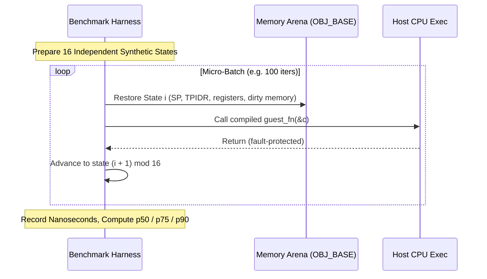

# Microarchitectural Latency Estimator & Empirical Timing Architecture

## 1. Overview

Accurate performance measurement of JIT-lifted code requires both:
1. **Static Microarchitectural Estimation**: An analytical cost model evaluating the cycle cost of emitted host x86-64 instructions along the predicted execution path; and
2. **Empirical Nanosecond Timing**: Sub-nanosecond wall-clock execution benchmarks under rotating cache states and realistic memory topologies.

The **Latency Estimator** (`src/horizon2llvm/benchmark/latency_estimator.cpp`) integrates both disciplines to quantify optimization gains across all 23 compiler lowering layers.

---

## 2. Static Microarchitectural Cost Model

The static latency model evaluates compiled host x86-64 machine code by traversing basic blocks and mapping instruction opcodes to modern x86-64 microarchitectural latencies (Golden Cove / Zen 4 baseline):

| Instruction Category | Typical Opcodes | Est. Latency (Cycles) | Port Execution Throughput |
| :--- | :--- | ---: | :--- |
| Simple ALU | `add`, `sub`, `and`, `or`, `xor`, `mov` | 1 | 4–6 per cycle (Ports 0, 1, 5, 6) |
| Complex ALU / Shifts | `shl`, `shr`, `sar`, `ror`, `lea` | 1–3 | 2 per cycle |
| Integer Multiply | `imul` | 3–4 | 1 per cycle (Port 1) |
| Vector ALU (AVX2/AVX-512) | `vpaddd`, `vpxor`, `vpblendd` | 1 | 2–3 per cycle (Ports 0, 1, 5) |
| Vector Multiply / FMA | `vpmulld`, `vfmadd213ps` | 4 | 2 per cycle (Ports 0, 1) |
| Memory Load (L1d hit) | `mov reg, [mem]`, `vmovdqu` | 4–5 | 2–3 per cycle (Ports 2, 3, 7) |
| Memory Store | `mov [mem], reg` | 1 (retire) | 1–2 per cycle (Ports 4, 9) |
| Conditional Branch | `jcc`, `cmovcc` | 1 (predicted) | 2 per cycle |
| Branch Mispredict Penalty | Pipeline flush | ~15 | N/A |
| Atomic RMW / Spinwait | `lock cmpxchg`, `pause` | 18–140 | Serialized |

The total static path latency estimate $\mathcal{L}_{\text{static}}$ is summed along the critical execution path:
$$\mathcal{L}_{\text{static}} = \sum_{i \in \text{Path}} \text{InsnLatency}(i)$$

---

## 3. Empirical Measurement & Lockstep Rotating Micro-Batches

Microbenchmarks often suffer from synthetic artifacts such as branch predictor over-training, constant cache hits, or loop counter amortization. UltraTears uses **Lockstep Rotating Micro-Batches**:

### 3.1 Rotating State Pool
- A pool of 16 self-consistent, independent CPU states and object graphs is pre-synthesized.
- Each successive execution iteration switches to the next state index `(iter + 1) % 16`.
- This ensures varying branch inputs, non-identical register arguments, and rotating cache line access, preventing single-input branch predictor memorization.

### 3.2 State Restoration
Between batch iterations, `restore_benchmark_state` resets:
1. `Cpu` state (general-purpose registers `x0..x30`, vector registers `v0..v31`, stack pointer `sp`, and `nzcv`).
2. Slices of dirty guest memory in `OBJ_BASE` that may have been mutated by previous iterations.
3. Stub allocation pointer (`g_stub_heap_ptr`) and branch iteration counters.

### 3.3 Percentile Latency Metrics (`p50 / p75 / p90`)
After discarding initial cold-cache warmup iterations, raw timings are gathered across multiple batches and sorted:
- **`p50` (Median)**: Represents the steady-state hot-path execution latency.
- **`p75`**: Captures latency under moderate pipeline disturbances.
- **`p90` (Tail Latency)**: Reflects cache line invalidations, branch mispredictions, or host thread context switches.
