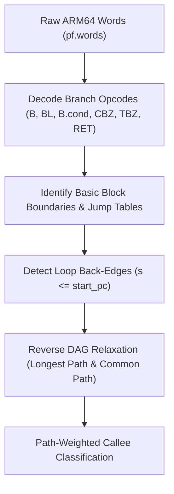

# Automated External Callee & Branch Sensitivity Analyzer (`stub_analyzer`)

## 1. Motivation & Problem Statement

Extracted benchmark samples contain calls to external functions (e.g. game engine subroutines, memory allocators, Horizon OS HLE services). In traditional microbenchmarking, external calls are either:
1. Stubbed with dummy no-ops that return 0, which often leads to immediate null-pointer dereferences or early error return branches that skip the benchmarked function's core body; or
2. Manually written per sample, which is unscalable across dozens of benchmark suites.

The UltraTears **Stub Analyzer** (`src/horizon2llvm/benchmark/stub_analyzer.py`) automatically analyzes caller call-sites in guest ARM64 code, determines how external return values (`X0`) are utilized, solves for the longest static execution path, and synthesizes self-contained C runtime stubs (`auto_stubs.c`).

---

## 2. Guest ARM64 CFG Reconstruction & Longest-Path Solver

Rather than analyzing host x86-64 code (which lacks guest register mappings and varies between compiler layers), the analyzer operates directly on raw disassembled AArch64 machine instructions (`pf.words`):



### 2.1 Branch Decoding
Named instruction masks and decoders identify control-flow transitions:
- `is_arm64_b`: Unconditional relative branch (`imm26`).
- `is_arm64_bl`: Subroutine call (`imm26`).
- `is_arm64_bcond`: Conditional branch (`imm19`, condition code `cond`).
- `is_arm64_cbz_cbnz`: Zero comparison branch on register `Rt`.
- `is_arm64_tbz_tbnz`: Bit-test branch on bit position `[0..63]` of `Rt`.
- `is_arm64_ret`: Subroutine return (`ret x30`).
- `is_arm64_br`: Indirect branch through register (resolved via parsed jump table metadata).

### 2.2 Path Length Formulation & Iterative Fixed-Point Solver

The remaining static instruction length of each basic block $B$ is solved via **iterative fixed-point relaxation** over the reverse-topological DAG edges until convergence:

$$\text{LongestPath}(B) = \text{Len}(B) + \text{LoopBonus}(B) + \max_{S \in \text{succ}(B), S > B} \text{LongestPath}(S)$$

$$\text{CommonPath}(B) = \text{Len}(B) + \frac{1}{|\text{succ}(B)|} \sum_{S \in \text{succ}(B), S > B} \text{CommonPath}(S)$$

Where:
- For loop headers, $\text{LoopBonus}_{\text{longest}}(B) = \min(\text{LoopSpan}, 160) \times 3$ iterations.
- For common paths, $\text{LoopBonus}_{\text{common}}(B) = \min(\text{LoopSpan}, 160) \times 1$ iteration.

**Fixed-Point Worklist Iteration**:
Blocks are iterated in reverse address order (`blocks.rbegin()` to `blocks.rend()`). The solver tracks a dirty flag `changed`:
```cpp
bool changed = true;
for (int pass = 0; pass < 32 && changed; ++pass) {
    changed = false;
    for (auto it = blocks.rbegin(); it != blocks.rend(); ++it) {
        // compute new_longest and new_common
        if (new_longest != bi.longest || new_common != bi.common) {
            bi.longest = new_longest;
            bi.common = new_common;
            changed = true;
        }
    }
}
```
For acyclic subgraphs, the solver terminates in 1 pass. For arbitrary complex loop bodies, convergence is reached within 2–4 passes.

---

## 3. Unified Python Implementation (Single Source of Truth)

The stub and CFG analyzer is implemented as a single, unified Python tool (`src/horizon2llvm/benchmark/stub_analyzer.py`):
- **Readability & Mnemonic Parsing**:
  Rather than raw 32-bit machine opcode bitmasking, Python parses the human-readable disassembled reference assembly (`sample_arm64.asm`) directly using standard ARM64 mnemonics (`bl f_...`, `cbz x0, ...`, `tbz x0, ...`, `ret`).
- **Unified Artifact Generation**:
  For each sample, `stub_analyzer.py` automatically synthesizes:
  1. `auto_stubs.c`: Compilable C stubs handling pointer bump allocations, branch policies, and loop bounds.
  2. `STUB_ANALYSIS.md`: Rich documentation including Mermaid `flowchart TD` diagrams for each reconstructed function CFG.
  3. `stub_analysis.json`: Machine-readable CFG complexity and callee classification metadata ingested directly by `GenericSampleHarness` in C++.
- **Performance**:
  Running ahead of time during benchmark bringup, Python processes each sample suite in $< 0.1\,\text{s}$, completely eliminating duplicate C++ analysis code while keeping a strict single source of truth.

---

## 4. Callee Stub Classification (`StubKind`)

By tracking register aliases of `X0` (propagated through `mov Rd, Rm`) up to 10 instructions past the `bl` call site, callees are classified into three categories:

| Classification | Detection Heuristic | Synthesized Stub Action |
| :--- | :--- | :--- |
| `ConstantZero` | `X0` is neither branch-tested nor dereferenced before being overwritten. | Returns `0ULL`. |
| `PointerAllocator` | `X0` is used as base pointer `[X0, #off]` or matches known heap allocators (`f_800079d20`, `f_8001a1590`, `f_8001a6c10`). | Calls `guest_alloc(req_sz)` to bump-allocate from `HEAP_BASE`. |
| `BranchSensitive` | `X0` is tested by `CBZ`, `CBNZ`, `TBZ`, `TBNZ`, or `CMP/SUBS` immediately following the call. | Evaluates `longest_path_ret` vs `alt_branch_ret` controlled by policy bitmask. |

---

## 4. Combinatorial Policy Bitmask & Infinite Loop Safeguard

### 4.1 Combinatorial Branch Exploration
Each `BranchSensitive` callee is assigned a unique bit index `policy_bit` $\in [0, 31]$. When testing:
```c
uint32_t bit_mask = (1u << sc.policy_bit);
c->x[0] = (g_stub_branch_policy & bit_mask) ? sc.alt_branch_ret : sc.longest_path_ret;
```
- In default benchmark mode (`policy = 0`), the stub returns `longest_path_ret`, forcing execution down the deepest basic-block sequence to maximize code coverage.
- In fuzzing/coverage mode, flipping bit `policy_bit` returns `alt_branch_ret`, immediately exercising error handling and alternative paths.

### 4.2 Bounded Loop Execution ($\le 100$ Iterations)
If an external callee's return value is used as a loop termination condition (e.g. `while (poll_service())`), returning `longest_path_ret` unconditionally could cause the compiled function to loop indefinitely.

To prevent infinite loops, every synthesized `BranchSensitive` stub maintains a call counter:
```c
static uint32_t s_loop_bound_<sym> = 0;
void <sym>(Cpu* c) {
    clobber_caller_saved(c, ...);
    if (++s_loop_bound_<sym> > 100) {
        c->x[0] = 0x<alt_branch_ret>ULL; // Force loop exit
        return;
    }
    c->x[0] = (g_stub_branch_policy & bit_mask) ? 0x<alt_branch_ret>ULL : 0x<longest_path_ret>ULL;
}
```
All loop counters are cleanly reset to zero in `stub_reset_state(seed)`.
