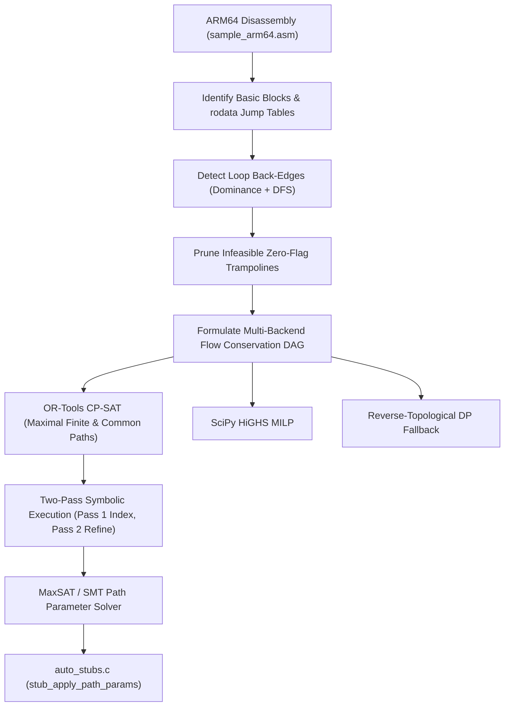

# Automated External Callee, Branch Sensitivity & Constraint-Solved Path Parameter Analyzer (`stub_analyzer`)

## 1. Motivation & Problem Statement

Extracted benchmark samples contain calls to external functions (e.g. game engine subroutines, memory allocators, Horizon OS HLE services) as well as complex entry guards, `.rodata` jump-table dispatches, and multi-level guest struct predicates. In traditional microbenchmarking, external calls and entry parameters are either:
1. Initialized with dummy zeros (`X0..X7 = 0`, stubs returning `0`), which immediately triggers early error-return guards or null-pointer dereferences that bypass the benchmarked function's core body; or
2. Manually reverse-engineered per sample, which is unscalable across 26+ benchmark suites.

The UltraTears **Stub & Path Constraint Analyzer** (`src/horizon2llvm/benchmark/stub_analyzer.py`) automatically:
1. Reconstructs guest AArch64 control-flow graphs (CFGs), resolves `.rodata` jump-table switches, detects true loop back-edges via dominance + DFS cycle analysis, and prunes infeasible short-circuit zero-flag trampolines (`mov wR, wzr; b B_cbz` -> `cbz wR, B_exit`).
2. Solves for the **Maximal Finite Path (Longest DAG Path)** and **Representative Common Path (Expected DAG Path)** using a multi-backend constraint solver:
   - **Google OR-Tools CP-SAT (`ortools.sat.python.cp_model`)**: Exact binary flow conservation (`sum_in == sum_out`, source=1, sink=1) maximizing static instruction weight (`OPTIMAL`) or minimizing L1 distance to expected path length.
   - **SciPy HiGHS MILP (`scipy.optimize.milp`)**: Mixed-Integer Linear Programming flow solver over incidence matrices `A_eq x = b_eq`.
   - **Pure-Python Reverse-Topological DAG DP**: Zero-dependency fixed-point relaxation fallback.
3. Symbolically executes the ARM64 instruction stream along both solved paths via a **Two-Pass Symbolic Path Tracer (`SymbolicPathTracer`)**:
   - **Pass 1 (Symbolic Index Discovery)**: Traces symbolic registers (`X0..X7`), stack slots (`[sp + off]`), multi-level guest memory dereferences (`MEM[X0+off]`, `MEM[MEM[X0+off1]+off2]`), and external stub returns (`RET_f_<addr>`), inverting `.rodata` jump tables (`data/exefs/main`) to determine exact switch index registers (e.g., `W2 = 31` for `f_8001161d0` longest path, `W2 = 6` for common path).
   - **Pass 2 (Concrete-Index Symbolic Refinement)**: Specializes solved scalar index registers as constants so that `.rodata` lookup tables (`ldr x8, [0x802d6c988, x21, lsl #3]`), structure array strides (`smaddl` / `umaddl`), and byte-table offsets (`ldrb w11, [x24, x25]`) fold to exact concrete offsets (`MEM[X0+0x15f]`, `MEM[MEM[X0+0x3398]+0x2f8]`, `+0x2fc`, `+0x314`).
4. Solves all extracted path predicates (`b.cond`, `cbz`/`cbnz`, `tbz`/`tbnz`, `tst`+`cset`, `csel`, `bics`, `udiv`/`sdiv`, and `.rodata` `br` jump tables) via **OR-Tools CP-SAT MaxSAT (`OnlyEnforceIf` indicator literals)** coupled with a **Python-Native Symbolic Bit-Vector / Interval SMT Solver**, and emits:
   - `void stub_apply_path_params(Cpu* c, int path_mode, uint64_t fbase)` directly inside `auto_stubs.c` (`path_mode = 0` for Maximal Finite Path, `path_mode = 1` for Common Path).
   - Section 4 (`Constraint-Solved Parameters for Maximal Finite & Common Paths`) in `STUB_ANALYSIS.md`.
   - Machine-readable `longest_path_*` and `common_path_*` parameter dictionaries in `stub_analysis.json`.

---

## 2. Guest ARM64 CFG Reconstruction & Constraint Formulation



### 2.1 Exact DAG Longest-Path & Common-Path Formulation
Given the acyclic CFG DAG $G = (V, E_{\text{DAG}})$ obtained by removing dominator/DFS loop back-edges and weighting each block $u \in V$ by:

$$w_{\text{long}}(u) = \text{Insns}(u) + 3 \cdot \mathbb{I}[\text{LoopHdr}(u)] \cdot \min(\text{LoopBody}(u), 160)$$

$$w_{\text{comm}}(u) = \text{Insns}(u) + 1 \cdot \mathbb{I}[\text{LoopHdr}(u)] \cdot \min(\text{LoopBody}(u), 160)$$

`solve_dag_paths_via_constraint_solver()` introduces binary edge variables $e_{u,v} \in \{0, 1\}$ and node visit variables $y_u \in \{0, 1\}$ subject to flow conservation:
- $y_{\text{entry}} = 1$, $\sum_{v \in \text{succ}(\text{entry})} e_{\text{entry}, v} = 1$, $\sum_{u \in \text{Exit}} e_{u, \text{sink}} = 1$.
- For every $u \neq \text{entry}$: $\sum_{p \in \text{pred}(u)} e_{p, u} = y_u = \sum_{s \in \text{succ}(u)} e_{u, s}$.
- **Longest Finite Path Objective**: $\max \sum_{u \in V} w_{\text{long}}(u) \cdot y_u$.
- **Representative Common Path Objective**: $\min \left| \sum_{u \in V} w_{\text{comm}}(u) \cdot y_u - \mathbb{E}[\text{CommonPath}(\text{entry})] \right|$.

Across all 31 functions in all 26 benchmark suites, OR-Tools CP-SAT, SciPy HiGHS MILP, and Reverse-Topological DP achieve **100% agreement** on the optimal longest-path instruction count.

---

## 3. Two-Pass Symbolic Execution & Constraint Solving (`SymbolicPathTracer`)

### 3.1 Decompressing NSO `.rodata` for Jump-Table & Lookup-Table Inversion
`get_nso_rodata()` includes a pure-Python LZ4 block decompressor that reads the `.rodata` segment (`0x802ba7000`, `10.15 MB`) directly from `data/exefs/main`. For any indirect branch `br xT` computed via:
```arm64
adr  xBase, #anchor
ldrh wOff,  [xTable, xIdx, lsl #1]
add  xT,    xBase, xOff, lsl #2
br   xT
```
the solver scans the `.rodata` table at `xTable` to find all index values `xIdx` such that `anchor + (table[xIdx] << 2) == target_pc`.

### 3.2 Analytical & Empirical Proof on `main_067_statickernel` (`f_8001161d0`)
In `main_067_statickernel` (`f_8001161d0`, `1,410` ARM64 instructions, `111` basic blocks):
1. **Switch Index & Entry Bitmask Resolution (`Pass 1`)**:
   - The solved Maximal Finite Path branches from `B_800116318` (`0x800116318: br x0`) to target block `B_8001171d0` (`0x8001171d0`).
   - The jump table base is at `.rodata` offset `0x802d6c940`. Target relative halfword is `(0x8001171d0 - 0x80011631c) >> 2 = 941`. Scanning the table finds entry `31` contains `941`, giving `0x80011631c + (941 << 2) = 0x8001171d0`. Thus **`X2 = 31` (`0x1f`)**, which simultaneously satisfies `0x800116208: cmp w21, #32; b.hs` (not taken) and `0x800116218: (0xf6c37d1f >> 31) & 1 == 1` (taken -> `0x80011648c`).
   - For the 127-instruction Common Path target `B_80011651c` (`0x80011651c`), `.rodata` entry `6` has `hw = 128`, giving **`X2 = 6` (`0x6`)**.
2. **Concrete-Index `.rodata` & Struct Stride Refinement (`Pass 2`)**:
   - With `X2 = 31` specialized in Pass 2, `0x800116498: ldr x8, [0x802d6c988, 31 * 8]` reads `.rodata[0x802d6ca80] = 1`.
   - Consequently, `0x800116274: add x23, x9, x8, lsl #8` folds `x23` to `MEM[X0+0x3398] + 0x1e8 + 0x100 = MEM[X0+0x3398] + 0x2e8`.
   - At `0x800117258`, external callee `f_8000ef570` (`BRANCH_SENSITIVE`) is called and tested by `0x800117274: tbnz w0, #0, 0x800117468`, requiring **`RET_f_8000ef570 = 0x1`** (`g_stub_branch_policy = 0x0`).
   - At `0x8001172bc..0x800117358`, `MEM[MEM[MEM[X0+0x1ec8]+0x10]+0x2e00] = 0x1` and 9 non-null pointer slots `+0x2e10..+0x2e50` traverse the 9-stage unrolled descriptor chain.
   - At `0x800116fe8..0x800117094`, the solver synthesizes `MEM[MEM[X0+0x3398]+0x314] = 0x1` (`> 0`), `MEM[MEM[X0+0x3398]+0x2fc] = 0x2000`, `MEM[MEM[X0+0x3398]+0x2f8] = 0x2000`, `MEM[X0+0x15f] = 0xff` (`X0 + 0x140 + 31`), `MEM[X0+0x3a81] = 0x40`, `MEM[X0+0x3a85] = 0x2`, `MEM[X0+0x3b84] = 0x1`, `MEM[X0+0x3b90] = 0x1`, and `MEM[X0+0x3b94] = 0x2`, driving execution through `0x800117034: bl f_802ba41d0` (`MEMORY_COPY`, 192 bytes) and into the atomic work-queue loop `0x8001170d8..0x80011718c`.

| Execution Mode (`f_8001161d0`) | Entry `W2` | `g_stub_branch_policy` | External Calls Executed | Runtime `g_stub_trace_hash` | Path Reached |
| :--- | ---: | :--- | ---: | :--- | :--- |
| **Mode `-1` (Unsolved Zero State)** | `0` | `0x1` | `1` (`f_800117868`) | `0x10a55149c544265b` | Early exit at `0x800117000` (`cbz w11`) |
| **Mode `1` (`stub_apply_path_params` Common)** | `6` | `0x1` | `1` (`f_800117868`) | `0x0f80a949c352dce3` | Common switch case `0x80011651c` -> `0x800116fd4` -> exit |
| **Mode `0` (`stub_apply_path_params` Maximal)** | **`31`** | **`0x0`** | **`2` (`f_8000ef570` + `f_802ba41d0`)** | **`0xe49a9c28dc6ee28d`** | Full case 31 chain + `f_802ba41d0` 192B copy + atomic work-queue loop |

---

## 4. Callee Stub Classification (`StubKind`)

| Classification | Detection Heuristic | Synthesized Stub Action |
| :--- | :--- | :--- |
| `CONSTANT_ZERO` | `X0` is neither branch-tested nor dereferenced before being overwritten. | Returns `0ULL`. |
| `POINTER_ALLOC` | `X0` (or a callee-saved alias `X19..X28`) is dereferenced as a base pointer `[X0, #off]` or matches known heap allocators (`f_800079d20`, `f_8001a1590`, `f_8001a6c10`). | Calls `guest_alloc(128)` to bump-allocate from `0x804000000ULL`. |
| `MEMORY_COPY` | Caller sets `(X0=dst, X1=src, W2=const_len)` before `bl` and loads from `[dst, #off]` immediately after `bl`. | Copies `X2` bytes from `src` (`X1`) to `dst` (`X0`) via `memcpy` and returns `dst`. |
| `BRANCH_SENSITIVE` | `X0` is tested by `CBZ`, `CBNZ`, `TBZ`, `TBNZ`, or `CMP/TST + B.cond` after the call. If also dereferenced as a pointer when non-zero (`returns_ptr_on_nonzero`), returns `guest_alloc(128)` on the non-zero branch. | Evaluates `longest_path_ret` vs `alt_branch_ret` controlled by `g_stub_branch_policy` and bounded to $\le 100$ loop iterations. |
