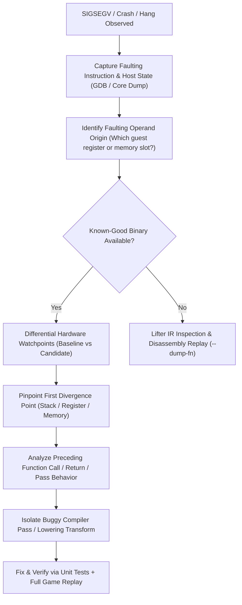

# Opaque Crash Debugging & Root-Cause Isolation Playbook

This document details practical, battle-tested methodologies for diagnosing and isolating low-level crashes, hangs, and state corruption in statically recompiled binary lifters (AArch64 → LLVM IR → x86-64) with minimal debugging information.

---

## 1. The Challenge of Debugging Statically Recompiled Code

In a static binary recompiler like UltraTears:
1. **Distant Crash Sites**: A register or stack slot corrupted during module startup (e.g., function 5,000) may not be dereferenced until function 150,000.
2. **Flattened Host Stack**: Due to tail-call devirtualization, leaf inlining, or dispatch trampolines, the host call stack (`bt` in GDB) often does not reflect the guest call tree.
3. **Optimized IR Obfuscation**: LLVM passes (`-O2`, mem2reg, SROA, GVN, DCE) fold and reorder instructions, making host assembly divergence non-obvious compared to original ARM64 disassemblies.
4. **Asynchronous/Multithreaded Noise**: Switch guest threads and Vulkan presentation threads run concurrently, obscuring single-threaded control flow.

---

## 2. Methodology & Diagnostic Workflow



---

## 3. Core Techniques Deployed

### A. Bracketing the Fault Site to an Exact Instruction

When a crash occurs without symbols or with ambiguous stack traces:

1. **Trap the Crash in GDB**:
   ```bash
   gdb -q -ex "handle SIG33 nostop noprint" -ex "run" -ex "bt" -ex "disas /r \$pc-32,\$pc+16" -ex "info registers" --args ./UltraTears
   ```
2. **Deconstruct the Host Fault**:
   ```assembly
   0x000055555627f1be: 48 8b 83 98 00 00 00    mov    0x98(%rbx),%rax
   0x000055555627f1c5: 48 89 48 08             mov    %rcx,0x8(%rax)  <-- FAULT
   ```
   - Identify `%rbx`: It holds the guest execution context `Cpu* c`.
   - Identify the offset: `0x98` in decimal is `152`. Since each 64-bit register is 8 bytes, $152 / 8 = 19$. Thus `%rax` was loaded directly from `c->x[19]`.
   - Identify the faulting address: Memory fault at `0x8` means `%rax + 8 = 0x8` $\implies$ `%rax == 0x0` (NULL dereference).
   - Conclusion: `c->x[19]` was corrupted to `0` prior to or inside `f_800bbe720`.

---

### B. Differential State Tracking (Known-Good vs Suspect Binary)

When a reference binary exists (e.g. `UltraTears_old` before a patch series), differential execution isolates divergence without guessing:

1. **Select the Divergent State**: We know `c->x[19]` is valid non-zero in `UltraTears_old` but `0` in `UltraTears`.
2. **Apply Hardware Watchpoints**:
   Hardware debug registers (`DR0`–`DR7` on x86) trigger traps precisely when memory is modified, with zero instrumentation overhead:
   ```gdb
   # Find address of c in gdb
   (gdb) break f_800bbe720
   (gdb) run
   (gdb) print/x c
   $1 = 0x7fffcc000a40
   # Set watchpoint on c->x[19]
   (gdb) watch *(uint64_t*)(0x7fffcc000a40 + 0x98)
   (gdb) rbreak ^f_
   ```
3. **Compare Write Locations**:
   Comparing the break sequence between old and new binaries immediately reveals where the written value diverged.
   In our case, both binaries wrote to `c->x[19]` at `f_80020f100`:
   ```assembly
   ldr x19, [sp, #64]
   ```
   - In Old: loaded `0x1030b009e8`.
   - In New: loaded `0x0000000000`.

---

### C. Stack Frame Differential & Pointer Arithmetic Invariants

Once a memory load produces unexpected content, check the pointer address itself:
- Is the memory corrupted, or is the pointer pointing to the wrong place?

```gdb
# In UltraTears_old at f_80020f100 entry:
(gdb) print/x c->sp
$1 = 0x101ffffae0

# In UltraTears at f_80020f100 entry:
(gdb) print/x c->sp
$2 = 0x101ffffa60
```

- **Delta**: `0x101ffffae0 - 0x101ffffa60 = 0x80` (128 bytes).
- This proves the stack contents were not overwritten; rather, `SP` itself was offset by exactly 128 bytes.
- Next step: Watch `c->sp` (`*(uint64_t*)(c + 0x100)`) between start of run and `f_80020f100`.
- The watchpoint fires in `f_80017c350` allocating `sub sp, sp, 128`, but the corresponding `add sp, sp, 128` never executes on exit.

---

### D. Single-Function IR Extraction & Pass Tracing

Instead of rebuilding the entire game (1,599 modules) to test hypotheses, use lifter CLI tools to isolate single functions:

```bash
# Dump pre-pass and post-pass LLVM IR for an exact function
python tools/gen_game.py data/exefs data/generated --dump-fn 0x80017c350
```

This generates:
- `data/generated/main/f_80017c350_prepass.ll`: Raw lifted IR prior to optimization passes.
- `data/generated/main/f_80017c350_postpass.ll`: Final lowered IR after all 23 passes.

Comparing prepass and postpass:
```diff
--- prepass
+++ postpass
 L_80017c778:
-  %t1534 = add i64 %t6, 128
-  store i64 %t1534, ptr %c_sp
   ret void
```
The epilogue restoration was being removed by the pass pipeline.

---

## 4. Stack & Memory Poisoning for Debugging

### The Problem: Silent Zeroes from Anonymous Virtual Memory
Operating systems guarantee that newly allocated anonymous pages (`mmap(MAP_ANONYMOUS)`) are zero-filled.
When code mistakenly reads:
- Beyond its stack allocation,
- From an uninitialized stack frame,
- Or from an offset shifted by an SP mismatch,
it reads clean zeroes (`0x0000000000000000`).
This turns an immediate illegal read into a latent bug that only manifests much later as an opaque null pointer dereference (`[0x0 + 8]`).

### Technique 1: Poisoning Stack Frames with Debug Bit-Patterns
In debug or testing builds (`-DENABLE_DEBUG_POISONING`):
1. **Thread Stack Pre-Poisoning**:
   When guest thread stacks are allocated (in `src/host/threads.c` or runtime `mmap`), fill the entire memory range with `0xCDCDCDCDCDCDCDCD` (Clean/Allocated memory in MSVC) or `0xBAADF00DBAADF00D` instead of letting it remain zeroed.
2. **Stack Frame Redzone / Poisoning**:
   When functions execute prologues or epilogues in debug mode:
   ```assembly
   // On function return, overwrite abandoned frame slots with 0xDEADBEEF:
   mov %rax, 0xDEADBEEFDEADBEEF
   mov [sp - 8], %rax
   mov [sp - 16], %rax
   ```
3. **Outcome**:
   If `c->sp` shifts or a function reads uninitialized frame memory, it immediately loads `0xBAADF00DBAADF00D`. The downstream dereference faults at `0xbaadf00dbaadf015` instead of `0x8`.
   A crash at `0xbaadf00d...` instantly tells the developer: **"This is an uninitialized/shifted stack read, not a NULL object pointer."**

### Technique 2: Runtime SP Invariant Verification
Add an optional instrumentation pass or assertion hook in debug builds:
- For every non-alloca, non-variadic function:
  ```llvm
  %sp_entry = load i64, ptr %c_sp
  ; ... function body ...
  %sp_exit = load i64, ptr %c_sp
  %sp_ok = icmp eq i64 %sp_entry, %sp_exit
  br i1 %sp_ok, label %ret_block, label %sp_corruption_trap
  ```
- If any pass or instruction leaks stack space, execution terminates at the exact return site with an explicit error:
  `FATAL: Function f_80017c350 leaked stack frame! Entry SP = 0x101ffffae0, Exit SP = 0x101ffffa60 (delta -128)`.

### Technique 3: Page Guard Fences & ASan Shadow Memory
1. **Thread Stack Guard Pages**:
   Place `PROT_NONE` guard pages at the top and bottom of guest thread stacks (`mprotect(..., PROT_NONE)`). Stack underflows and overflows immediately trigger `SIGSEGV` at the boundary.
2. **AddressSanitizer Shadow Poisoning**:
   In LLVM IR lowering, annotate guest stack allocations with `__asan_poison_memory_region` / `__asan_unpoison_memory_region` intrinsics. Any load from shifted stack offsets will trigger an AddressSanitizer report complete with shadow memory dump and allocation call stack.

> [!NOTE]
> **Status on Full ASan/MemSan Integration**: Full AddressSanitizer shadow poisoning with custom runtime hooks is deferred to future work. The lightweight stack poisoning (`0xBAADF00D` pre-fill) and runtime SP balance assertions provide sufficient coverage for catching frame leakage without requiring a dedicated ASan instrumented runtime or high memory overhead.

---

## 5. Summary of Key Invariants

1. **Stack Balance Invariant**: In AArch64 / AAPCS64, `SP` is callee-saved. Every prologue subtraction must balance with an epilogue addition across all function exits.
2. **Zero-Init Masking**: Never trust that a read of `0x0` came from code that intended to write `0x0`. In virtual memory environments, uninitialized pages always read as zero.
3. **Differential Execution is the Ultimate Filter**: When chasing bugs in thousands of generated functions, finding the *first* instruction where state diverges between good and bad builds saves days of speculative debugging.
